# Temporal 102: Exploring Durable Execution

## Table of Contents

- [Welcome](#welcome)
  - [Prerequisites](#prerequisites)
  - [Course Goals](#course-goals)
  - [Example Code and Learning Approach](#example-code-and-learning-approach)
  - [Examples Used in the Course](#examples-used-in-the-course)
- [Course Outcomes](#course-outcomes)
  - [Evaluate Durable Execution](#evaluate-durable-execution)
  - [Apply Development Best Practices](#apply-development-best-practices)
  - [Debug Workflow Execution](#debug-workflow-execution)
  - [Prepare for Production](#prepare-for-production)
- [Durable Execution System](#durable-execution-system)
  - [What Is a Durable Execution System?](#what-is-a-durable-execution-system)
  - [Developer Productivity](#developer-productivity)
- [Temporal Application Structure](#temporal-application-structure)
  - [Workflows and Activities](#workflows-and-activities)
  - [Workers and Application Code](#workers-and-application-code)
  - [The Temporal Cluster](#the-temporal-cluster)
  - [Temporal Cloud](#temporal-cloud)
  - [Separation of Application and Cluster](#separation-of-application-and-cluster)
- [How Errors Affect Workflow Execution](#how-errors-affect-workflow-execution)
  - [Activity Errors](#activity-errors)
  - [Workflow Errors](#workflow-errors)
  - [Returning Errors from Application Code](#returning-errors-from-application-code)
  - [Cross-Language Error Handling](#cross-language-error-handling)
- [Backwards-Compatible Evolution of Input Parameters and Return Values](#backwards-compatible-evolution-of-input-parameters-and-return-values)
  - [Example: Struct-Based Activity Input and Output](#example-struct-based-activity-input-and-output)
  - [Compatibility Considerations](#compatibility-considerations)
  - [Optional Self-Study: Using Structs](#optional-self-study-using-structs)
- [Choosing Names for Task Queues](#choosing-names-for-task-queues)
  - [Task Queue Names](#task-queue-names)
  - [Sharing a Task Queue Constant](#sharing-a-task-queue-constant)
  - [Running Multiple Worker Processes](#running-multiple-worker-processes)
- [Choosing Workflow IDs](#choosing-workflow-ids)
  - [Business-Meaningful Identifiers](#business-meaningful-identifiers)
  - [Uniqueness Within a Namespace](#uniqueness-within-a-namespace)
  - [How Temporal Handles a Workflow ID Conflict](#how-temporal-handles-a-workflow-id-conflict)
- [Workflow ID Reuse Policy and Retention Period](#workflow-id-reuse-policy-and-retention-period)
  - [Workflow ID Reuse Policies](#workflow-id-reuse-policies)
  - [Specifying a Workflow ID Reuse Policy](#specifying-a-workflow-id-reuse-policy)
  - [Retention Period](#retention-period)
  - [Archival and Export](#archival-and-export)
  - [Retention Periods Do Not Affect Open Workflows](#retention-periods-do-not-affect-open-workflows)
- [Logging in Workflows and Activities](#logging-in-workflows-and-activities)
  - [Replay-Aware Workflow Logging](#replay-aware-workflow-logging)
  - [Using the Logger Interface](#using-the-logger-interface)
  - [Adding Shared Log Fields](#adding-shared-log-fields)
  - [Activity Logging](#activity-logging)
  - [Limitations of the Default Logger](#limitations-of-the-default-logger)
  - [Integrating Another Logging Implementation](#integrating-another-logging-implementation)
- [Accessing Results](#accessing-results)
  - [Asynchronous Execution Requests](#asynchronous-execution-requests)
  - [Waiting on Execution Results](#waiting-on-execution-results)
  - [Deferring Access to Execution Results](#deferring-access-to-execution-results)
- [Using Appropriate Timeouts](#using-appropriate-timeouts)
  - [Match Timeouts to the Actual Work](#match-timeouts-to-the-actual-work)
  - [Choosing a Start-to-Close Timeout](#choosing-a-start-to-close-timeout)
- [What Is a Timer?](#what-is-a-timer)
  - [Durable Delays](#durable-delays)
  - [Duration and Precision](#duration-and-precision)
- [Use Cases for Timers](#use-cases-for-timers)
- [Pausing Workflow Execution for a Specified Duration](#pausing-workflow-execution-for-a-specified-duration)
- [Running Code at a Specific Point in the Future](#running-code-at-a-specific-point-in-the-future)
- [What Happens to a Timer if the Worker Crashes?](#what-happens-to-a-timer-if-the-worker-crashes)
- [Hands-On Exercise #1: Observing Durable Execution](#hands-on-exercise-1-observing-durable-execution)
  - [Files and Objectives](#files-and-objectives)
  - [Parts A–C: Logging and Timer](#parts-ac-logging-and-timer)
  - [Part D: Observe Worker Recovery](#part-d-observe-worker-recovery)
  - [Inspect the Results](#inspect-the-results)
  - [Optional: Integrate Zap](#optional-integrate-zap)
- [Workflow Execution Overview](#workflow-execution-overview)
  - [Definition, Type, and Execution](#definition-type-and-execution)
  - [Open and Closed Executions](#open-and-closed-executions)
  - [Progress and Waiting](#progress-and-waiting)
  - [How Workflow Execution Ends](#how-workflow-execution-ends)
  - [Continue-As-New](#continue-as-new)
  - [Interpreting the Final Status](#interpreting-the-final-status)
- [How Workflow Code Maps to Commands](#how-workflow-code-maps-to-commands)
  - [Example: Processing a Pizza Order](#example-processing-a-pizza-order)
  - [Internal Steps and Cluster Interactions](#internal-steps-and-cluster-interactions)
  - [Scheduling an Activity](#scheduling-an-activity)
  - [Starting a Timer](#starting-a-timer)
  - [Completing or Failing the Workflow](#completing-or-failing-the-workflow)
  - [Commands Are Requests to the Cluster](#commands-are-requests-to-the-cluster)
- [Overview of Event History](#overview-of-event-history)
  - [Event History Content](#event-history-content)
  - [Accessing Event History](#accessing-event-history)
  - [Protecting Confidential Data](#protecting-confidential-data)
- [Event History Limits](#event-history-limits)
  - [Event History Item Count](#event-history-item-count)
  - [Event History Size](#event-history-size)
  - [Keeping Large Data Outside Temporal](#keeping-large-data-outside-temporal)
- [Event Structure and Attributes](#event-structure-and-attributes)
  - [Common Event Fields](#common-event-fields)
  - [Attributes Vary by Event Type](#attributes-vary-by-event-type)
- [How Commands Map to Events](#how-commands-map-to-events)
  - [From Scheduling to Activity Completion](#from-scheduling-to-activity-completion)
  - [From Starting a Timer to Firing It](#from-starting-a-timer-to-firing-it)
  - [Continuing with the Next Activity](#continuing-with-the-next-activity)
  - [Durable History and Worker Caches](#durable-history-and-worker-caches)
- [Workflow and Activity Task States](#workflow-and-activity-task-states)
  - [Reading the State from an Event Name](#reading-the-state-from-an-event-name)
  - [Activity Task Outcomes](#activity-task-outcomes)
  - [Timeouts Describe State Boundaries](#timeouts-describe-state-boundaries)
  - [Workflow Task Outcomes](#workflow-task-outcomes)
- [Sticky Execution](#sticky-execution)
  - [How Sticky Execution Works](#how-sticky-execution-works)
  - [Falling Back to the Original Task Queue](#falling-back-to-the-original-task-queue)
- [History Replay: How Temporal Provides Durable Execution](#history-replay-how-temporal-provides-durable-execution)
  - [Progress Before the Crash](#progress-before-the-crash)
  - [Detecting an Unfinished Workflow Task](#detecting-an-unfinished-workflow-task)
  - [Reconstructing Workflow State](#reconstructing-workflow-state)
  - [Reusing Recorded Activity Results](#reusing-recorded-activity-results)
  - [Replaying a Completed Timer](#replaying-a-completed-timer)
  - [Continuing Beyond Recorded Progress](#continuing-beyond-recorded-progress)
  - [What Replay Requires](#what-replay-requires)
- [Why Temporal Requires Determinism for Workflows](#why-temporal-requires-determinism-for-workflows)
  - [Determinism Is About Commands](#determinism-is-about-commands)
  - [History Tells Replay What to Expect](#history-tells-replay-what-to-expect)
  - [Example: A Random Branch Breaks Replay](#example-a-random-branch-breaks-replay)
  - [Avoiding Nondeterminism](#avoiding-nondeterminism)
- [Common Sources of Non-Determinism](#common-sources-of-non-determinism)
  - [Random Numbers](#random-numbers)
  - [External Systems and Mutable State](#external-systems-and-mutable-state)
  - [System Time](#system-time)
  - [Goroutines, Channels, and Select](#goroutines-channels-and-select)
  - [Unordered Iteration](#unordered-iteration)
  - [Run IDs in Workflow Logic](#run-ids-in-workflow-logic)
- [Identifying Non-Deterministic Code through Static Analysis](#identifying-non-deterministic-code-through-static-analysis)
  - [What workflowcheck Does](#what-workflowcheck-does)
  - [Installing and Running workflowcheck](#installing-and-running-workflowcheck)
  - [Understanding Its Limits](#understanding-its-limits)
  - [Handling False Positives](#handling-false-positives)
- [How Workflow Changes Can Lead to Non-Deterministic Errors](#how-workflow-changes-can-lead-to-non-deterministic-errors)
  - [Deterministic Does Not Always Mean Replay-Compatible](#deterministic-does-not-always-mean-replay-compatible)
  - [What Happens After Deployment](#what-happens-after-deployment)
  - [Changes That Can Break Replay](#changes-that-can-break-replay)
  - [Changes That Usually Preserve Replay Compatibility](#changes-that-usually-preserve-replay-compatibility)
- [Deployment Leads to Non-Deterministic Error](#deployment-leads-to-non-deterministic-error)
  - [The Change: Remove the Delivery Check](#the-change-remove-the-delivery-check)
  - [Recognizing the Error in the Web UI](#recognizing-the-error-in-the-web-ui)
  - [Connecting the Error to History](#connecting-the-error-to-history)
- [Using Workflow Reset to Recover from a Bad Deployment](#using-workflow-reset-to-recover-from-a-bad-deployment)
  - [What a Reset Changes](#what-a-reset-changes)
  - [Choosing the Reset Point](#choosing-the-reset-point)
  - [Resetting the Pizza Workflow](#resetting-the-pizza-workflow)
  - [Understanding the New History](#understanding-the-new-history)
  - [Resetting from the Command Line](#resetting-from-the-command-line)
- [Unit Testing Primer for Go (Optional)](#unit-testing-primer-for-go-optional)
  - [What a Unit Test Checks](#what-a-unit-test-checks)
  - [Writing a Go Unit Test](#writing-a-go-unit-test)
  - [Test File and Function Conventions](#test-file-and-function-conventions)
  - [Running Go Tests](#running-go-tests)
  - [Testify: Assert and Require](#testify-assert-and-require)
  - [Mock Objects and Test Suites](#mock-objects-and-test-suites)
- [Validating Correctness of Temporal Application Code](#validating-correctness-of-temporal-application-code)
  - [The testsuite Package](#the-testsuite-package)
  - [Workflow Test Environment](#workflow-test-environment)
  - [Activity Test Environment](#activity-test-environment)
  - [Organizing Temporal Tests](#organizing-temporal-tests)
  - [Running Temporal Tests](#running-temporal-tests)
- [Testing Activities](#testing-activities)
  - [Activity Implementation](#activity-implementation)
  - [Activity Tests](#activity-tests)
  - [How the Activity Test Works](#how-the-activity-test-works)
- [Testing Workflows](#testing-workflows)
  - [Workflow Implementation](#workflow-implementation)
  - [Workflow Tests](#workflow-tests)
  - [How the Workflow Test Works](#how-the-workflow-test-works)
- [Mocking Activities for Workflow Tests](#mocking-activities-for-workflow-tests)
  - [Why Mock an Activity?](#why-mock-an-activity)
  - [A Test Using the Real Activity](#a-test-using-the-real-activity)
  - [Replacing the Activity with a Mock](#replacing-the-activity-with-a-mock)
  - [Understanding the Mock Expectation](#understanding-the-mock-expectation)
  - [Using a Fake Activity Instead](#using-a-fake-activity-instead)
- [Hands-On Exercise #2: Testing the Translation Workflow](#hands-on-exercise-2-testing-the-translation-workflow)
  - [Exercise Files and Goals](#exercise-files-and-goals)
  - [Part A: Run the Activity Tests](#part-a-run-the-activity-tests)
  - [Part B: Test Another Translation](#part-b-test-another-translation)
  - [Part C: Test Invalid Input](#part-c-test-invalid-input)
  - [Part D: Test and Debug the Workflow](#part-d-test-and-debug-the-workflow)
  - [Part E: Test with Mock Activities](#part-e-test-with-mock-activities)
  - [Exercise Commands](#exercise-commands)
- [Debugging a Workflow that Does Not Progress](#debugging-a-workflow-that-does-not-progress)
  - [Scenario 1: No Worker Has Picked Up the Task](#scenario-1-no-worker-has-picked-up-the-task)
  - [Scenario 2: Recently Stopped Workers Still Appear](#scenario-2-recently-stopped-workers-still-appear)
  - [Using Worker Identities to Investigate](#using-worker-identities-to-investigate)
  - [Checking Task Queues and Deployed Code](#checking-task-queues-and-deployed-code)
  - [A Quick Progress Check](#a-quick-progress-check)
- [Interpreting Event History for Workflow Executions](#interpreting-event-history-for-workflow-executions)
  - [Refreshing Status and Inspecting the Stack](#refreshing-status-and-inspecting-the-stack)
  - [Choosing a History View](#choosing-a-history-view)
  - [Reading the Start Event](#reading-the-start-event)
  - [Following Normal and Sticky Workflow Tasks](#following-normal-and-sticky-workflow-tasks)
  - [Inspecting an Activity's Configuration and Outcome](#inspecting-an-activitys-configuration-and-outcome)
  - [Correlating Related Events](#correlating-related-events)
- [Terminating a Workflow Execution with the Web UI](#terminating-a-workflow-execution-with-the-web-ui)
  - [Recognizing a Permanent Activity Failure](#recognizing-a-permanent-activity-failure)
  - [Terminating through the Web UI](#terminating-through-the-web-ui)
  - [What Termination Does to Running Work](#what-termination-does-to-running-work)
  - [Terminating from the Command Line](#terminating-from-the-command-line)
  - [Terminating from Go Code](#terminating-from-go-code)
- [Identifying and Fixing a Bug in an Activity Definition](#identifying-and-fixing-a-bug-in-an-activity-definition)
  - [Diagnosing the Failing Request](#diagnosing-the-failing-request)
  - [Why History May Still End at ActivityTaskScheduled](#why-history-may-still-end-at-activitytaskscheduled)
  - [Verifying the Fix with Activity Tests](#verifying-the-fix-with-activity-tests)
  - [Deploying the Fix to the Existing Execution](#deploying-the-fix-to-the-existing-execution)
- [Hands-On Exercise #3: Debugging and Fixing an Activity Failure](#hands-on-exercise-3-debugging-and-fixing-an-activity-failure)
  - [Pizza Exercise Files and Starting State](#pizza-exercise-files-and-starting-state)
  - [Part A: Run the Pizza Workflow](#part-a-run-the-pizza-workflow)
  - [Part B: Interpret the Pizza Order History](#part-b-interpret-the-pizza-order-history)
  - [Part C: Reproduce the Discount Failure](#part-c-reproduce-the-discount-failure)
  - [Part D: Test and Correct the Discount](#part-d-test-and-correct-the-discount)
  - [Part E: Deploy the Fix Without Restarting the Workflow](#part-e-deploy-the-fix-without-restarting-the-workflow)
  - [Pizza Exercise Commands](#pizza-exercise-commands)
- [The Deployment Landscape](#the-deployment-landscape)
  - [The Four Cluster Services](#the-four-cluster-services)
  - [Scaling the Cluster](#scaling-the-cluster)
  - [Connectivity and Persistence](#connectivity-and-persistence)
  - [Visibility and Search](#visibility-and-search)
  - [The Application Worker Fleet](#the-application-worker-fleet)
  - [Self-Hosting and Temporal Cloud](#self-hosting-and-temporal-cloud)
  - [Moving Between Environments](#moving-between-environments)
- [Configuring a Temporal Client for Production](#configuring-a-temporal-client-for-production)
  - [Default Client Options](#default-client-options)
  - [Connecting to a Non-Local Cluster](#connecting-to-a-non-local-cluster)
  - [TLS and Mutual Authentication](#tls-and-mutual-authentication)
  - [Configuring an mTLS Client in Go](#configuring-an-mtls-client-in-go)
  - [Using the CLI with a Secure Cluster](#using-the-cli-with-a-secure-cluster)
  - [Keeping Connection Settings Environment-Specific](#keeping-connection-settings-environment-specific)
- [Overview of Temporal Application Deployment](#overview-of-temporal-application-deployment)
  - [Development and Production](#development-and-production)
  - [Building Workers for Each SDK](#building-workers-for-each-sdk)
  - [Packaging the Application](#packaging-the-application)
  - [Rolling Out Worker Updates](#rolling-out-worker-updates)

## Welcome

### Prerequisites

This course is intended for experienced software developers with basic Go proficiency and foundational Temporal knowledge. **Temporal 101** is the recommended prerequisite.

You should already be able to:

- Develop and execute Workflows and Activities in Go.
- Configure and run a Worker.
- Navigate the Temporal Web UI.
- Explain the high-level interactions between a Temporal application and the Temporal Cluster during Workflow Execution.

### Course Goals

Temporal 102 moves beyond basic application development toward skills needed for production deployment. It focuses on:

- Understanding common problems encountered by Temporal developers and why they occur.
- Identifying, solving, and preventing those problems.
- Building a deeper understanding of Temporal through key concepts and best practices.

### Example Code and Learning Approach

The examples use more Go features than Temporal 101, including **structs, pointers, and interfaces**, as well as third-party packages such as **`testify`** for unit tests. Expert Go knowledge is not required.

The code is designed to teach specific Temporal concepts, rather than serve as a production-ready template. Some examples contain **intentional flaws** so that failures can be observed and understood in a learning environment.

### Examples Used in the Course

| Example | Learning purpose |
| :--- | :--- |
| Translation Workflow | Replaces Temporal 101's Spanish greeting/farewell microservice with support for other words and additional languages. The first exercise uses structs for business inputs and results to demonstrate best practices. |
| Pizza-order Workflow | Shows how Workflow code produces **Commands** sent to the Temporal Cluster, which lead to **History Events**. These concepts underpin history replay and recovery after a Worker crash. |
| Loan-processing Workflow | Demonstrates a long-running Workflow, why Workflow code must be **deterministic**, and what can happen when it is not. |

## Course Outcomes

The course covers Temporal across the **full development lifecycle**: testing, debugging, deploying, and updating applications. Its objectives fall into four areas.

### Evaluate Durable Execution

- Explain how **History Replay** recreates the state of a Workflow Execution.
- Use **Timers** to introduce delays and determine how a Worker crash affects them.
- Summarize the relationship between **Temporal SDK API calls, Worker Commands, and History Events**.
- Explain determinism in the context of Workflow Execution and its implications for application code.

### Apply Development Best Practices

- Model business input parameters and return values as **data structures** to support backwards-compatible evolution.
- Use logging to report information from Workflows and Activities during execution.
- Identify, correct, and avoid common sources of Workflow non-determinism.
- Select Workflow IDs appropriate to the use case.
- Develop and execute unit tests for Workflows and Activities.
- Use **mocks** to isolate Workflow tests from Activity implementations.

### Debug Workflow Execution

- Analyze **Event History** to diagnose execution problems.
- Use the Web UI to trace both open and closed Workflow Executions.
- View the stack trace of a current Workflow Execution.
- Distinguish the different states of Workflows and Activities.
- Explain the role of **Sticky Task Queues** in Workflow Execution.
- Describe how returning errors from Workflows and Activities affects execution.
- Observe the consequences of running non-deterministic Workflow code.
- **Reset** a Workflow Execution to recover from a bad deployment.
- Distinguish **cancellation** from **termination**.
- Terminate Workflows using the CLI, SDK, and Web UI.

### Prepare for Production

- Illustrate the logical and physical views of a production Temporal application deployment.
- Configure a Temporal Client to connect to **Temporal Cloud** or a secure self-hosted cluster.
- Identify which changes can be safely deployed **without versioning**.

## Durable Execution System

### What Is a Durable Execution System?

Temporal is a **durable execution system**: it preserves application execution state so code can recover automatically from failures and continue making progress.

Failures can range from a **network timeout** to a **kernel panic on an application server**. Rather than requiring the application to reconstruct its progress from scratch, Temporal retains the information needed to recover Workflow state.

Durable execution supports reliable orchestration; application code still needs correct business logic and retry-safe external side effects.

### Developer Productivity

Developers normally spend substantial effort handling failures and timeouts. Temporal provides **higher-level abstractions**, recovery mechanisms, and built-in scalability so more of that effort can go toward business logic.

The **Web UI** also makes execution observable. It lets you inspect past and current Workflow Executions, including their:

- Event History.
- Input parameters.
- Return values, when available.

## Temporal Application Structure

### Workflows and Activities

A **Workflow** defines the sequence of steps that makes up an application's main business logic. Temporal provides language-specific **SDKs** with APIs and libraries for implementing applications in general-purpose languages. In this course, Workflow and Activity Definitions are Go functions using the Go SDK.

Workflow code must be **deterministic**: during replay, its decisions must produce Commands compatible with the recorded Event History.

**Activities** encapsulate business logic that is non-deterministic or prone to failure, such as external I/O. Workflows schedule Activities, and Temporal automatically retries retryable failures according to their Retry Policy and applicable timeouts. This handles transient failures without a custom retry loop in Workflow code.

### Workers and Application Code

The **Temporal Cluster orchestrates execution; it does not execute application code**. Workers poll Task Queues and execute Workflow and Activity code.

The SDK provides the Worker implementation. The developer writes code to:

1. Configure a Worker with a Task Queue name.
2. Register the Workflow and Activity Definitions it can execute.
3. Start the Worker.

The course uses **Temporal Application Code** to collectively mean:

- Workflow Definitions.
- Activity Definitions.
- Worker configuration and startup code.

### The Temporal Cluster

A self-hosted **Temporal Cluster** consists of the Temporal Server—its Frontend Service and backend services—plus the database used for persistence. Its support enables durable, scalable, and reliable Workflow Execution.

Optional supporting components can include:

- **Elasticsearch** for advanced visibility, depending on the deployment's visibility configuration; supported SQL visibility is another option.
- **Grafana** for operational dashboards showing cluster and application health, backed by a metrics data source.

### Temporal Cloud

**Temporal Cloud** provides a managed service fulfilling the same orchestration and persistence roles as a self-hosted cluster. It removes the need for your team to deploy, secure, operate, and maintain the Temporal Server infrastructure.

The operational responsibilities differ, but the core Workflow programming and execution model is the same. In this course, **“Temporal Cluster” generally also applies to Temporal Cloud**, unless a distinction is explicitly made.

### Separation of Application and Cluster

**Application code executes outside the Temporal Cluster**, whether the cluster is self-hosted or provided by Temporal Cloud.

```text
Temporal application                         Temporal Cluster / Cloud
┌──────────────────────────────┐             ┌──────────────────────────┐
│ Developer-written code       │             │ Frontend Service         │
│ • Workflow Definitions       │  polls and  │ Backend services         │
│ • Activity Definitions       │◄───────────►│ Task Queues              │
│ • Worker configuration       │ reports     │ Persistent Event History │
│                              │ results     │ and execution state      │
│ SDK-provided Worker + Client │             │                          │
└──────────────────────────────┘             └──────────────────────────┘
```

In production, Workers and the cluster typically run on separate machines or containers and can even run in different data centers. Workers must be able to reach the cluster's Frontend Service. Using Temporal Cloud manages the cluster infrastructure; your team still deploys and operates the application Workers.

## How Errors Affect Workflow Execution

Returning an error signals failure, but **Activity attempt failure and Workflow Execution failure have different consequences**.

| Where the error is returned | Default behavior |
| :--- | :--- |
| Activity Definition | The attempt fails; Temporal retries retryable errors according to the Activity's Retry Policy and applicable timeouts. |
| Workflow Definition | The Workflow Execution fails; there is no Workflow Retry Policy by default. |

### Activity Errors

Activities perform error-prone operations, such as querying a database. Failures might involve a temporary outage, rejected credentials, or invalid SQL.

The default Activity Retry Policy uses **exponential backoff**:

```text
1s → 2s → 4s → 8s → 16s → 32s → 64s → 100s → 100s → …
```

These are delays between attempts, not the duration of the attempts themselves. By default, there is no attempt-count limit. Retries can stop when the Activity succeeds, is canceled, encounters a non-retryable error, reaches an applicable overall timeout, or its Workflow closes. A Start-to-Close Timeout limits one attempt and can trigger another retry; it does not limit the entire retry sequence.

Temporary outages may resolve without intervention. Persistent problems require a fix: for example, correct credentials or SQL, then deploy and restart the Activity Workers if code changed. A subsequent attempt can use the corrected implementation, provided retries are still allowed and the updated Worker receives the task.

Customize retries through **`workflow.ActivityOptions.RetryPolicy`**. Different calls to `workflow.ExecuteActivity` can use different options and policies to match their business requirements.

**One `ExecuteActivity` call can result in multiple executions of the Activity code.** Make external side effects **idempotent**: repeating the same logical operation should have the same effect as performing it once. For operations such as payments, this commonly requires an idempotency key or deduplication in the external system.

While retries continue, the Activity Future remains pending. If the Activity ultimately fails, its Future's `Get` returns an error to Workflow code. The Workflow can handle that error with a fallback or compensation; Activity failure does not automatically mean the Workflow must fail.

### Workflow Errors

Workflow Retry Policies are unusual: orchestration normally handles an Activity's eventual failure rather than restarting the entire Workflow.

Prefer correcting a recoverable underlying problem while execution can still make progress, rather than failing the Workflow unnecessarily. Return an error when failure is the intended business outcome or recovery cannot be completed.

**Workflow Execution failure is distinct from Workflow Task failure.** A Worker crash or a Workflow-code problem such as a non-determinism error does not, by itself, mean the Workflow Definition returned an error and closed the execution as failed. Such problems can prevent progress while the execution remains open.

### Returning Errors from Application Code

Use ordinary Go errors; a Temporal-specific API is not required. For example, an Activity making an HTTP request can return the original error:

```go
resp, err := http.Get(url)
if err != nil {
	return "", err
}
defer resp.Body.Close()
```

This fragment assumes a function returning `(string, error)` and continues with response handling after the shown code. Returning the original error preserves its diagnostic information, whereas replacing it with `errors.New("request failed")` discards the cause. In an Activity, prefer an HTTP request using the Activity's context so cancellation propagates to the request.

The SDK's **`temporal` package** also provides error constructors for explicit application error types and **non-retryable errors**. Use these when the failure needs semantics beyond a generic Go error, such as indicating that another Activity attempt cannot resolve invalid input.

### Cross-Language Error Handling

The Worker automatically converts returned errors into Temporal's **language-neutral failure representation**. The cluster can persist failure details consistently, and SDKs can decode them into their own language's error model.

This supports applications spanning multiple SDKs—for example, a TypeScript client starting a Go Workflow that schedules Python and Java Activities. Each Activity still needs a suitable Worker and Task Queue routing; language-neutral failures allow errors to cross these boundaries without depending on a shared native error type.

## Backwards-Compatible Evolution of Input Parameters and Return Values

**Use a single struct for business input and a struct for the result** of Workflow and Activity Definitions. This lets their data evolve without changing the function signature.

- A Workflow must take **`workflow.Context`** as its first parameter.
- An Activity should take **`context.Context`** as its first parameter, although it is not required. It enables cancellation notification and other Activity SDK features.
- These SDK-supplied contexts are separate from the serialized business input.

Both definitions can accept multiple business parameters, but changing their **number, order, or types** can break compatibility with existing executions and callers. Adding fields to an input struct avoids changing the parameter list. A result struct similarly allows additional output fields without changing the return type.

### Example: Struct-Based Activity Input and Output

Temporal 101's greeting Activity accepted a name and returned a Spanish greeting:

```go
func GreetInSpanish(ctx context.Context, name string) (string, error)
```

Supporting additional languages by adding a separate `languageCode string` parameter would change that signature. Starting with structs gives the data room to evolve:

```go
type GreetingInput struct {
	Name         string
	LanguageCode string
}

type GreetingOutput struct {
	Greeting string
}
```

The Activity now has a stable struct-based signature. With `context` and `fmt` imported, this illustrative implementation supports French and returns an error for other language codes:

```go
func GetTranslatedGreeting(ctx context.Context, input GreetingInput) (GreetingOutput, error) {
	if input.LanguageCode == "fr" {
		return GreetingOutput{
			Greeting: fmt.Sprintf("Bonjour, %s", input.Name),
		}, nil
	}

	return GreetingOutput{}, fmt.Errorf("unsupported language code: %q", input.LanguageCode)
}
```

The signature stays the same as languages or result fields are added. Classify unsupported input as non-retryable when another attempt cannot help.

### Compatibility Considerations

**Structs support compatible evolution; they do not make every change compatible.** With the default JSON encoding, adding a field is generally compatible at the serialization level, but the implementation must still handle older payloads:

- A field absent from stored input decodes to its Go **zero value**. Define a suitable default or otherwise preserve the behavior expected by older executions.
- Renaming fields, changing their types, or making a new field mandatory can break compatibility.
- Result changes must also remain compatible with callers and Workflows consuming older recorded results.
- Keep serialized fields exported so the default JSON converter can encode them.

The initial migration from `string` inputs/results to structs **is not backwards-compatible** with the old payload shape. Adopt the struct-based design early rather than assuming an existing string-based execution can decode into the new type.

Payload compatibility is also separate from Workflow determinism: a stable function signature does not make a change to the Workflow's Command sequence replay-compatible.

### Optional Self-Study: Using Structs

The **`01-using-structs/`** example demonstrates struct-based inputs and results for both Workflow and Activity Definitions. It contains `microservice/`, `start/`, and `worker/` directories for exploring the complete application flow.

## Choosing Names for Task Queues

### Task Queue Names

The Temporal Cluster maintains **Task Queues** that Workers poll for work. The client specifies a Task Queue when starting a Workflow, and a suitable Worker must poll that same queue in the same namespace.

These excerpts show the matching values in starter and Worker code:

```go
options := client.StartWorkflowOptions{
	ID:        "my-workflow",
	TaskQueue: "my-task-queue-name",
}

run, err := c.ExecuteWorkflow(ctx, options, ProcessOrderWorkflow, input)
```

```go
w := worker.New(c, "my-task-queue-name", worker.Options{})
```

**Task Queues are created dynamically when first used.** A mismatch does not immediately produce a “queue not found” error. Instead, the client and Worker use different queues: the Worker can still communicate with the cluster, but it does not receive tasks from the queue selected by the client. Without a suitable Worker polling that queue, the Workflow cannot progress.

### Sharing a Task Queue Constant

When starter and Worker code can share a package, define the queue name **once as a constant**:

```go
package app

const TaskQueueName = "my-task-queue-name"
```

Reference it in the starter:

```go
options := client.StartWorkflowOptions{
	ID:        "my-workflow",
	TaskQueue: app.TaskQueueName,
}

run, err := c.ExecuteWorkflow(ctx, options, ProcessOrderWorkflow, input)
```

And in the Worker:

```go
w := worker.New(c, app.TaskQueueName, worker.Options{})
```

This prevents the two values from drifting apart. Our **`01-using-structs/`** example follows this pattern: its starter and Worker both reference `translation.TaskQueueName`.

A shared Go constant is not always practical, particularly when the starter is maintained separately or written in another language. In that case, keep the exact queue name consistent across their configuration.

### Running Multiple Worker Processes

For production, run **at least two Worker processes for each Task Queue**, with compatible definitions registered. If one crashes, another can recover Workflow state and continue processing tasks, including tasks for new executions.

- **Availability:** A single Worker process is no longer the sole execution resource for that queue. Place replicas on separate machines or failure domains when protection from host failure is needed.
- **Scalability:** Additional Workers increase processing capacity, subject to cluster and downstream-system limits.
- **Recovery:** Workflow state can be reconstructed from Event History. An in-flight Activity on a crashed Worker may need to time out and be retried; recovery is not necessarily immediate.

## Choosing Workflow IDs

### Business-Meaningful Identifiers

A **Workflow ID** should identify the business process represented by the execution. Including a business identifier makes the execution easier to find and lets repeated start requests refer to the same logical operation.

Examples:

- Order processing: `process-order-number-90743812`.
- Loan management: `manage-loan-account-28430614`.

This starter excerpt assumes `input.OrderNumber` is a string:

```go
options := client.StartWorkflowOptions{
	ID:        "process-order-number-" + input.OrderNumber,
	TaskQueue: app.TaskQueueName,
}

run, err := c.ExecuteWorkflow(ctx, options, ProcessOrderWorkflow, input)
```

Use a stable ID for the same business operation rather than generating a new ID for every repeated request. This prevents concurrent duplicate Workflow Executions with that ID; it does not replace idempotency for external Activity side effects.

### Uniqueness Within a Namespace

Temporal allows **at most one running Workflow Execution with a given Workflow ID in a namespace**.

- The constraint applies **across all Workflow Types** in that namespace.
- An order Workflow and a loan Workflow cannot run simultaneously with the same ID, even though their types differ.
- The same ID can be used independently in another namespace.

Prefixes such as `process-order-number-` and `manage-loan-account-` help distinguish business processes and avoid unintended collisions.

**Workflow ID and Run ID are different:** the Workflow ID identifies the business process, while a Run ID uniquely identifies a particular run. Whether an ID can be reused after an execution closes is controlled separately by the **Workflow ID reuse policy**.

### How Temporal Handles a Workflow ID Conflict

With the Go SDK's default `ExecuteWorkflow` behavior, attempting to start a Workflow whose ID is already running **does not start a second execution**. Instead, the call returns a handle to the existing execution. The new request's input does not update the running Workflow.

To receive an error instead, set this option:

```go
options := client.StartWorkflowOptions{
	ID:                                       "process-order-number-" + input.OrderNumber,
	TaskQueue:                                app.TaskQueueName,
	WorkflowExecutionErrorWhenAlreadyStarted: true,
}
```

The SDK also supports an explicit **`WorkflowIDConflictPolicy`** for choosing how to handle an already-running ID, including using the existing execution or terminating it and starting another. Choose the behavior deliberately for the business use case. Conflict policy concerns a running execution; reuse policy concerns an ID whose previous execution has closed.

## Workflow ID Reuse Policy and Retention Period

### Workflow ID Reuse Policies

A **Workflow ID Reuse Policy** controls whether a new execution can use the ID of a **closed execution** whose data Temporal still retains.

| Policy | Behavior |
| :--- | :--- |
| `WORKFLOW_ID_REUSE_POLICY_ALLOW_DUPLICATE` | **Default:** allow reuse after the previous execution closes, regardless of its outcome. |
| `WORKFLOW_ID_REUSE_POLICY_ALLOW_DUPLICATE_FAILED_ONLY` | Allow reuse only if the previous execution ended unsuccessfully: failed, timed out, canceled, or terminated. Reject reuse after successful completion. |
| `WORKFLOW_ID_REUSE_POLICY_REJECT_DUPLICATE` | Reject reuse regardless of the previous execution's outcome, while its data is retained. |
| `WORKFLOW_ID_REUSE_POLICY_TERMINATE_IF_RUNNING` | **Deprecated:** terminate an execution currently running with the ID and start a new one; otherwise allow reuse after closure. |

The [official Temporal API definition](https://github.com/temporalio/api/blob/master/temporal/api/enums/v1/workflow.proto) deprecates `TERMINATE_IF_RUNNING`. Its replacement separates closed-ID reuse from running-ID conflicts:

```go
WorkflowIDReusePolicy:    enums.WORKFLOW_ID_REUSE_POLICY_ALLOW_DUPLICATE,
WorkflowIDConflictPolicy: enums.WORKFLOW_ID_CONFLICT_POLICY_TERMINATE_EXISTING,
```

These fields belong in `client.StartWorkflowOptions`. **`WorkflowIDConflictPolicy` requires Temporal Server v1.24.0 or later.** When using the older `TERMINATE_IF_RUNNING` option, leave `WorkflowIDConflictPolicy` unspecified.

### Specifying a Workflow ID Reuse Policy

Import the API enums alongside the SDK client package:

```go
import (
	enums "go.temporal.io/api/enums/v1"
	"go.temporal.io/sdk/client"
)
```

Set **`WorkflowIDReusePolicy`** in the start options. This excerpt allows reuse only after an unsuccessful execution:

```go
options := client.StartWorkflowOptions{
	ID:                    "example-workflow-id",
	TaskQueue:             shared.TaskQueueName,
	WorkflowIDReusePolicy: enums.WORKFLOW_ID_REUSE_POLICY_ALLOW_DUPLICATE_FAILED_ONLY,
}

we, err := c.ExecuteWorkflow(ctx, options, example.MyWorkflow)
```

The Temporal CLI also supports specifying a reuse policy when starting a Workflow; consult `temporal workflow start --help` for the values accepted by the installed CLI version.

### Retention Period

The **Retention Period** is the namespace-level duration after a Workflow Execution closes before its stored data becomes eligible for automatic deletion. Retention limits storage growth and the operational cost of keeping closed execution data.

Supported retention ranges depend on the deployment and version; choose the duration according to operational and access requirements.

**Reuse policies are not permanent business uniqueness constraints.** Temporal can enforce them only while it retains the previous execution's data. After that data is deleted, even `REJECT_DUPLICATE` cannot prevent a new execution from using the same ID based on the old execution. If an operation must never be repeated, preserve that business rule in a durable application record or external deduplication mechanism.

### Archival and Export

Long-term audit requirements may call for execution records months or years after closure. Temporal offers ways to preserve history outside normal cluster retention:

- **Self-hosted Archival:** When enabled and configured, copies execution history and/or visibility data to supported long-term storage, such as a filesystem or Amazon S3, before deletion from active persistence.
- **Temporal Cloud Export:** Configured history export to external storage, such as S3. Availability and configuration depend on the Cloud offering.

Preserving history externally supports long-term inspection; **archived or exported records do not extend Workflow ID reuse enforcement** in active persistence.

### Retention Periods Do Not Affect Open Workflows

**The retention countdown begins when a Workflow Execution closes**, not when it starts. A five-day retention period does not delete the state of a Workflow that runs for ten years.

Open executions retain the state and history needed to continue running. This is separate from Event History size limits: a long-running Workflow may still need **Continue-As-New** to keep each run's history bounded.

## Logging in Workflows and Activities

### Replay-Aware Workflow Logging

Logging helps trace the execution path at runtime. The Go SDK provides a **`log.Logger` interface**, a basic default implementation, and accessors for Workflow and Activity loggers.

During **History Replay**, a Worker reconstructs Workflow state by re-executing Workflow code against recorded Events. **`workflow.GetLogger(ctx)` suppresses Workflow log messages during replay by default**, preventing duplicate output from steps that already ran.

Calling a third-party logger directly from Workflow code bypasses that replay-aware wrapper. Instead, configure the third-party implementation through the Temporal Client and continue using the Workflow logger accessor.

### Using the Logger Interface

The interface exposes four levels, from least to most severe:

```text
Debug → Info → Warn → Error
```

Get the logger near the start of the Workflow Definition. Each method accepts a message followed by optional **key-value pairs**:

```go
logger := workflow.GetLogger(ctx)

logger.Debug("Preparing to execute an Activity")
logger.Info("Calculated cost of order", "Tax", tax, "Total", total)
```

These excerpts assume the referenced business variables are already defined. Keep structured fields in key-value pairs so the configured logging implementation can process them consistently.

### Adding Shared Log Fields

Import **`go.temporal.io/sdk/log`** and use **`log.With`** to attach fields to every message from a derived logger:

```go
logger := log.With(workflow.GetLogger(ctx), "version", 4, "user", "jsmith")

logger.Debug("Preparing to execute an Activity")
logger.Info("Calculated cost of order", "Tax", tax, "Total", total)
```

Both messages include `version` and `user`; the second also includes `Tax` and `Total`. Deriving from `workflow.GetLogger(ctx)` preserves replay-aware logging.

### Activity Logging

Import **`go.temporal.io/sdk/activity`** and retrieve the logger using the Activity's `context.Context`:

```go
logger := activity.GetLogger(ctx)

logger.Info("Looking up customer in the database", "Key", customerID)
logger.Error("Database connection failed")
```

Completed Activities with recorded results are **not re-executed during Workflow replay**, so their logger does not need replay suppression. Activity retries are actual new attempts and can legitimately produce repeated log messages.

Using the SDK accessor provides a consistent logging API and automatically includes execution context, such as Activity Type and Task Queue, as structured fields.

### Limitations of the Default Logger

The SDK's default logger is intentionally basic:

- Writes to **standard output** of the process using it. Workflow and Activity messages appear in the Worker terminal unless that output is collected or redirected.
- Emits all four levels without a configurable minimum-level threshold.
- Offers limited formatting and destination control, with execution metadata included alongside the message.

In this project's **Go SDK v1.37.0**, the [default logger](https://github.com/temporalio/sdk-go/blob/v1.37.0/internal/log/default_logger.go) prints the level and message before the key-value fields. Formatting can vary by implementation and version.

### Integrating Another Logging Implementation

Provide a custom implementation through **`client.Options.Logger`**. This illustrative excerpt assumes `NewAlternateLogger` is an application-provided constructor returning an SDK-compatible logger:

```go
customLogger := NewAlternateLogger()
c, err := client.Dial(client.Options{
	Logger: customLogger,
})
if err != nil {
	return err
}
defer c.Close()
```

Configure destinations, formatting, and minimum log levels through the chosen logging package as in any other Go application. The supplied logger must implement the SDK's **`log.Logger`** interface: `Debug`, `Info`, `Warn`, and `Error`, each accepting a message and variadic key-value fields.

If a logging package does not implement that interface, use an **adapter**. Temporal's [Zap adapter example](https://github.com/temporalio/samples-go/tree/main/zapadapter) demonstrates integrating Zap. Workflow code should still call `workflow.GetLogger(ctx)`, and Activity code should call `activity.GetLogger(ctx)`.

## Accessing Results

### Asynchronous Execution Requests

Workflows can run for months or years, and individual Activities can also be long-running. Their execution is **asynchronous to the code that requests it**: requesting execution does not run the definition locally or wait for it to finish.

From client code:

```go
run, err := c.ExecuteWorkflow(ctx, options, MyWorkflow, input)
if err != nil {
	return err
}
```

From Workflow code, using a context with Activity options configured:

```go
future := workflow.ExecuteActivity(ctx, MyActivity, input)
```

The two return different kinds of handles:

| API | Returned handle | What the call waits for |
| :--- | :--- | :--- |
| `c.ExecuteWorkflow` | `client.WorkflowRun`, a future-like handle | The server's response to the start request, **not Workflow completion**. |
| `workflow.ExecuteActivity` | `workflow.Future` | Returns a Future without waiting for Activity completion; the SDK emits a scheduling Command through Workflow Task processing. |

A client start request still involves a network round trip and can fail before returning a handle.

### Waiting on Execution Results

Call **`Get`** to wait for a result or error. Pass a pointer to a variable matching the execution's output type so the SDK can decode the successful result into it.

For a Workflow result in client code:

```go
var result string
if err := run.Get(ctx, &result); err != nil {
	return err
}
```

For an Activity result in Workflow code, requesting execution and waiting are commonly chained:

```go
var result string
if err := workflow.ExecuteActivity(ctx, MyActivity, input).Get(ctx, &result); err != nil {
	return err
}
```

The chained expression waits because of **`Get`**, not because `ExecuteActivity` itself waits for completion. While retryable Activity failures are being retried, the Future remains pending.

In Workflow code, `Get` **yields through the SDK's deterministic scheduler** while waiting; it does not hold an operating-system thread blocked for the Activity's duration. Always check the error before treating the result as successful. A wait can also end because its context is canceled or, for client calls, reaches a deadline.

### Deferring Access to Execution Results

For **independent Activities**, request all executions before waiting on their results. This allows them to run concurrently without adding ordinary Go goroutines to Workflow code:

```go
futureA := workflow.ExecuteActivity(ctx, MyActivityA, inputA)
futureB := workflow.ExecuteActivity(ctx, MyActivityB, inputB)
futureC := workflow.ExecuteActivity(ctx, MyActivityC, inputC)

var resultA, resultB, resultC string
errA := futureA.Get(ctx, &resultA)
errB := futureB.Get(ctx, &resultB)
errC := futureC.Get(ctx, &resultC)
```

This excerpt assumes each Activity returns a string. Handle `errA`, `errB`, and `errC` before using the corresponding results.

**Waiting in A–B–C order does not force the Activities to execute in that order.** All three have already been scheduled; B and C can finish while the Workflow waits for A.

If each Activity takes approximately `T` and sufficient Worker and downstream capacity is available:

| Scheduling approach | Approximate total Activity time |
| :--- | :--- |
| Schedule A, wait; schedule B, wait; schedule C, wait | `3 × T` |
| Schedule A, B, and C; then wait for results | `T`, plus scheduling overhead |

Use this pattern only when the Activities do not depend on one another's results or require ordered side effects. Requesting concurrent execution enables parallel processing; available capacity determines the actual speedup.

## Using Appropriate Timeouts

### Match Timeouts to the Actual Work

Copying working examples can speed up development, but **their timeout values are not production defaults**. Reassess timeouts whenever an Activity's work changes—for example, when a simple greeting becomes a remote-service call, file-processing operation, or database query.

A five-second timeout may suit a greeting that normally completes in a fraction of a second, but not a substantially longer operation:

```go
options := workflow.ActivityOptions{
	StartToCloseTimeout: 5 * time.Second,
}
ctx = workflow.WithActivityOptions(ctx, options)

var result string
err := workflow.ExecuteActivity(ctx, MyActivity, input).Get(ctx, &result)
```

This excerpt assumes `time` and the SDK's `workflow` package are imported. Check `err` before using `result`.

### Choosing a Start-to-Close Timeout

**Start-to-Close Timeout bounds one Activity attempt**, measured from when a Worker starts its Activity Task. Set it **slightly longer than the slowest successful attempt you reasonably expect**, allowing for normal latency variation.

| Timeout choice | Consequence |
| :--- | :--- |
| Too short | Legitimate attempts time out, triggering unnecessary retries and potentially repeated external side effects. |
| Too long | A crashed Activity Worker can go undetected longer, delaying a retry and recovery and reducing effective throughput. |
| Matched to expected duration | Normal attempts have enough time to finish, while lost attempts are detected within a useful recovery window. |

Temporal cannot rely on a crashed Worker to report failure. Expiration of the attempt's timeout allows the server to detect missing completion and retry according to the Retry Policy. For **long-running Activities**, heartbeats with a **Heartbeat Timeout** can detect a lost or stalled Worker sooner than a long Start-to-Close Timeout alone.

Start-to-Close does **not** include time waiting in the Task Queue or bound the entire retry sequence. Use **Schedule-to-Close Timeout** when the Activity needs an overall deadline spanning queueing and retries.

A timeout also does not guarantee that an external operation has stopped. The original operation may still complete after Temporal has scheduled a retry, so side effects must remain idempotent or deduplicated.

## What Is a Timer?

### Durable Delays

A **durable Timer** introduces a delay in a Workflow Execution. Code awaiting the Timer pauses until it fires, while other independent Workflow work can continue.

**Timers are maintained by the Temporal Cluster**, rather than by a sleeping Worker thread. Waiting yields through the Workflow SDK, so no Worker thread needs to remain occupied for the duration of the delay. A Worker crash does not erase the Timer; a suitable Worker can resume the Workflow after it fires.

### Duration and Precision

A Timer is scheduled with a **fixed duration**, which can range from seconds to several years.

Avoid relying on **sub-second Timer precision**. Although an API may accept a duration shorter than one second, Worker–cluster round trips and scheduling latency affect when Workflow code actually resumes. Durable Timers are suitable for reliable delays, not precise real-time scheduling.

## Use Cases for Timers

Timers introduce delays when the business process requires time to pass before the next step.

| Use case | Example |
| :--- | :--- |
| **Fixed intervals** | A customer-onboarding Workflow sends email reminders one day, one week, and one month after signup. Calculate each delay relative to the intended reminder time, rather than accidentally adding those intervals together. |
| **Dynamically calculated intervals** | A previous Activity returns a value that determines how long the Workflow should wait before scheduling the next Activity. The delay can vary between iterations. |
| **Allowing time for offline steps** | A payment-processing Workflow waits to allow a paper check to clear or paperwork to arrive by courier or mail. |

A Timer indicates that **time has elapsed**, not that an external step has completed. If proceeding requires confirmation that a check cleared or documents arrived, obtain that confirmation separately before continuing.

## Pausing Workflow Execution for a Specified Duration

Use **`workflow.Sleep`** to wait for a durable Timer before continuing along the current Workflow code path. It is the **Workflow-safe replacement for Go's `time.Sleep`**.

```go
if err := workflow.Sleep(ctx, 10*time.Second); err != nil {
	return err
}
```

This excerpt assumes a Workflow returning only `error`, with `time` and the SDK's `workflow` package imported. For a Workflow returning a result and an error, return the appropriate zero-value result alongside the error.

The arguments are the Workflow context and delay duration. The call yields until the Timer **fires or is canceled**: expiration returns `nil`, while cancellation returns an error.

## Running Code at a Specific Point in the Future

Use **`workflow.NewTimer`** to set a durable Timer and defer waiting for it. It is the **Workflow-safe counterpart to Go's `time.NewTimer`**.

```go
timerFuture := workflow.NewTimer(ctx, 5*time.Second)
logger.Info("The timer was set")

if err := timerFuture.Get(ctx, nil); err != nil {
	return err
}
logger.Info("The timer has fired")
```

This excerpt assumes a Workflow returning only `error` and a logger obtained through `workflow.GetLogger(ctx)`.

`workflow.NewTimer` returns a **`workflow.Future` immediately**, letting subsequent code run before waiting.

- The Future becomes ready when the Timer **fires or is canceled**.
- **`Get(ctx, nil)`** yields until it is ready. Pass `nil` because a Timer has no result payload to decode.
- Check the returned error: a canceled Timer must not be treated as having fired successfully.

| API | Setting and waiting |
| :--- | :--- |
| `workflow.Sleep` | Sets the Timer and waits in one call. |
| `workflow.NewTimer` | Sets the Timer and returns a Future; waiting is a separate operation. |

Use `NewTimer` when the Workflow needs to perform other orchestration between setting the Timer and awaiting it. The duration is relative; the code after a successful `Get` runs once a Worker processes the Timer's firing, rather than at a guaranteed exact wall-clock instant.

## What Happens to a Timer if the Worker Crashes?

**A Timer continues counting down even when no Workers are running.** It is maintained by the Temporal Cluster, not by the Worker process that requested it.

The execution flow is:

1. Workflow code calls `workflow.Sleep` or `workflow.NewTimer`.
2. The Worker reports a Command requesting a Timer with the specified duration, and the cluster persists it.
3. When the Timer expires, the cluster records its firing and schedules a Workflow Task so execution can continue.
4. A suitable Worker processes the task, reconstructing Workflow state from history if needed, and resumes the code awaiting the Timer.

Once the cluster has persisted the Timer, a Worker crash **does not restart its duration**. Consider a ten-second Timer whose Worker crashes three seconds after it starts:

| Worker recovery | Timer behavior |
| :--- | :--- |
| Worker restarts two seconds after the crash | About five seconds remain. The Workflow waits for the original Timer to fire. |
| Worker restarts twenty minutes after the crash | The Timer has already fired. The Worker can continue past the wait without starting another ten-second delay. |

The cluster fires the Timer at expiration regardless of Worker availability, but **Workflow code cannot resume until a suitable Worker processes the resulting task**. Worker outages and task-processing latency can therefore make the observed wait longer than the requested duration.

Design the business logic to tolerate delayed continuation—for example, by checking whether a reminder or follow-up action is still appropriate after a long outage. A durable Timer preserves the scheduled delay; it does not guarantee that application code runs at an exact instant.

## Hands-On Exercise #1: Observing Durable Execution

### Files and Objectives

The code in **`02-durable-execution/`** includes logging and a ten-second Timer between translation calls. Use it to observe a second Worker complete an execution after the original Worker stops.

| File | Role |
| :--- | :--- |
| `02-durable-execution/workflow.go` | `SayHelloGoodbye` translates Hello, waits ten seconds, then translates Goodbye. |
| `02-durable-execution/activity.go` | `TranslateTerm` calls the translation service and logs its work. |
| `02-durable-execution/shared.go` | Input/result structs and Task Queue constant `durable-exec-tasks`. |
| `02-durable-execution/microservice/translation-service.go` | HTTP translation service on port `9998`; logs each successful translation. |
| `02-durable-execution/worker/main.go` | Registers the Workflow and Activity and polls the shared Task Queue. |
| `02-durable-execution/start/main.go` | Starts `durable-execution-workflow` using name and language arguments, then waits for and prints the result. |

### Parts A–C: Logging and Timer

Review these implementation steps in the local files:

**A. Workflow logging (`workflow.go`):**

1. Obtain a logger with `workflow.GetLogger(ctx)` near the start of the Workflow.
2. Log Workflow invocation at **Info** level, including the input name as a key-value pair.
3. Before each Activity call, log at **Debug** level which term will be translated and its language code.

**B. Activity logging (`activity.go`):**

1. Import `go.temporal.io/sdk/activity` and obtain the logger with `activity.GetLogger(ctx)`.
2. Log invocation at **Info** level, including the term and language code.
3. Log the successful translation at **Debug** level, including the translated value.
4. Optionally log errors at **Error** level before returning them; the local implementation includes these statements.

**C. Timer (`workflow.go`):**

After constructing `helloMessage` and before preparing the Goodbye Activity, log **`Sleeping between translation calls`** at Debug level and call `workflow.Sleep(ctx, 10*time.Second)`. This creates a window in which to stop the Worker. When writing or extending this code, handle the error from `workflow.Sleep` so cancellation does not fall through to the next Activity.

### Part D: Observe Worker Recovery

Run all Makefile commands from the course directory, **`02-exploring-durable-execution`**. Read the complete sequence first so you can react during the ten-second delay.

1. Stop any existing exercise Workers before starting the two below. Stop the previous translation service if it is using port `9998`, so this exercise's service can run and show its translation logs.
2. Start the Docker-based Temporal development server:

   ```bash
   make temporal-up
   ```

3. In **terminal 1**, start the translation service and leave it running:

   ```bash
   make 02-durable-execution-service
   ```

4. In **terminal 2**, start the first Worker:

   ```bash
   make 02-durable-execution-worker
   ```

5. In **terminal 3**, start a second Worker with the same command:

   ```bash
   make 02-durable-execution-worker
   ```

6. In **terminal 4**, start the Workflow using your name and a supported language code:

   ```bash
   make 02-durable-execution-start NAME=Andy LANG=sk
   ```

   The default name is `Andy` and the default language is French (`fr`). Supported codes are `de`, `es`, `fr`, `lv`, `mi`, `sk`, `tr`, and `zu`.

7. Watch both Worker terminals. As soon as one prints **`Sleeping between translation calls`**, press **Ctrl-C in that terminal** to stop that Worker. Leave the other Worker running.
8. Observe the remaining Worker continue execution after the Timer fires. Allow for task routing and recovery latency; the continuation need not occur at exactly ten seconds.
9. The starter terminal should print both translated messages, confirming completion despite the original Worker stopping. For `Andy` and `sk`, expect:

   ```json
   {
     "HelloMessage": "Ahoj, Andy",
     "GoodbyeMessage": "Zbohom, Andy"
   }
   ```

Ctrl-C requests Worker shutdown; this exercise demonstrates recovery after losing that Worker process, rather than simulating an abrupt machine failure.

### Inspect the Results

- **Service terminal:** Hello should have been translated only once for this run. Its completed Activity result was reused during replay, rather than calling the service again. Goodbye is translated when execution continues.
- **Worker terminals:** Compare original execution logs with the surviving Worker's continuation. Replay-aware Workflow logging suppresses duplicate messages from replayed steps.
- **Web UI:** Open http://localhost:8233, select the `default` namespace, and inspect `durable-execution-workflow`. Look for the completed Hello Activity, `TimerStarted`, `TimerFired`, the Goodbye Activity, and Workflow completion.

Inspect the same execution from the CLI:

```bash
make 02-durable-execution-history
make 02-durable-execution-history-detailed
```

The starter reuses `durable-execution-workflow` as the Workflow ID. For repeated completed runs, inspect the latest Run ID; an already-running execution with that ID may be returned instead of starting a new one.

### Optional: Integrate Zap

Use Temporal's [Zap adapter sample](https://github.com/temporalio/samples-go/tree/main/zapadapter) as a guide to configuring Zap and supplying an SDK-compatible logger through `client.Options.Logger`. Continue using `workflow.GetLogger` and `activity.GetLogger` in application code. This is an optional self-study extension.

## Workflow Execution Overview

### Definition, Type, and Execution

| Term | Meaning |
| :--- | :--- |
| **Workflow Definition** | The function implementing the business process. |
| **Workflow Type** | The registered name identifying that definition, used to route execution to a Worker that supports it. In Go, it defaults to the function name unless a custom registration name is supplied. |
| **Workflow Execution** | A particular run of the business process, initiated through a Temporal Client, such as an SDK client or the CLI. |

A single definition can support many executions: generate a report each morning, or start 5,000 executions with different customer IDs to produce monthly statements. The definition specifies the **input type**; the start request supplies the **input value**.

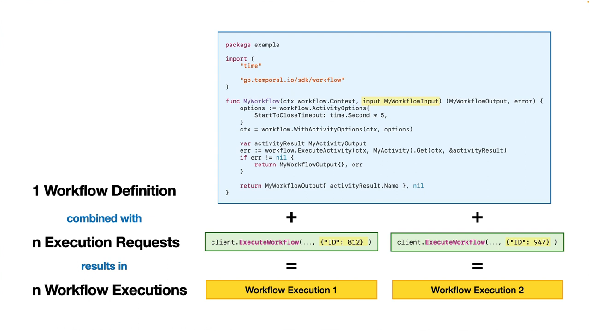

Each new run has a server-generated **Run ID**. Starting another execution of the same definition—even with identical input—creates a distinct run, provided the start request actually creates an execution rather than returning an existing one under the configured ID policies.

### Open and Closed Executions

A Workflow Execution is either:

- **Open:** Running, including periods when it is waiting and no Workflow code is actively executing.
- **Closed:** No longer running, with a final status indicating why it ended.

The transition is **one-way: open → closed**. A closed run does not reopen. Running the definition again creates a new run with a different Run ID.

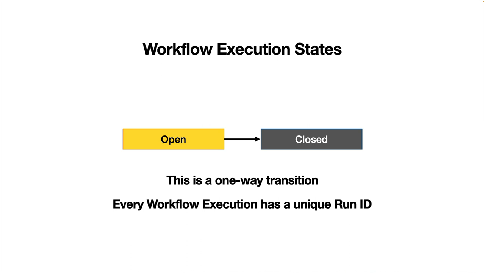

### Progress and Waiting

While open, a Workflow alternates between making progress and awaiting something needed to continue:

```text
Worker processes a Workflow Task
    → Workflow code makes progress and requests work
    → Workflow yields while awaiting an Activity, Timer, or other event
    → Cluster records events and schedules a Workflow Task
    → A Worker processes that task and continues execution
```

For example, code that needs an Activity's result waits on its Future. Code awaiting a Timer waits until it fires or is canceled, then handles the outcome. Independent Workflow work can continue while a particular code path waits.

**An open execution does not require continuously running Workflow code or a dedicated Worker thread.** Workers poll the cluster for tasks and execute code when there is work to process. The cluster preserves the execution state between tasks.

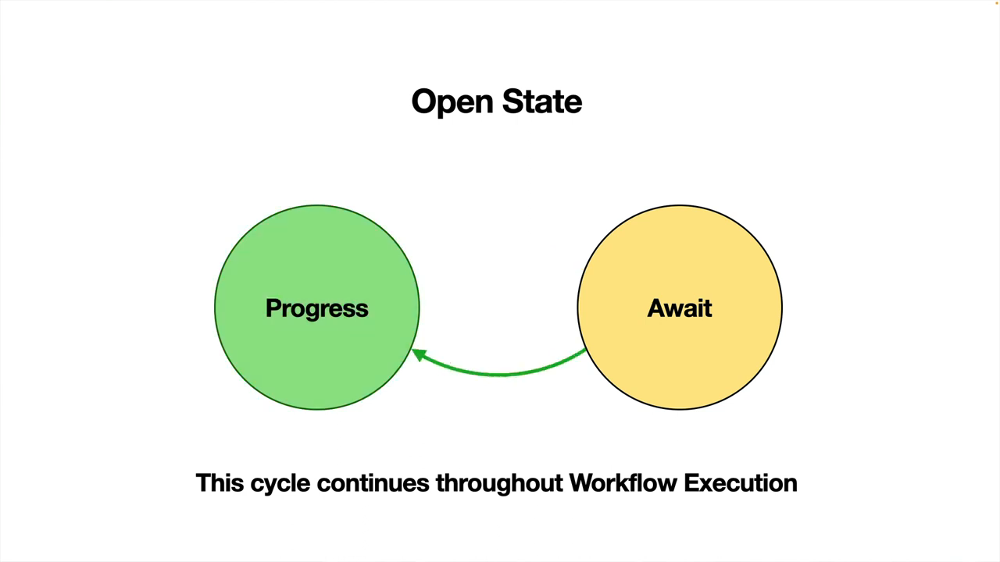

### How Workflow Execution Ends

There are six closed statuses:

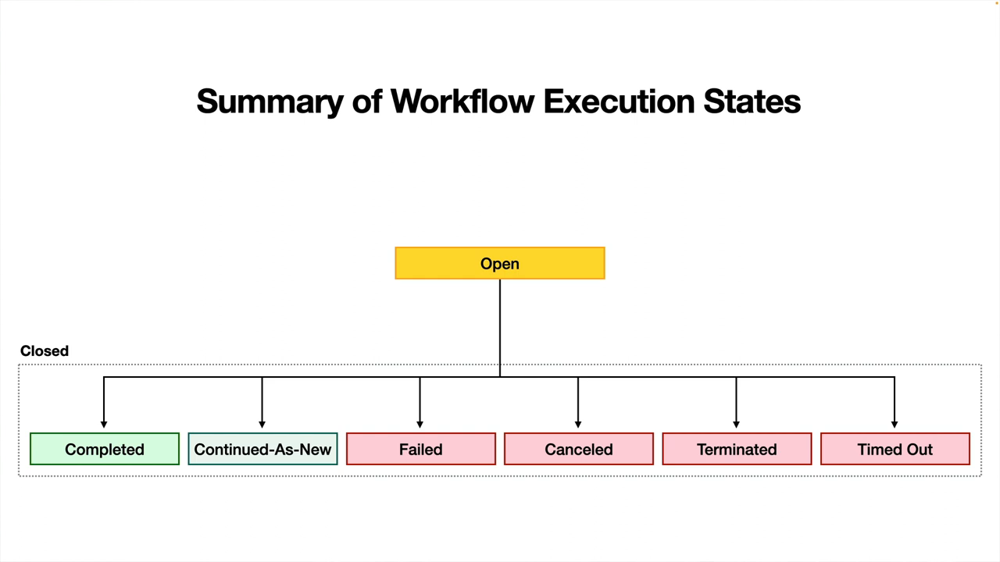

| Final status | Cause |
| :--- | :--- |
| **Completed** | The Workflow function finishes successfully. A result payload is optional. |
| **Continued-As-New** | The current run closes and a new run continues the logical Workflow with a fresh Event History. |
| **Failed** | The Workflow function returns an error representing failure. |
| **Timed Out** | An applicable Workflow execution or run time limit expires before the run finishes. A Workflow Task timeout alone does not close the execution. |
| **Terminated** | An external request immediately stops the execution, through an SDK client, CLI, or Web UI. Workflow cleanup code does not get an opportunity to run. |
| **Canceled** | The Workflow closes as canceled after responding to cancellation. A cancellation request alone does not immediately close it. |

**Cancellation is cooperative; termination is immediate.** Workflow code can handle cancellation and perform cleanup before exiting. Activities can also observe cancellation through the SDK's cancellation mechanisms; long-running Activities generally need heartbeats to receive server-side cancellation requests promptly. A Workflow may handle a cancellation request and complete successfully instead of closing as canceled.

### Continue-As-New

Temporal limits both the **number of Events** and the **size of Event History** for each run. Activity-heavy or long-running Workflows can approach these limits as history accumulates.

**Continue-As-New** closes the current run and starts another with:

- The **same Workflow ID**.
- A **new Run ID**.
- A **fresh Event History**.
- Input supplied by the Workflow to carry forward the business state needed for the next run.

The logical business process continues, but the old run remains closed as **Continued-As-New**. State does not automatically transfer from local variables; pass the necessary state in the new run's input. This keeps history bounded without ending the overall business process.

### Interpreting the Final Status

The final status helps narrow down why execution stopped. For a failed run, inspect the final **`WorkflowExecutionFailed`** Event for failure details, including the returned error. The Web UI presents these details alongside the execution's history.

Do not confuse **Workflow Task failure** with **Workflow Execution failure**. A Worker crash, replay problem, or task timeout can interrupt progress while the Workflow remains open. Likewise, an Activity attempt can fail and be retried without closing the Workflow.

## How Workflow Code Maps to Commands

Certain operations in Workflow code cause the Worker to produce **Commands**: requests telling the Temporal Cluster what to do next. Ordinary calculations and data manipulation do not produce Commands of their own.

### Example: Processing a Pizza Order

Consider a Workflow that processes a pizza order. It calculates the total price, checks whether the customer's address is within the delivery area, waits to allow time for fulfillment, and then bills the customer. Following these steps shows where ordinary code execution becomes a request to the Temporal Cluster.

### Internal Steps and Cluster Interactions

The Workflow begins by configuring a **five-second Start-to-Close Timeout** for its Activities. `workflow.WithActivityOptions` attaches these options to the Workflow context, but does not schedule anything. The options become part of later Activity scheduling requests.

Next, the Workflow iterates over the pizzas and sums their prices. This calculation happens entirely within the Worker. Assigning variables, evaluating conditions, and constructing structs likewise produce no Commands of their own.

**Not every statement—and not every SDK call—requires interaction with the cluster.** The distinction is whether the operation requests orchestration, such as scheduling an Activity or starting a Timer.

### Scheduling an Activity

To determine the distance to the customer, the Workflow calls **`workflow.ExecuteActivity`** for `GetDistance`. This produces a **`ScheduleActivityTask` Command** identifying the Activity Type, Task Queue, address input, and execution options.

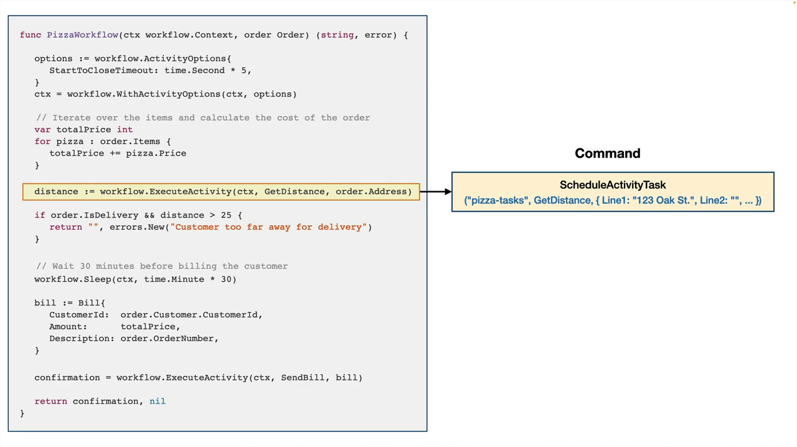

The yellow highlight marks the operation that produces the Command. The code shown is **pseudocode**: it simplifies Activity calls and omits error handling. In Go, `workflow.ExecuteActivity` returns a Future, and `Get` retrieves the result or an error. Business inputs and results should use structs even though this simplified example returns a string.

The cluster processes the scheduling request and makes an Activity Task available to a Worker. **The cluster orchestrates the Activity; the Activity Worker executes its code.** While awaiting the result through `Get`, the Workflow code path yields.

When the result becomes available, a Worker continues the Workflow and checks `order.IsDelivery && distance > 25`. Evaluating the condition is an internal step. If it is true, returning an error produces **`FailWorkflowExecution`**, and the execution ends without reaching the Timer or billing Activity. Otherwise, processing continues.

### Starting a Timer

For an accepted order, the Workflow calls **`workflow.Sleep(ctx, 30*time.Minute)`** to allow time for cooking and delivery. This produces a **`StartTimer` Command** specifying a 30-minute duration.

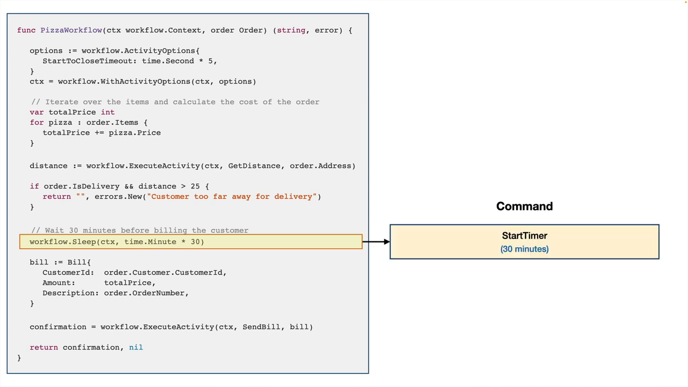

The cluster maintains the Timer durably while the awaiting code path pauses. The wait ends when the Timer fires or cancellation ends it; the Workflow must handle the outcome before proceeding. Elapsed time alone does not confirm successful cooking or delivery—the delay is a simplification of fulfillment in this example.

After successful expiration, the Workflow constructs a billing input struct containing the customer ID, total price, and order number. Populating this struct is another internal step. Calling `workflow.ExecuteActivity` for `SendBill` then produces a second **`ScheduleActivityTask` Command**, this time carrying the billing input. The Workflow awaits the billing confirmation.

### Completing or Failing the Workflow

Once billing succeeds, the Workflow returns the confirmation with a `nil` error. The Worker produces a **`CompleteWorkflowExecution` Command** carrying that result.

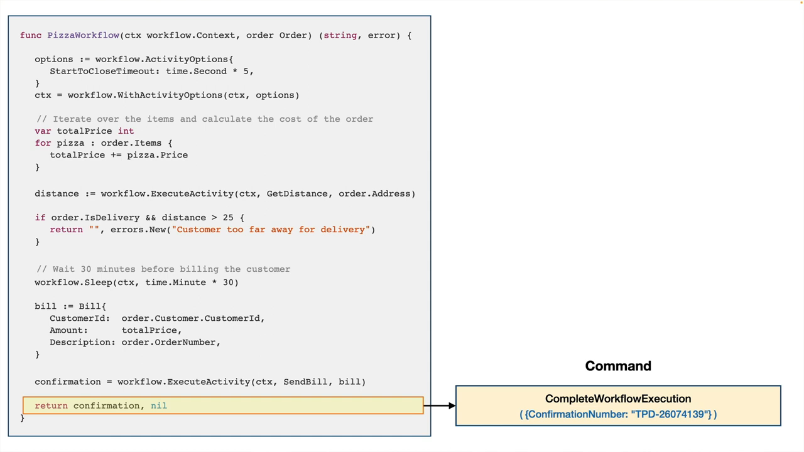

The cluster records successful completion, and the client can retrieve the confirmation. Returning an error representing failure instead produces **`FailWorkflowExecution`** with failure details. The return statement therefore determines how the Worker asks the cluster to close the run.

### Commands Are Requests to the Cluster

The relationship is:

```text
Workflow code executes in a Worker
    → SDK produces Commands for requested orchestration
    → Worker sends Commands when completing the Workflow Task
    → Temporal Cluster processes them and records History Events
    → Resulting tasks and events enable further execution
```

**Commands express requested actions; History Events record what happened.** An SDK call does not necessarily send a separate network request immediately: Commands are delivered through Workflow Task completion, and one task can produce multiple Commands.

This distinction underpins replay compatibility. Internal code can be re-executed to reconstruct state, but its decisions must remain consistent with the Commands expected by the recorded history.

## Overview of Event History

Every Workflow Execution has an **Event History**: the single source of truth for what transpired during that run. The Temporal Cluster maintains it, appending Events as it processes Client requests, Worker Commands, and execution outcomes such as Activity completion or Timer expiration.

History represents **the cluster's perspective of execution**, not a trace of every statement executed by a Worker. A local calculation does not create an Event of its own, and an external side effect is known to the cluster only through the information reported to it.

Event History is persisted in the cluster's database. It survives Worker crashes and can survive a cluster restart because it is stored outside the server processes; this durability depends on preserving the underlying persistence storage.

History serves two main purposes:

- **Recovery:** A Worker replays recorded Events to reconstruct Workflow state and continue execution. Recorded Activity results let it recover without repeating already-completed Activities.
- **Investigation:** Developers can inspect the steps, inputs, results, and failures of current or past executions. This provides a durable execution record beyond transient application logs, while the history remains available under retention or archival settings.

### Event History Content

Event History is an **ordered, append-only log**. Each Event has a sequential Event ID and follows the preceding Event. Once written, its contents and position in that run's history are immutable.

The first Event of a successfully started run is always **`WorkflowExecutionStarted`**. Further Events describe the run's progress: Workflow Tasks, Activity scheduling and outcomes, Timers, and other interactions. Their sequence depends on the Workflow's decisions and what happens during execution.

When the run closes, its closing Event is the final entry. The Event corresponds to the final status:

| Final status | Closing Event |
| :--- | :--- |
| Completed | `WorkflowExecutionCompleted` |
| Continued-As-New | `WorkflowExecutionContinuedAsNew` |
| Failed | `WorkflowExecutionFailed` |
| Timed Out | `WorkflowExecutionTimedOut` |
| Terminated | `WorkflowExecutionTerminated` |
| Canceled | `WorkflowExecutionCanceled` |

Continue-As-New starts a new run with its own history; it does not modify or extend the closed run's log.

### Accessing Event History

Although the cluster stores history in its database, applications and developers access it through Temporal's APIs:

- **SDK:** Retrieve Events programmatically, for example with the Go Client's `GetWorkflowHistory` method.
- **CLI:** Inspect an execution with `temporal workflow show`; add `--detailed` to see Event attributes.
- **Web UI:** Open an execution's history to inspect Events and their input, result, or failure details.

Use the **Run ID** to distinguish histories when several runs share a Workflow ID. The durable-execution exercise's CLI commands are listed under [Inspect the Results](#inspect-the-results).

### Protecting Confidential Data

The Temporal Cluster does not execute application code, but it **stores payloads sent by the application**, including Workflow and Activity inputs and results. Those payloads can contain confidential medical, financial, or other business data. Values used only inside application code are not automatically sent to the cluster, but serialized inputs and outputs are.

**TLS protects data in transit**, such as communication between a Client or Worker and the cluster's Frontend Service. Self-hosted deployments can also configure TLS between cluster services. Transport encryption does not, by itself, prevent stored payloads from being readable by the cluster.

To keep sensitive payloads confidential from the cluster, encrypt them **within the application before sending them**. In the Go SDK, a custom **Payload Codec** can perform encryption and decryption as part of the Data Converter:

```text
Application value
    → serialize and encrypt in the Client or Worker
    → cluster stores the encrypted payload
    → authorized Client or Worker receives it
    → decrypt and deserialize into an application value
```

Clients and Workers that exchange these payloads need compatible conversion settings and access to the required keys. The cluster can persist and return the encrypted data without decrypting it. Inspecting encrypted payloads in the Web UI likewise requires an appropriately configured decoding mechanism.

**Payload encryption does not hide all execution metadata.** Workflow IDs, Workflow and Activity Type names, Task Queue names, and other non-payload fields remain visible to Temporal, so avoid placing confidential values in them. For encryption configuration and key management, consult the [Temporal security documentation](https://docs.temporal.io/security).

## Event History Limits

Temporal limits both the **number of Events** and the **size of Event History** to bound storage use and keep execution and replay performant. These are separate limits: a run can accumulate too many small Events or too much data in relatively few Events.

### Event History Item Count

The standard thresholds for a single run are:

| Event count | Effect |
| :--- | :--- |
| **10,240 Events** | The cluster begins logging warnings as history continues to grow. |
| **51,200 Events** | The run reaches the history-count limit and may be terminated. |

An Activity call produces multiple Events, so **Event count is not Activity count**. Workflow Tasks, Timers, and other interactions also contribute to history growth.

Aim to keep each run's history to **a few thousand Events**, leaving room to act before reaching a hard limit. For a recurring or long-running process, use **Continue-As-New** to close the current run and carry the necessary business state into a new run with a fresh history. Repeat this as needed rather than allowing one history to grow indefinitely.

These thresholds describe the standard service limits; self-hosted settings can vary. The Go SDK also exposes `workflow.GetInfo(ctx).GetContinueAsNewSuggested()` to help a Workflow decide when to start a fresh run.

### Event History Size

Workflow and Activity inputs and results contribute to history size because Temporal stores their serialized payloads. Large payloads increase storage, transfer, and replay costs even when the Event count is low.

| Size limit | Applies to |
| :--- | :--- |
| **2 MB** | An individual payload. |
| **50 MB** | The overall Event History for a run. |

Exceeding the history-size limit can cause the run to be terminated. **An oversized payload is not necessarily handled by terminating the Workflow:** the service can reject the request or completion carrying it, causing a start request, Activity, or Workflow Task to fail depending on where it occurs. Keep payloads comfortably below the limit rather than relying on a particular failure outcome.

Continue-As-New bounds accumulated history, but it does not make an oversized input or result acceptable. The new run's input must also fit within payload limits.

### Keeping Large Data Outside Temporal

Use the **Claim Check pattern** when a Workflow or Activity needs to process large data. Store the data in an external system and pass a small reference through Temporal instead of the data itself.

For example, a document-processing Workflow can receive an object-storage key. An Activity loads the document, processes it, writes the output to storage, and returns the output key:

```text
Workflow input: source object key
    → Activity retrieves and processes the source document
    → Activity stores the processed document externally
    → Activity result: output object key
    → Workflow passes the key to the next Activity or returns it
```

The reference can be a database primary key, object-storage key, or file path accessible to the relevant Activity Workers. **External reads and writes belong in Activities**, not Workflow code.

Keep the referenced data available for as long as executions and retries may need it. Prefer stable, versioned references so the same logical operation does not unexpectedly read changed content. External writes must also be retry-safe: a retried Activity should not create unintended duplicate outputs.

This keeps history focused on orchestration and small business values while the external system handles bulk storage.

## Event Structure and Attributes

An Event records a particular occurrence in a Workflow Execution, such as starting the run, scheduling an Activity, or firing a Timer. Temporal defines many Event Types, each with attributes describing that occurrence.

### Common Event Fields

Every Event includes three core fields:

| Field | Meaning |
| :--- | :--- |
| **Event ID** | Identifies the Event within that run's history and indicates its sequential position. IDs are local to a history, not globally unique across executions. |
| **Event time** | The timestamp recorded by the cluster for the occurrence. |
| **Event Type** | Identifies what happened, such as `WorkflowExecutionStarted` or `ActivityTaskScheduled`. |

Use Event IDs to follow history order and timestamps to understand elapsed time between recorded occurrences. The Event Type determines which additional attributes to inspect.

### Attributes Vary by Event Type

Workflow lifecycle Events record the information needed to start the run or describe its outcome:

| Event Type | Key attributes |
| :--- | :--- |
| `WorkflowExecutionStarted` | Workflow Type, input payloads, Task Queue, and applicable Workflow timeouts and Retry Policy. |
| `WorkflowExecutionCompleted` | Result payloads, if the Workflow returned a result. |
| `WorkflowExecutionFailed` | Failure details describing why the Workflow failed, including information about the returned error. |

Activity Events follow a similar pattern. **Scheduling records what was requested; completion records what was returned.**

| Event Type | Key attributes |
| :--- | :--- |
| `ActivityTaskScheduled` | Activity ID and Type, input payloads, Task Queue, Activity timeouts, and Retry Policy. |
| `ActivityTaskCompleted` | Result payloads and references to the associated scheduled and started Events. |
| `ActivityTaskFailed` | Failure details and references identifying the associated Activity execution. |

Those references let you connect a result or failure to its original scheduling request even when several Activities are in progress at once. Activity retries do not necessarily produce a separate set of history Events for every attempt; the cluster can track intermediate retry state without appending each attempt to Workflow history.

Timer Events contain different attributes again. **`TimerStarted`** records the Timer ID and requested duration, while **`TimerFired`** identifies the Timer and references its starting Event.

When investigating execution, inspect the attributes that answer the relevant question: input and Activity Type for what was requested, timeouts and Retry Policy for how it was configured, result payloads for what it returned, and failure details for why it failed. The Web UI exposes these details, and the CLI's `--detailed` view displays Event attributes.

## How Commands Map to Events

**Commands request work; Events record what happened.** A single Command can lead to several Events over time: one when the cluster accepts the request, and others as the requested work starts and finishes.

The pizza-order Workflow illustrates this through two Activities separated by a Timer. It first obtains the delivery distance, waits 30 minutes for an eligible order, and then sends the bill.

### From Scheduling to Activity Completion

Calling `workflow.ExecuteActivity` for `GetDistance` causes the Workflow Worker to produce a **`ScheduleActivityTask` Command**. When the cluster processes that Command, it records **`ActivityTaskScheduled`** and makes an Activity Task available through the specified Task Queue.

An Activity Worker with available capacity polls that queue and receives the Task. It can be the same Worker process that runs the Workflow or another process polling the queue and registered to execute that Activity Type. The cluster records **`ActivityTaskStarted`** as the attempt begins.

The Worker executes `GetDistance` and reports its successful result to the cluster. The cluster then records **`ActivityTaskCompleted`**, including the result, and schedules a Workflow Task so the Workflow can continue with that value.

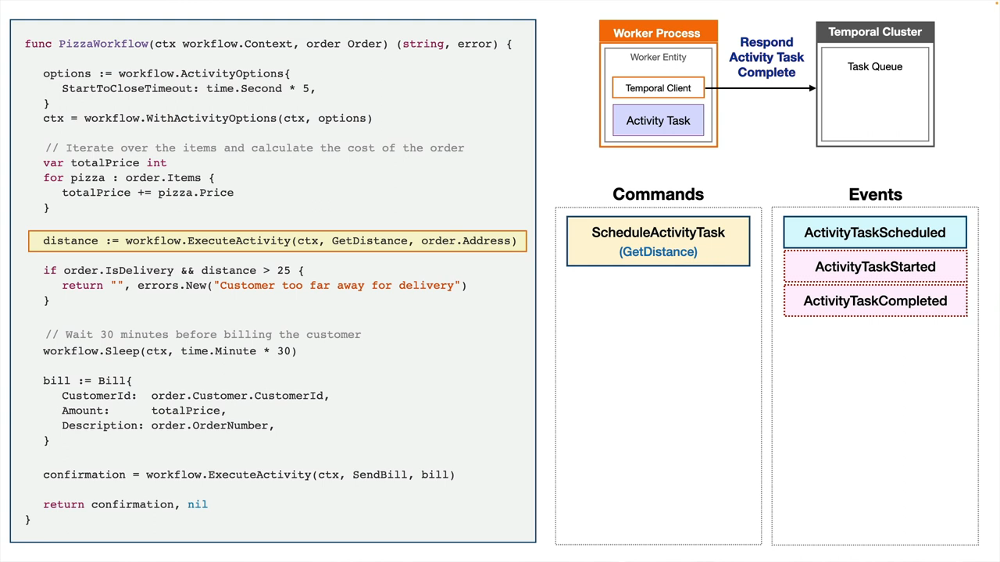

In the diagram, the solid blue Event is the direct response to the scheduling Command. The dotted pink Events record later developments: the Worker starting and completing the Activity. **The Activity completion report is an SDK-to-cluster response, not a Workflow Command.**

The five-second attempt timeout can lead to a retry; it does not stop the original code. Overlapping attempts are possible, so **Task dispatch does not imply exactly-once execution**.

### From Starting a Timer to Firing It

Once the distance check succeeds, `workflow.Sleep(ctx, 30*time.Minute)` produces a **`StartTimer` Command**. The cluster records **`TimerStarted`** and manages the durable Timer while the Workflow waits.

When the duration elapses, the cluster records **`TimerFired`**. No second Command is needed to make the Timer fire: this Event follows from the Timer the cluster already accepted. The cluster schedules a Workflow Task, and an available Workflow Worker resumes execution past the sleep.

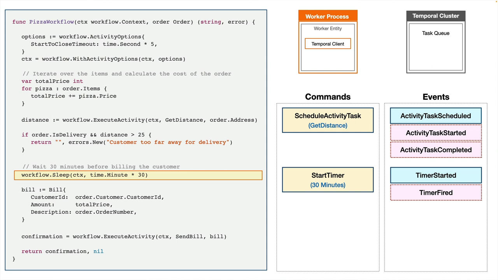

### Continuing with the Next Activity

Constructing the bill is an internal step and produces no Command. Calling `workflow.ExecuteActivity` for `SendBill` then produces another **`ScheduleActivityTask` Command**, beginning the same sequence:

```text
ScheduleActivityTask (SendBill)
    → ActivityTaskScheduled
    → ActivityTaskStarted
    → ActivityTaskCompleted
```

The Workflow receives the billing confirmation and returns it.

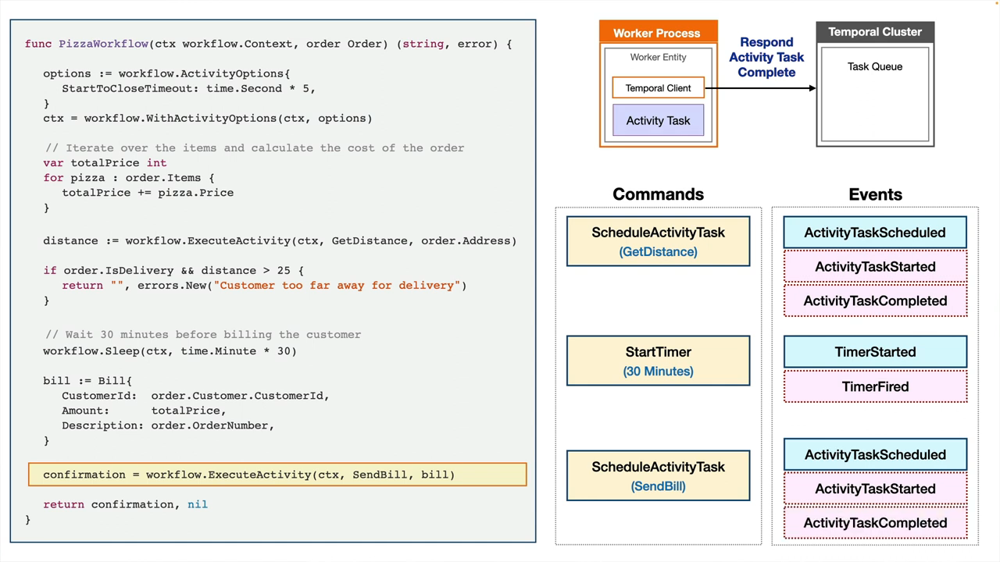

This sequence shows the successful Activity and Timer paths. A complete Event History also includes Workflow lifecycle and Workflow Task Events, which are omitted from these diagrams. Failed, timed-out, or canceled operations can produce different Events.

### Durable History and Worker Caches

Workers cache Workflow state to reduce fetching and replay. **The cache is an optimization; persisted Event History is the source of truth.** Losing the cache requires reconstruction from history, not restarting the business process.

## Workflow and Activity Task States

Event names reveal the progress of the Task they describe. Removing the `ActivityTask` or `WorkflowTask` prefix leaves a state or outcome such as `Scheduled`, `Started`, or `Completed`. This makes history easier to interpret and provides a way to understand timeout names.

### Reading the State from an Event Name

On the successful path, a Task passes through three stages:

| Suffix | Meaning |
| :--- | :--- |
| **Scheduled** | The cluster has scheduled work to be dispatched through a Task Queue. |
| **Started** | The cluster has dispatched the Task to a polling Worker, beginning the attempt. |
| **Completed** | The Worker has reported success and the cluster has accepted the completion. |

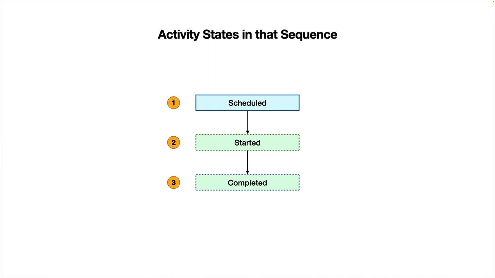

### Activity Task Outcomes

An Activity can finish unsuccessfully as well as successfully. Its outcome determines the Event recorded in history:

| Event | Meaning |
| :--- | :--- |
| `ActivityTaskCompleted` | The Worker reported a successful result. |
| `ActivityTaskFailed` | The Activity ended in failure after any applicable retries. |
| `ActivityTaskCanceled` | The Activity was canceled, rather than merely having cancellation requested. |
| `ActivityTaskTimedOut` | A timeout ended the Activity after any applicable retries. Inspect its timeout type to see which limit was exceeded. |

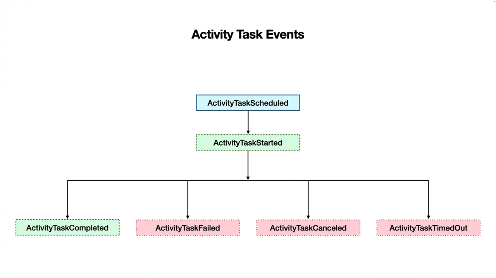

The Worker reports success or failure based on the Activity's execution. In Go, returning a normal error reports failure for that attempt; returning a result with a nil error reports success. **An attempt failing does not necessarily mean the Activity has reached its final outcome:** the cluster can retry it. Intermediate retry attempts are not necessarily appended as separate started and failed Events in Workflow history.

The **cluster determines timeouts** because it can detect a missing response even if the Worker has crashed. A Worker that no longer runs cannot report its own failure to finish on time.

Cancellation is also distinct from failure. A cancellation request is not itself a closed outcome. A running Activity normally learns of cancellation through heartbeats and cooperates by stopping and reporting cancellation; requesting cancellation does not forcibly kill its code.

### Timeouts Describe State Boundaries

Activity timeout names identify the boundaries they measure:

| Timeout | Interval it bounds |
| :--- | :--- |
| **Schedule-to-Start** | Waiting for a Worker to pick up the Activity Task. |
| **Start-to-Close** | Executing one Activity attempt after it starts. |
| **Schedule-to-Close** | The total time from scheduling the Activity to its final outcome, including queueing, retries, and retry delays. |
| **Heartbeat** | The allowed interval without a heartbeat from a running Activity. |

These diagrams show the usual started-to-outcome path, but **not every timeout requires a Task to have started**. For example, Schedule-to-Start can expire while the Activity waits for a Worker. Inspect the timeout type in Event attributes rather than assuming every `ActivityTaskTimedOut` means execution took too long.

### Workflow Task Outcomes

Workflow Tasks follow the same naming pattern, but perform different work. A Workflow Task lets a Worker process history, run or replay Workflow code, and report the resulting Commands; it is not the entire Workflow Execution.

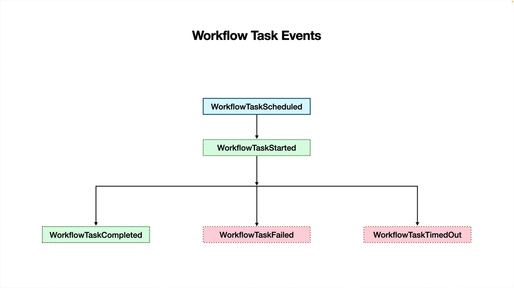

| Event | Meaning |
| :--- | :--- |
| `WorkflowTaskScheduled` | The cluster scheduled work to advance the Workflow. |
| `WorkflowTaskStarted` | A Worker received the Workflow Task. |
| `WorkflowTaskCompleted` | The Worker successfully processed the Task and the cluster accepted its response, including any Commands. |
| `WorkflowTaskFailed` | Processing the Task failed, for example because of a Workflow panic or a nondeterminism error. |
| `WorkflowTaskTimedOut` | The Task exceeded its applicable timeout without an accepted completion. |

**Workflow Task completion is not Workflow Execution completion.** A Task can complete by issuing a Command to schedule an Activity or start a Timer while the Workflow remains open. Likewise, a failed or timed-out Workflow Task generally leads to another attempt to process the Workflow, rather than immediately failing the entire execution.

Returning an application error from Workflow code is a different case: the Worker can successfully complete the Workflow Task with a `FailWorkflowExecution` Command. History can therefore contain `WorkflowTaskCompleted` followed by `WorkflowExecutionFailed`. Always read the full prefix as well as the outcome suffix.

## Sticky Execution

Workers cache the execution state of Workflow functions they run. **Sticky Execution** makes that cache more useful by preferentially routing subsequent Workflow Tasks for the same execution to the Worker that already holds its state.

With a cache hit, the Worker can process new history Events and resume the cached Workflow instead of replaying the full history for every Task. Stickiness is a **performance optimization**, not a requirement for correctness or a guarantee that one Worker will handle the entire execution.

### How Sticky Execution Works

The first Workflow Task is dispatched through the named Task Queue configured for the Workflow. Any eligible Workflow Worker polling that queue can receive it.

After processing the Task, the Worker advertises its automatically named, Worker-specific **Sticky Queue** to the Temporal Service. The Worker polls this queue as well as the original Task Queue. Subsequent Workflow Tasks for the execution are routed to the Sticky Queue so the Worker can reuse its cached state.

```text
First Workflow Task
    → Original Task Queue
    → Worker A processes the Task and caches Workflow state

Subsequent Workflow Tasks
    → Worker A's Sticky Queue
    → Worker A resumes the cached Workflow
```

**Sticky Execution applies only to Workflow Tasks.** Activity Tasks continue to be dispatched through their configured Task Queues; they do not need to return to the Worker holding the Workflow's cached state.

### Falling Back to the Original Task Queue

If the Worker does not start a Task from its Sticky Queue within the **sticky Schedule-to-Start Timeout**, the service clears stickiness for that execution and reschedules the Workflow Task through the original Task Queue. The Go SDK's default sticky Schedule-to-Start Timeout is **five seconds**.

Another eligible Worker can then receive the Task, obtain history, and replay the Workflow to reconstruct its state. Once it processes the Task successfully, subsequent Tasks can become sticky to that Worker.

```text
Workflow Task waits in Worker A's Sticky Queue
    → Sticky Schedule-to-Start Timeout expires
    → Task is rescheduled through the original Task Queue
    → Worker B receives history and reconstructs Workflow state
    → Execution continues
```

This fallback handles cases such as a Worker crash or a Worker unable to pick up work promptly. Losing cached state also requires history replay; it does not lose durable Workflow progress. **The cluster's Event History remains the source of truth**, regardless of which Worker processes the next Task.

## History Replay: How Temporal Provides Durable Execution

When a Worker crashes, its variables disappear. So how can another Worker continue the same Workflow?

**It runs the Workflow code again, using history to recover what already happened.** This is called **History Replay**.

Temporal does not save every variable. It saves the Workflow's input and the outcomes of operations such as Activities and Timers. During replay, ordinary calculations run again, while completed operations use their recorded outcomes.

> **Replay rebuilds state. It does not repeat completed Activities or restart completed Timers.**

### Progress Before the Crash

Follow the pizza-order Workflow through these steps:

1. Receive the order and calculate its total price.
2. Run `GetDistance`, which returns **15 kilometers**.
3. Check the distance: 15 is within the 25-kilometer delivery limit.
4. Wait for a **30-minute Timer** to fire.
5. Send the bill and return a confirmation.

Suppose the Worker crashes **after the Timer fires but before it schedules `SendBill`**.

The Worker's memory is gone, but the cluster still has the order input, the Activity result of 15, and the Events showing that the Timer started and fired. Those records are enough to recover.

### Detecting an Unfinished Workflow Task

The crashed Worker had accepted a Workflow Task. When it does not finish within the **Workflow Task Timeout—10 seconds by default—the cluster schedules another attempt**.

The cluster detects the missing completion, not the crash itself. A stalled Worker can time out too.

Another Worker picks up the Task and receives the Workflow's history. Sticky routing does not prevent recovery: work waiting for an unavailable Worker can fall back to the original Task Queue.

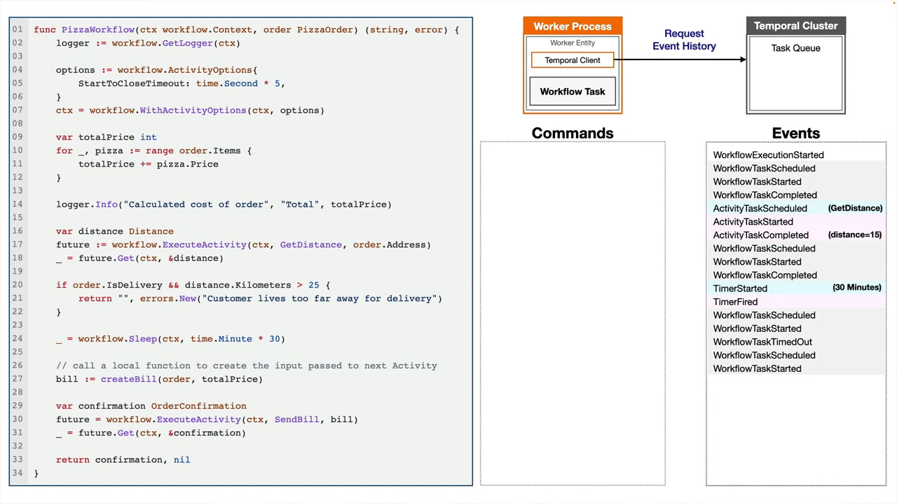

The Go code in the diagrams omits error handling to focus on replay. Real code must handle errors from `Future.Get` and `workflow.Sleep`.

### Reconstructing Workflow State

The new Worker starts the Workflow function **from the beginning**, using the same order input.

It adds up the pizza prices again. Same items, same calculation, same total. That is how the `totalPrice` variable is restored—without storing a separate copy of that variable.

The cost-calculation log statement also runs again, but `workflow.GetLogger(ctx)` suppresses its output during replay by default. This avoids duplicate log messages.

### Reusing Recorded Activity Results

Next, the code reaches `GetDistance`. The SDK checks history and finds that this Activity **already completed with a result of 15 kilometers**.

It does not schedule the Activity again. Instead, `future.Get(ctx, &distance)` receives the stored result, restoring `distance` to 15.

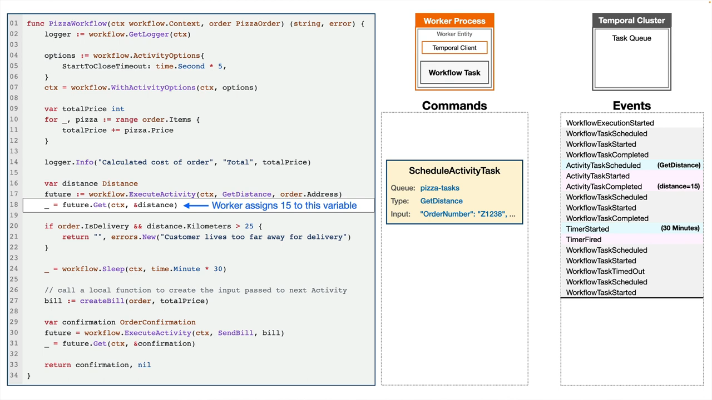

The distance check passes again. Replay uses the original result even if the external service would return a different value today. This is why Activity code does not have to be deterministic.

**Recorded completion matters:** if an Activity changes an external system but crashes before reporting success, it may be retried. Activities still need to be safe to retry.

### Replaying a Completed Timer

Next comes `workflow.Sleep(ctx, 30*time.Minute)`. History shows that the Timer already started **and fired**.

**There is no second 30-minute wait.** The SDK treats the sleep as finished and moves on.

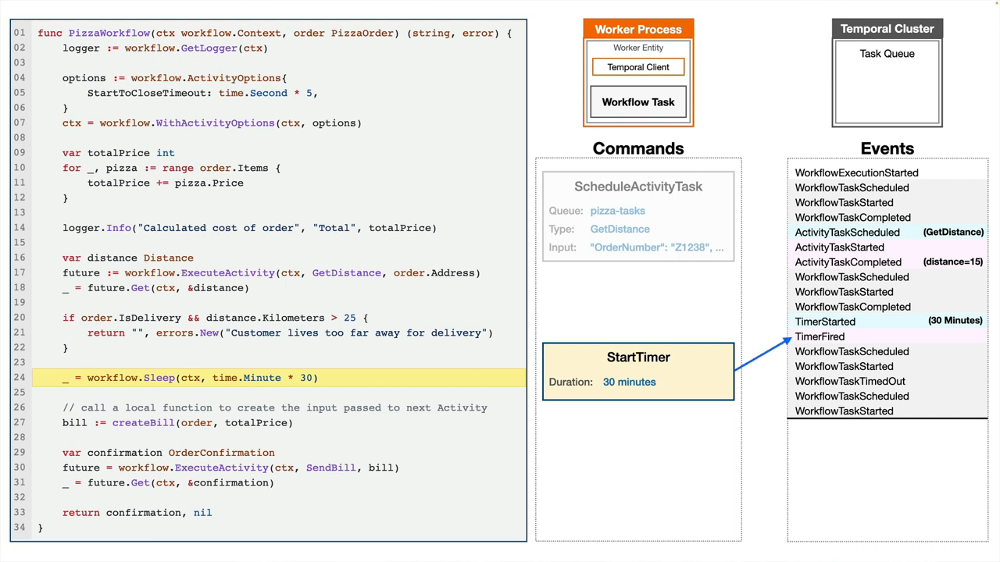

If the Timer had not fired yet, the Workflow would wait for the existing Timer—not start its duration over.

### Continuing Beyond Recorded Progress

The total price and distance are restored, and the wait is complete. Now the code reaches `SendBill`.

History has no record of this Activity being scheduled. **Replay has caught up; this is new work.** The Worker sends the scheduling Command, and an Activity Worker executes `SendBill`.

The Workflow receives the confirmation and returns it. The Worker sends `CompleteWorkflowExecution`, and the cluster records `WorkflowExecutionCompleted` with that result.

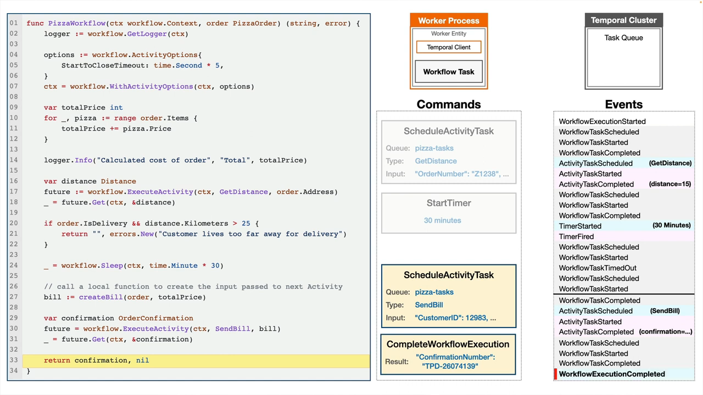

The customer gets the same outcome as without the crash. History also records the Task timeout and recovery.

| Operation | During replay |
| :--- | :--- |
| Calculate the total | Run the calculation again. |
| Get the distance | Reuse the recorded result: 15. |
| Wait 30 minutes | Reuse the recorded Timer firing. |
| Send the bill | Execute now—it was not previously scheduled. |

### What Replay Requires

For this to work, **Workflow code must be deterministic**: the same recorded input and results must lead to decisions compatible with history. An incompatible code change can cause a nondeterminism error.

- **Put external I/O in Activities.** Direct network calls or file writes in Workflow code could happen again during replay.
- **Use Temporal's Workflow APIs** for time, timers, and concurrency.
- **Keep Activity effects retry-safe.** Reusing recorded results does not guarantee exactly-once external effects.

## Why Temporal Requires Determinism for Workflows

Replay can recover a Workflow only if its code follows the path already recorded in history. If replay takes a different path, the Worker cannot safely connect the old results to the new execution.

**Determinism is what makes that recovery reliable.**

### Determinism Is About Commands

“The same input produces the same output” is a useful starting point, but it is not enough for Temporal. Two executions could return the same result while scheduling different Activities along the way.

> **Given the same Workflow input and recorded outcomes, replay must produce a compatible sequence of Commands in the same order.**

The recorded outcomes matter too. An Activity may return different results in separate executions; during replay of one execution, the Worker uses that execution's stored result.

For example, a reporting Workflow might request:

```text
1. ScheduleActivityTask → ImportSalesData
2. StartTimer           → wait four hours
3. ScheduleActivityTask → RunDailyReport
```

Replay must preserve this order. Requesting the report where history expects the Timer is a mismatch, even if the Workflow would eventually return the same value.

### History Tells Replay What to Expect

Events produced directly by Commands tell the SDK what operations were previously requested:

| Recorded Event | Expected operation during replay |
| :--- | :--- |
| `ActivityTaskScheduled` for `ImportSalesData` | Schedule that Activity. |
| `TimerStarted` for a four-hour Timer | Start that Timer. |
| `ActivityTaskScheduled` for `RunDailyReport` | Schedule that Activity. |

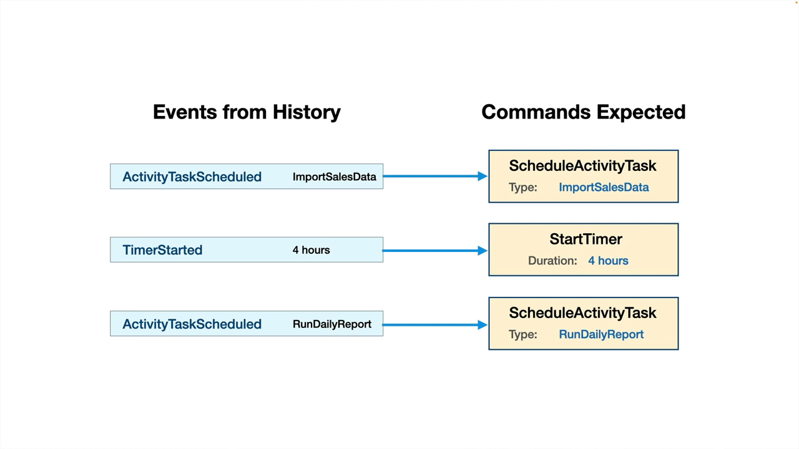

As the code runs again, the SDK matches its decisions against history. A match lets replay continue and reuse recorded results. A mismatch causes a **nondeterminism error**: the code no longer agrees with the execution it is trying to restore.

This matters whenever replay happens—not just after a crash. A Worker can also replay because its cache evicted the Workflow's state.

### Example: A Random Branch Breaks Replay

Suppose the reporting Workflow uses an ordinary random number to decide whether to wait four hours.

**On the first execution:**

1. `ImportSalesData` completes successfully.
2. The random number is **84**, so the condition `number >= 50` is true.
3. The Workflow starts the four-hour Timer, and the Timer fires.
4. The Worker crashes before scheduling `RunDailyReport`.

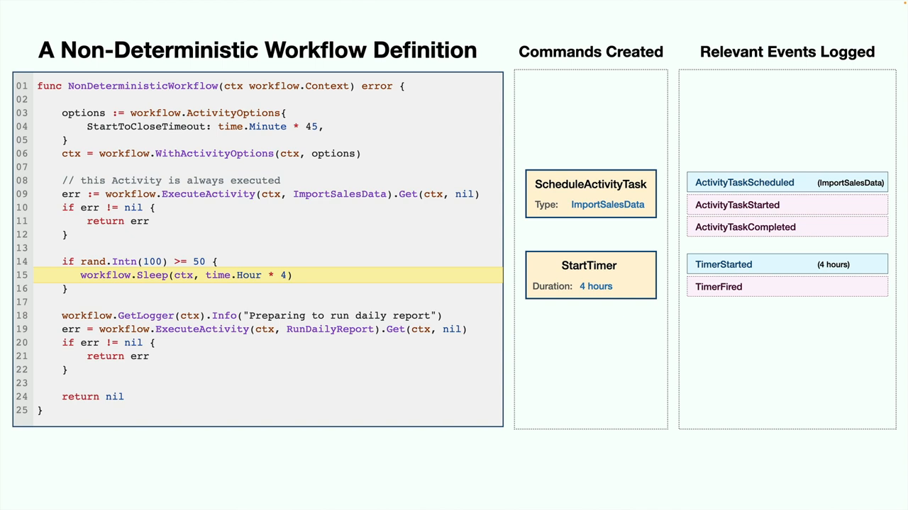

**During replay:**

1. The scheduling decision for `ImportSalesData` matches history. Its recorded result is reused.
2. The random number is now **14**, so the condition is false.
3. The code skips the Timer and tries to schedule `RunDailyReport`.

But history says the next operation must be **`StartTimer`**, not **`ScheduleActivityTask`**.

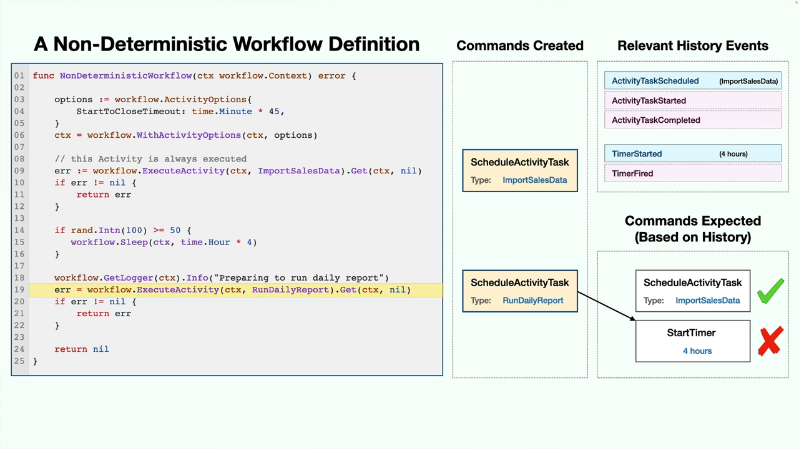

| Position | History expects | Replay produces |
| :--- | :--- | :--- |
| 1 | Schedule `ImportSalesData` | Schedule `ImportSalesData` — match. |
| 2 | Start the four-hour Timer | Schedule `RunDailyReport` — mismatch. |

The problem is not that 14 is an invalid number. **The random value changed a decision that controls the Command sequence.** The SDK cannot safely continue replay along this different path.

### Avoiding Nondeterminism

- **Keep ordinary randomness and external I/O out of Workflow code.** Use an Activity when the Workflow needs a result from the outside world; its recorded result can then be reused during replay.
- **Use Temporal APIs for Workflow time and waiting**, such as `workflow.Now` and `workflow.Sleep`.
- **Keep code changes compatible with existing histories.** Even code with no randomness can break replay if an update adds, removes, or reorders Commands on an already recorded path.

A nondeterminism error comes from the SDK's replay checks. It is **not an ordinary error returned by an Activity or `Future.Get` that Workflow code can catch and recover from**. Fix the incompatible behavior or use a supported versioning strategy so existing executions can replay correctly.

## Common Sources of Non-Determinism

Workflow code runs again during replay. Anything that changes its decisions between the original execution and replay can make it disagree with history.

**Use Activities for external work and Temporal's Workflow APIs for time and concurrency.** These keep the information needed for replay under Temporal's control.

### Random Numbers

An ordinary random-number generator can return a different value during replay. If that value chooses which Activity to run or whether to start a Timer, the Command sequence can change.

Generate the number **inside an Activity** and return it to the Workflow. Once the Activity completes, replay uses the stored result instead of generating another number.

### External Systems and Mutable State

A database row, file, network response, or global variable may change while the Workflow is running. Reading it directly during replay could therefore produce a different decision. Writing to an external system directly could repeat an effect.

Put these interactions in **Activities**:

- Database queries and updates.
- Filesystem reads and writes.
- HTTP requests and other network calls.
- Reading input streams or writing output streams.
- Access to mutable state outside the Workflow.

The Workflow receives recorded Activity results and uses them to decide what happens next. Activities still need to handle retries safely.

### System Time

`time.Now()` reads the machine's current clock. Replay happens later, so it would see a different time. `time.Sleep()` blocks a real goroutine rather than creating a durable Workflow Timer.

| Avoid in Workflow code | Use instead |
| :--- | :--- |
| `time.Now()` | `workflow.Now(ctx)` |
| `time.Sleep(duration)` | `workflow.Sleep(ctx, duration)` |

**`workflow.Now` returns Temporal's logical Workflow time.** During replay, that time follows the recorded execution rather than the current wall clock. `workflow.Sleep` creates a durable Timer whose progress is recorded in history.

### Goroutines, Channels, and Select

Ordinary Go goroutines are scheduled by the runtime. Their execution order can change with machine load, which can change the order of Workflow decisions.

Use the SDK's deterministic concurrency tools:

| Avoid in Workflow code | Use instead |
| :--- | :--- |
| `go` statements | `workflow.Go` |
| Native Go channels | `workflow.Channel`, created with `workflow.NewChannel` or `workflow.NewBufferedChannel` |
| Native `select` statements | `workflow.Selector`, created with `workflow.NewSelector` |

These let a Workflow coordinate concurrent work without depending on ordinary goroutine scheduling.

### Unordered Iteration

Go does not guarantee map iteration order. Scheduling one Activity per map entry can therefore create a different Command order during replay.

**Sort the keys first, then iterate in that order.** For string keys, the pattern is:

```go
keys := slices.Sorted(maps.Keys(items))
for _, key := range keys {
    // Use items[key] in a stable order.
}
```

The example uses the standard-library `maps` and `slices` packages available in Go 1.23. The important point is the order: if iteration affects Commands, it must be repeatable. A map calculation whose result is genuinely independent of iteration order does not inherently change the Command sequence.

### Run IDs in Workflow Logic

A **Workflow ID** identifies the logical Workflow. A **Run ID** identifies one particular run. Continue-As-New and Workflow retries create new runs with new Run IDs; Reset can also create a new run from earlier history.

**Do not use the Run ID as a business decision, random seed, or stable identifier for external effects.** In particular, Reset can replay earlier history under a different Run ID, so branching on it can disagree with the original execution.

The ID of an individual run does not simply change in place. The problem is that a Run ID is not stable across all the runs and recovery operations associated with the logical Workflow. Use a business identifier supplied in the Workflow input, or the Workflow ID when its scope fits the operation. Run IDs remain useful for logs and diagnosing a specific run.

## Identifying Non-Deterministic Code through Static Analysis

You do not have to wait for replay to discover every determinism mistake. **`workflowcheck`** can catch many of them by inspecting Go code without executing the Workflow.

### What workflowcheck Does

The tool locates Workflow Definitions registered with Workers and analyzes their code, including functions they call, for potentially nondeterministic behavior.

When it finds a problem, it reports a hierarchy showing how the Workflow reaches the offending operation. Follow that chain to the root cause rather than looking only at the Workflow's top-level function.

### Installing and Running workflowcheck

The upstream Go installation command is:

```bash
go install go.temporal.io/sdk/contrib/tools/workflowcheck@latest
```

On a Nix-managed machine, provide the tool through the project's Nix development shell instead of a global Go installation. Pinning the tool version makes checks repeatable across machines.

Once `workflowcheck` is available on `PATH`, run it from the module root:

```bash
workflowcheck ./...
```

`./...` checks packages recursively. You can also pass a specific package path to narrow the check.

- **No findings:** the command exits without output.
- **Findings:** the report identifies the offending code and the call chain leading to it.

### Understanding Its Limits

**A clean report is useful evidence, not proof of determinism.** Static analysis cannot detect every violation. Examples include some mutations of global variables and operations performed through reflection.

Older tool versions may also report false positives for safe formatting functions such as `fmt.Sprintf` and `fmt.Append`. Check the tool version and the reported call chain before treating every finding as a real violation.

Static analysis also does not prove that a code change can replay an existing history. Code can be deterministic on its own while requesting a different Command sequence from the version that produced that history. Replay testing addresses that separate compatibility question.

### Handling False Positives

First verify why the operation is safe during replay. If the report is genuinely a false positive, the tool supports a line-level ignore directive:

```go
value := knownSafeFunction() //workflowcheck:ignore
```

The directive must have **no space between `//` and `workflowcheck:ignore`**. It suppresses checking for that line; it does not make an unsafe operation deterministic.

The tool also supports configuration for ignoring particular functions or skipping files. Keep exclusions narrow so real problems remain visible. See the [workflowcheck documentation](https://pkg.go.dev/go.temporal.io/sdk/contrib/tools/workflowcheck) for configuration and other options.

## How Workflow Changes Can Lead to Non-Deterministic Errors

A Workflow can contain no random numbers, no direct network calls, and no system-clock reads—and still fail replay after a deployment.

**The new code must agree with the history created by the old code.** Being deterministic on its own is not enough.

### Deterministic Does Not Always Mean Replay-Compatible

Suppose the original Workflow schedules Activity A and then starts a Timer. You update it to schedule Activity B before that Timer instead.

Both versions are deterministic. But an execution whose history already records Activity A cannot necessarily replay using code that now requests Activity B.

```text
Old code:  Activity A → Timer
New code:  Activity B → Timer
           ↑
           Existing history expects A here, not B.
```

When reviewing a change, ask:

> **Could the updated code request different Commands, or request them in a different order, while replaying an existing history?**

If yes, the change may break replay. `workflowcheck` cannot answer this compatibility question: it inspects code for unsafe behavior, rather than comparing its execution with histories produced by an earlier version.

### What Happens After Deployment

A Worker process runs the code loaded into that process. Deploying updated code requires starting Workers with the new version. **Workers cache Workflow execution state—not a separately refreshable copy of the source code.**

When a new Worker picks up a Task for an existing execution, it has to reconstruct that execution using history and the code it now runs. If the two disagree, replay fails.

Restarting Workers does not immediately replay every open Workflow. Replay happens when a Worker processes a Workflow Task without usable cached state. An execution waiting on a long Timer might not encounter the problem until that Timer fires or another event triggers a Task.

This is why an incompatible change **may** cause an error rather than always causing one:

- A fresh execution has no old history to conflict with.
- An existing execution may already have recorded operations that the new code changes.
- A change affecting only work beyond recorded progress may not conflict with that particular history.

Long-running Workflows make compatibility especially important: old executions can still be active when new versions are deployed.

### Changes That Can Break Replay

| Change | Why it can conflict with history |
| :--- | :--- |
| Add or remove an Activity | Inserts or removes an expected scheduling Command. |
| Change the Activity Type | Requests a different Activity at an already recorded position. |
| Add or remove a Timer | Inserts or removes an expected Timer Command. |
| Reorder Activities or Timers | Changes the sequence of expected Commands. |
| Change a condition controlling these operations | Can select a different path during replay. |

The problem appears when the change affects the part of execution already recorded in history. Use replay testing and a supported Workflow versioning strategy before deploying incompatible changes to active executions.

### Changes That Usually Preserve Replay Compatibility

Some changes leave the recorded Command sequence intact:

| Change | Compatibility consideration |
| :--- | :--- |
| Edit logging statements | Safe for replay if they do not change Workflow decisions. |
| Refactor local calculations | Safe only if the resulting decisions remain compatible with history. |
| Change Activity timeout or Retry Policy settings | Generally replay-compatible; does not retroactively reconfigure an already scheduled Activity. |
| Modify an Activity implementation | Does not change the Workflow's scheduling sequence. Recorded completions still supply their old results during replay. |
| Change a nonzero Timer duration to another nonzero duration | Replay-compatible in Go; an already started Timer retains its recorded schedule. |

**In the Go SDK, changing a Timer duration to or from zero can break compatibility.** A zero-duration sleep does not create the same Timer Command as a positive-duration sleep. Other SDKs can have different rules; TypeScript does not have this same zero-duration restriction.

Replay compatibility is also separate from business correctness. A new Activity implementation can affect pending work or retries, even though completed Activity results are reused during Workflow replay.

**The practical rule: preserve already recorded decisions, and version changes that need a different path.**

## Deployment Leads to Non-Deterministic Error

The pizza shop stops offering delivery. Removing the delivery-distance check sounds straightforward, but existing orders may already have that check recorded in their Workflow histories.

**A valid business change can still be an incompatible Workflow change.**

### The Change: Remove the Delivery Check

The developer removes the `GetDistance` Activity call and the condition that rejects customers outside the delivery area. They also clean up the unused variables and import, then deploy the updated code and restart the Worker.

The Workflow's path has changed:

```text
Before: GetDistance → delivery check → Timer → SendBill
After:                                Timer → SendBill
```

New orders can follow the new path. But an open order that already scheduled `GetDistance` still has that operation in its history. Restarting the Worker does not remove it.

When the updated Worker processes that order's next Workflow Task, replay uses the new code against the old history—and they no longer agree.

### Recognizing the Error in the Web UI

The Workflow detail page displays a **Non Deterministic Error** warning. The failed Event is `WorkflowTaskFailed`, with this message:

```text
lookup failed for scheduledEventID to activityID:
scheduleEventID: 5, activityID: 5
```

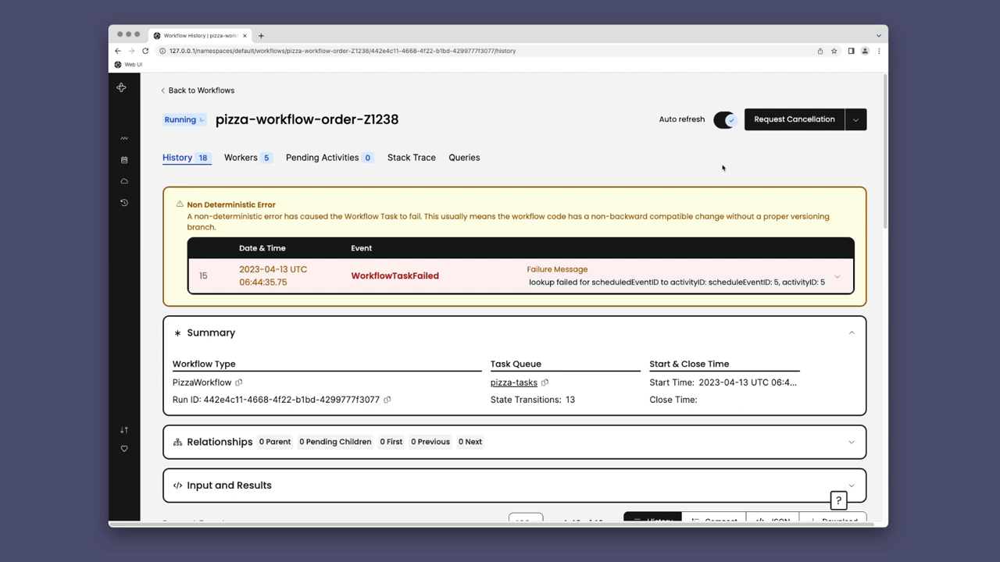

Notice that the Workflow is still marked **Running**. The error prevents the Worker from processing its Workflow Task; it is not the same as a `WorkflowExecutionFailed` Event closing the execution.

### Connecting the Error to History

The message points to **Event ID 5**. Looking up that Event reveals `ActivityTaskScheduled` with Activity Type **`GetDistance`**.

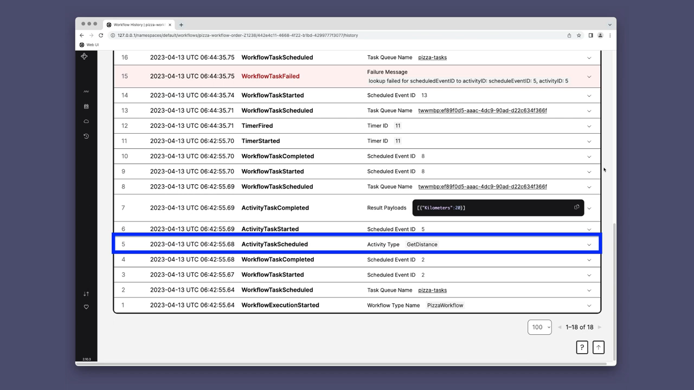

The history also shows that this Activity started and completed before the Timer. The updated code skips the Activity entirely, so the SDK cannot match the recorded Activity to the replayed code.

The cause is therefore the removed scheduling call—not an unavailable Activity Worker or a new failure inside `GetDistance`. Registering the Activity implementation alone would not fix it: the Workflow must reproduce the compatible scheduling decision during replay.

**Automatic replay restores state only when the code remains compatible with history.** More Workers running the same incompatible code will encounter the same problem. Existing executions need compatible code or a supported versioning path, even when new executions should use the revised business process.

## Using Workflow Reset to Recover from a Bad Deployment

**Workflow Reset lets an execution resume from an earlier point in its history.** It can help recover an order stuck after an incompatible deployment, provided the code can replay the history kept before that point.

For the pizza order, the problem is the recorded `GetDistance` Activity that the updated code no longer schedules. Resetting to a point before that scheduling decision lets the new code proceed without it.

### What a Reset Changes

A reset creates a **new Run with the same Workflow ID and a new Run ID**. If the current execution is still running, Temporal terminates it as part of the reset.

The new Run retains the history prefix before the reset boundary. A Worker replays that prefix to reconstruct state, then continues execution from the selected Workflow Task.

A fresh execution starts from the beginning; a reset retains recorded progress before the chosen boundary.

**Reset does not undo changes already made in external systems.** Activities scheduled again after the boundary can repeat work that previously succeeded. Their side effects still need to be retry-safe or deduplicated.

### Choosing the Reset Point

The Web UI offers three choices:

| Option | Use it when… |
| :--- | :--- |
| First Workflow Task | You need to resume before the Workflow's earliest Command-producing decisions. |
| Last Workflow Task | The latest available boundary retains a history prefix compatible with the code. |
| Specific Event ID | You have identified the precise supported Workflow Task boundary to reset to. |

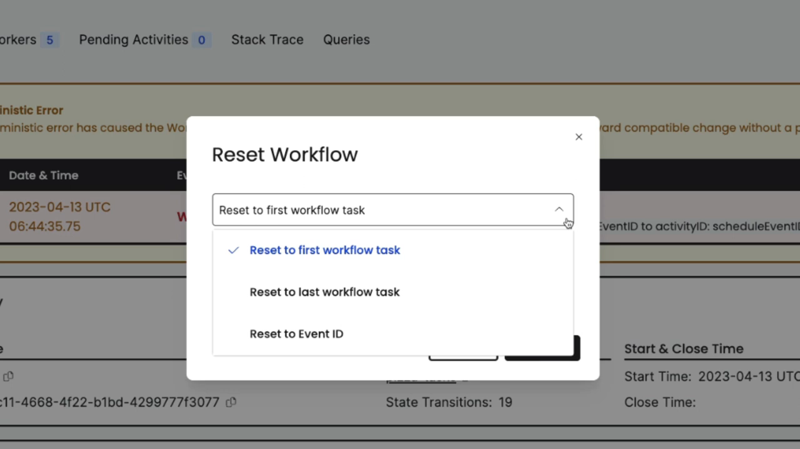

An Event ID is not an arbitrary rewind point: **only supported Workflow Task events can serve as reset boundaries**. An Activity completion or Timer firing is not itself a valid choice.

Choose a boundary **before the first conflicting decision**, while preserving as much compatible progress as possible. Resetting too late leaves the incompatible history in place; resetting earlier than necessary repeats more work.

### Resetting the Pizza Workflow

In this order, `GetDistance` was the first operation to generate a Command. The first Workflow Task completed at **Event ID 4**, and `ActivityTaskScheduled` for `GetDistance` followed at **Event ID 5**.

The recovery steps are:

1. Open the affected Workflow in the Web UI and select **Reset**.
2. Choose **Reset to first workflow task**, before `GetDistance` was scheduled.
3. Enter a useful reason, such as `Deployed an incompatible change (deleted Activity)`.
4. Confirm the reset and open the new Run.

The reason becomes part of the history, making the recovery understandable later. In the original Run, `WorkflowExecutionTerminated` records it:

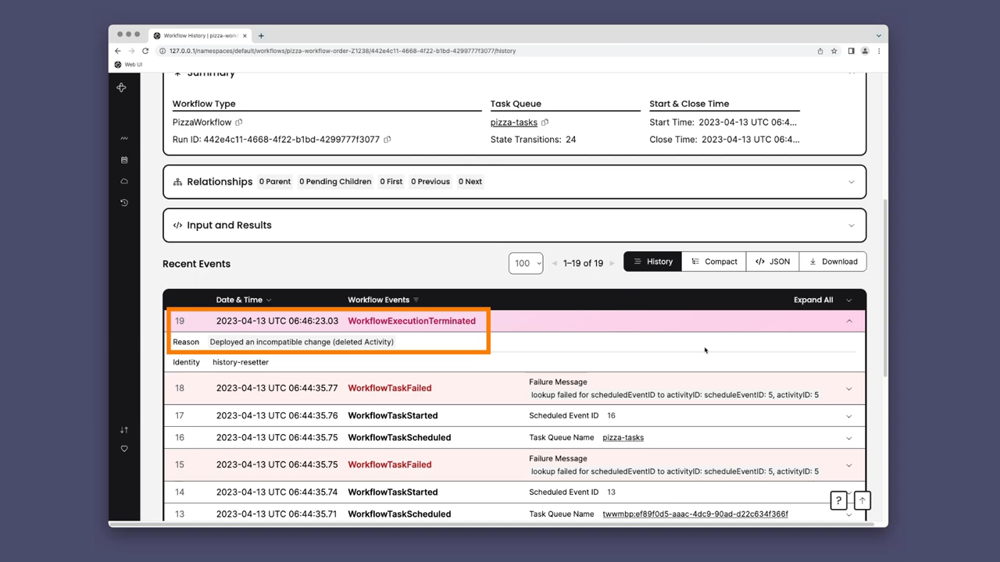

### Understanding the New History

In the new Run, the boundary is represented by a `WorkflowTaskFailed` Event containing the reset reason. **This Event marks the reset; it is not another nondeterminism failure.** The next Workflow Task runs with the updated code.

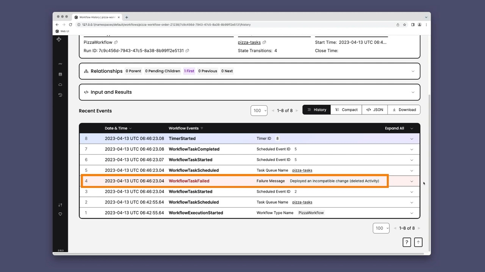

The retained history stops before `GetDistance` was scheduled, so the new code can skip that Activity without conflicting with it. The old Timer's start and firing are also beyond the boundary and are not retained.

The order therefore follows the updated path:

```text
Reset boundary → start a new Timer → wait for it to fire → SendBill → complete
```

**The Timer waits again for its full duration**, even though it already fired in the original Run. Reset preserves progress before the boundary, not completed work after it. Signals and other eligible external events can also be reapplied depending on the reset options; review those options when they affect the Workflow.

Reset is a recovery tool, not a replacement for compatible deployments. It only resolves this mismatch because the conflicting Activity lies outside the retained history.

### Resetting from the Command Line

The equivalent reset for this order is:

```bash
temporal workflow reset \
  --workflow-id pizza-workflow-order-Z1238 \
  --event-id 4 \
  --reason "Deployed an incompatible change (deleted Activity)"
```

Here, `4` is the first Workflow Task's completion Event in **this particular history**. Inspect the target execution before choosing an Event ID; the same number does not identify the right boundary in every Workflow. Add `--run-id` when you need to select a specific source Run.

## Unit Testing Primer for Go (Optional)

Go includes a testing framework in its standard library. Testify adds convenient assertions, mocks, and test suites. If both are already familiar, this primer can be skipped.

### What a Unit Test Checks

A **unit test** checks a small piece of code in isolation, such as a function's result for a given input. Finding a defect while developing is usually cheaper than discovering it in production.

Unit tests provide confidence in individual behaviors. Other tests answer different questions:

| Test type | Main question |
| :--- | :--- |
| Unit | Does this piece of code behave correctly? |
| Integration | Do these pieces work together correctly? |
| Performance | Does the code meet runtime speed or resource requirements? |

Passing unit tests does not prove that the whole application works, but it gives a fast way to catch regressions in the behaviors they cover.

### Writing a Go Unit Test

Suppose `addition.go` contains:

```go
package arithmetic

func Sum(first, second int) int {
    return first + second
}
```

The test calls `Sum` with known inputs and compares the result with the expected value. Put this in `addition_test.go`:

```go
package arithmetic

import "testing"

func TestSum(t *testing.T) {
    result := Sum(2, 5)
    expected := 7

    if result != expected {
        t.Fatalf("got %d, want %d", result, expected)
    }
}
```

`*testing.T` tracks the test's status and output. `t.Fatalf` records a failure and stops the **current test function**. Including both actual and expected values makes a failure easier to diagnose.

### Test File and Function Conventions

Go discovers tests through naming and signatures:

- **Files end in `_test.go`.** Matching the source filename, such as `addition_test.go`, is a useful convention rather than a requirement.
- **Test functions use `func TestXxx(t *testing.T)`**, with no return value. The character after `Test` must not be a lowercase letter.
- **Tests live in the package directory.** Using the same package name allows access to unexported code. An external test package, such as `arithmetic_test`, imports the package and tests its exported API.

A function can have several tests covering different scenarios—for example, `TestSumPositiveInts`, `TestSumNegativeInts`, and `TestSumTwoZeroes`. Table-driven tests and subtests can also group related cases.

### Running Go Tests

Run tests in the current package:

```bash
go test
```

Use verbose output to see each test and its result, including passing tests:

```bash
go test -v
```

Run all packages below the current directory, or select tests by name:

```bash
go test ./...
go test -v -run '^TestSum$' .
```

Failures show the test name and diagnostic output. **A successful command is only useful if it actually discovered the intended tests.** Check verbose output when adding a new test. Invalid `TestXxx` signatures can produce errors; functions that do not match the test naming convention are ordinary functions and are not run as tests.

### Testify: Assert and Require

Testify's `assert` package shortens common checks:

```go
package arithmetic

import (
    "testing"

    "github.com/stretchr/testify/assert"
)

func TestSum(t *testing.T) {
    assert.Equal(t, 7, Sum(2, 5))
}
```

For `Equal`, the order is **expected value, then actual value**. Other helpers check errors, booleans, ordering, nil values, and collection contents.

The `require` package offers similar checks with a different failure behavior:

| Package | After a failed check |
| :--- | :--- |
| `assert` | Marks the test failed, but lets the current test continue. |
| `require` | Marks the test failed and stops the current test function. |

**`require` does not stop the entire test run.** Other tests still run. Use it for prerequisites where continuing would cause misleading failures or a panic:

```go
require.NoError(t, err)
assert.Equal(t, expected, result)
```

Here, the result is checked only if the operation succeeded. Fatal checks such as `require` and `t.Fatalf` must run in the test's goroutine, not a separate goroutine spawned by it.

### Mock Objects and Test Suites

**Mocks replace runtime dependencies with controlled behavior.** Testify's `mock` package can configure expected calls and return values, allowing a test to check its own logic without relying on a live database or service.

For example, a customer lookup dependency could return a known postal code for one ID and an error for another. This makes success and failure paths repeatable. Tests can also verify that expected calls occurred.

**Suites group tests with shared setup and teardown.** Testify's `suite` package supports hooks before and after a suite or individual tests. For simpler tests, ordinary Go test functions and `t.Cleanup` are often sufficient.

Temporal's Go SDK provides a `testsuite` package for exercising Workflow and Activity code in a test environment, including support for mocking Activities. This allows Temporal-specific behavior to be tested without starting a real Temporal Server.

## Validating Correctness of Temporal Application Code

Testing a Temporal application checks that its business logic behaves as intended: the Workflow makes the right decisions, Activities return the expected results, and errors are handled correctly.

**The Go SDK provides local test environments for both Workflows and Activities.** They run without a Temporal Server, making tests quick to execute during development.

### The testsuite Package

Import the SDK's testing support from:

```go
import "go.temporal.io/sdk/testsuite"
```

Three types provide the main building blocks:

| Type | Purpose |
| :--- | :--- |
| `WorkflowTestSuite` | Creates Workflow and Activity test environments and holds shared test configuration. |
| `TestWorkflowEnvironment` | Executes Workflow code and exposes its completion state, result, and error. |
| `TestActivityEnvironment` | Executes Activity code directly and exposes its result and error. |

### Workflow Test Environment

A typical Workflow test follows this sequence:

1. Create a `WorkflowTestSuite` and call `NewTestWorkflowEnvironment()`.
2. Register Workflow and Activity implementations as needed, or mock Activity calls.
3. Execute the Workflow with test inputs using `ExecuteWorkflow`.
4. Check completion with `IsWorkflowCompleted`, inspect `GetWorkflowError`, and decode the result with `GetWorkflowResult`.

**Completion alone does not mean success.** A Workflow can finish with an error, so test both its completion state and its outcome.

The environment also supports **automatic time skipping**. When possible, it advances simulated time to fire Timers rather than waiting for their real duration. A Workflow that sleeps for hours can therefore be tested in seconds.

Time skipping applies to Temporal's simulated Workflow time—not arbitrary sleeps or external work inside Activities. Running Activities can prevent the environment from skipping ahead until they finish.

### Activity Test Environment

Use `NewTestActivityEnvironment()` to create an environment for an Activity. Register the Activity as needed, then invoke it with `ExecuteActivity` and check the returned error and encoded result.

This isolates the Activity from the Workflow that normally calls it. For example, a translation Activity can be tested for a successful response, an unavailable service, or an invalid language code.

**The environment does not automatically replace external dependencies.** An Activity that calls an HTTP service or database still needs a controlled dependency, such as a local test server, fake, or mock, if the test is to run in isolation.

### Organizing Temporal Tests

There are two common styles:

| Style | Structure |
| :--- | :--- |
| Ordinary Go tests | Each case is a `func TestXxx(t *testing.T)` that creates its own environment. |
| Testify suite | A struct groups test methods and supplies setup and teardown hooks. |

`WorkflowTestSuite` supplies Temporal's environments; **Testify's `suite` package supplies the method-based test runner and lifecycle hooks** when using the second style.

The examples here use ordinary test functions. Create a fresh environment for each test to keep execution state and mock expectations independent. Use `t.Cleanup` for resources that need to be released after the test.

These tests validate application behavior in the SDK's test environment. They do not replace integration tests against a real Server or replay tests that check compatibility with existing Event Histories.

### Running Temporal Tests

Temporal tests use ordinary `go test` commands. See [Running Go Tests](#running-go-tests) for verbose output, package selection, and name filtering.

## Testing Activities

An Activity test runs the implementation in `TestActivityEnvironment`, then checks its error and result. The environment supplies the Activity context, including support for SDK logging.

### Activity Implementation

This Activity returns the square of its input. Put it in `square.go`:

```go
package example

import (
    "context"

    "go.temporal.io/sdk/activity"
)

func SquareActivity(ctx context.Context, number int) (int, error) {
    logger := activity.GetLogger(ctx)
    logger.Info("Preparing to calculate the square")

    result := number * number

    logger.Debug("Finished calculating the square")
    return result, nil
}
```

The example uses a plain integer for brevity. Struct-based inputs and outputs are preferable when the Activity contract needs to evolve. The calculation also assumes values small enough that their square fits in an `int`.

### Activity Tests

Put these tests in `square_test.go`, in the same directory and package:

```go
package example

import (
    "testing"

    "github.com/stretchr/testify/assert"
    "github.com/stretchr/testify/require"
    "go.temporal.io/sdk/testsuite"
)

func TestSquareActivityPositive(t *testing.T) {
    testSuite := &testsuite.WorkflowTestSuite{}
    env := testSuite.NewTestActivityEnvironment()
    env.RegisterActivity(SquareActivity)

    value, err := env.ExecuteActivity(SquareActivity, 3)
    require.NoError(t, err)

    var result int
    require.NoError(t, value.Get(&result))
    assert.Equal(t, 9, result)
}

func TestSquareActivityNegative(t *testing.T) {
    testSuite := &testsuite.WorkflowTestSuite{}
    env := testSuite.NewTestActivityEnvironment()
    env.RegisterActivity(SquareActivity)

    value, err := env.ExecuteActivity(SquareActivity, -4)
    require.NoError(t, err)

    var result int
    require.NoError(t, value.Get(&result))
    assert.Equal(t, 16, result)
}
```

Each test uses a fresh environment.

### How the Activity Test Works

| Step | What it checks or prepares |
| :--- | :--- |
| `NewTestActivityEnvironment()` | Creates the local Activity test runtime. |
| `RegisterActivity(SquareActivity)` | Makes the Activity implementation available to that environment. |
| `ExecuteActivity(SquareActivity, input)` | Runs the Activity with the supplied input and returns an encoded value or an error. |
| `require.NoError(t, err)` | Confirms execution succeeded before accessing the value. |
| `value.Get(&result)` | Decodes the returned value into an `int`. |
| `assert.Equal(t, expected, result)` | Confirms the decoded result is correct. |

Require successful execution and decoding before comparing the result. A nil execution error alone does not establish that the calculation is correct.

Run only these tests with:

```bash
go test -v -run '^TestSquareActivity' .
```

No Temporal Server or Worker process is required for these tests.

## Testing Workflows

A Workflow test runs the orchestration code in `TestWorkflowEnvironment`. It can execute real Activity implementations locally or replace Activity calls with mocks.

This example uses the real `SquareActivity` to calculate the **sum of squares** of two integers.

### Workflow Implementation

Put the input type and Workflow in `sum_of_squares.go`, alongside `SquareActivity`:

```go
package example

import (
    "time"

    "go.temporal.io/sdk/workflow"
)

type PairOfInts struct {
    First  int
    Second int
}

func SumOfSquaresWorkflow(ctx workflow.Context, numbers PairOfInts) (int, error) {
    options := workflow.ActivityOptions{
        StartToCloseTimeout: 5 * time.Second,
    }
    ctx = workflow.WithActivityOptions(ctx, options)

    var squareOne int
    err := workflow.ExecuteActivity(ctx, SquareActivity, numbers.First).Get(ctx, &squareOne)
    if err != nil {
        return -1, err
    }

    var squareTwo int
    err = workflow.ExecuteActivity(ctx, SquareActivity, numbers.Second).Get(ctx, &squareTwo)
    if err != nil {
        return -1, err
    }

    return squareOne + squareTwo, nil
}
```

The Activities run **sequentially**: the first `Get` waits for its result before the second Activity is scheduled. If either call fails after its retry handling, the Workflow returns that error instead of calculating the sum.

The five-second `StartToCloseTimeout` applies to each Activity attempt, not the entire Workflow. As with the Activity example, these small inputs avoid integer overflow.

### Workflow Tests

Put these tests in `sum_of_squares_test.go`:

```go
package example

import (
    "testing"

    "github.com/stretchr/testify/assert"
    "github.com/stretchr/testify/require"
    "go.temporal.io/sdk/testsuite"
)

func TestSumOfSquaresWorkflowPositive(t *testing.T) {
    testSuite := &testsuite.WorkflowTestSuite{}
    env := testSuite.NewTestWorkflowEnvironment()
    env.RegisterActivity(SquareActivity)

    input := PairOfInts{
        First:  2,
        Second: 5,
    }

    env.ExecuteWorkflow(SumOfSquaresWorkflow, input)
    require.True(t, env.IsWorkflowCompleted())
    require.NoError(t, env.GetWorkflowError())

    var result int
    require.NoError(t, env.GetWorkflowResult(&result))
    assert.Equal(t, 29, result)
}

func TestSumOfSquaresWorkflowNegative(t *testing.T) {
    testSuite := &testsuite.WorkflowTestSuite{}
    env := testSuite.NewTestWorkflowEnvironment()
    env.RegisterActivity(SquareActivity)

    input := PairOfInts{
        First:  -3,
        Second: 7,
    }

    env.ExecuteWorkflow(SumOfSquaresWorkflow, input)
    require.True(t, env.IsWorkflowCompleted())
    require.NoError(t, env.GetWorkflowError())

    var result int
    require.NoError(t, env.GetWorkflowResult(&result))
    assert.Equal(t, 58, result)
}
```

Expected sums: **`2² + 5² = 29`** and **`(-3)² + 7² = 58`**.

### How the Workflow Test Works

The setup resembles an Activity test, but the execution and result APIs differ:

| Operation | Activity test | Workflow test |
| :--- | :--- | :--- |
| Create environment | `NewTestActivityEnvironment()` | `NewTestWorkflowEnvironment()` |
| Run code | `ExecuteActivity` returns a value and error | `ExecuteWorkflow` has no return values |
| Check error | Inspect the returned error | Call `GetWorkflowError()` |
| Read result | Decode the returned value with `Get` | Call `GetWorkflowResult(&result)` |

Register the Activity implementations the Workflow will execute. Passing the Workflow function directly to `ExecuteWorkflow` allows the environment to register it automatically; explicit Workflow registration is not needed in this example. Executing by a registered name requires registration first.

The three checks answer different questions:

1. **Did execution finish?** `IsWorkflowCompleted()`.
2. **Did it finish without an error?** `GetWorkflowError()`.
3. **Did it return the correct value?** `GetWorkflowResult` followed by an equality assertion.

The `-1` returned alongside an error in the implementation is not a successful Workflow result.

These tests cover orchestration together with the real Activity calculation. Mocking Activities would isolate the Workflow's decisions from the Activity implementation.

Run the Workflow tests with:

```bash
go test -v -run '^TestSumOfSquaresWorkflow' .
```

## Mocking Activities for Workflow Tests

**Mocking an Activity lets a test check Workflow decisions without running the Activity implementation.** The Workflow still schedules the Activity and receives its result, but the test controls that result.

### Why Mock an Activity?

The sum-of-squares tests use a real Activity that performs a small, local calculation. That is easy to run reliably. An Activity that calls an external API introduces more uncertainty:

- The service might be unavailable or slow.
- Its response might change over time.
- Producing a particular error or edge case might be difficult.

A mock removes those dependencies from the Workflow test. Test the real Activity separately to verify its behavior, and use integration tests to check interaction with the actual service.

### A Test Using the Real Activity

Consider an `EstimateAge` Workflow that accepts a name, calls `RetrieveEstimate`, and formats the returned age into a message. The Activity has this signature:

```go
func RetrieveEstimate(ctx context.Context, name string) (int, error)
```

Its real implementation calls a remote age-estimation API. A Workflow test using that implementation looks like this:

```go
package example

import (
    "testing"

    "github.com/stretchr/testify/assert"
    "github.com/stretchr/testify/require"
    "go.temporal.io/sdk/testsuite"
)

func TestEstimateAgeWithRealActivity(t *testing.T) {
    testSuite := &testsuite.WorkflowTestSuite{}
    env := testSuite.NewTestWorkflowEnvironment()
    env.RegisterActivity(RetrieveEstimate)

    env.ExecuteWorkflow(EstimateAge, "Betty")
    require.True(t, env.IsWorkflowCompleted())
    require.NoError(t, env.GetWorkflowError())

    var result string
    require.NoError(t, env.GetWorkflowResult(&result))
    assert.Equal(t, "Betty has an estimated age of 77", result)
}
```

This test requires the service to return **exactly `77`** for Betty. A different estimate could fail the test even if the Workflow formats its result correctly.

It exercises the Workflow and its external dependency together, rather than isolating the Workflow. Running it in the SDK test environment does not make it a full end-to-end test against a Temporal Server.

### Replacing the Activity with a Mock

Use the environment's `OnActivity` method to supply a controlled response:

```go
package example

import (
    "testing"

    "github.com/stretchr/testify/assert"
    "github.com/stretchr/testify/mock"
    "github.com/stretchr/testify/require"
    "go.temporal.io/sdk/testsuite"
)

func TestEstimateAgeWithMockActivity(t *testing.T) {
    testSuite := &testsuite.WorkflowTestSuite{}
    env := testSuite.NewTestWorkflowEnvironment()

    env.OnActivity(RetrieveEstimate, mock.Anything, "Betty").
        Return(77, nil).
        Once()

    env.ExecuteWorkflow(EstimateAge, "Betty")
    require.True(t, env.IsWorkflowCompleted())
    require.NoError(t, env.GetWorkflowError())

    var result string
    require.NoError(t, env.GetWorkflowResult(&result))
    assert.Equal(t, "Betty has an estimated age of 77", result)
    env.AssertExpectations(t)
}
```

The real Activity does not run, so this test makes no request to the age-estimation API. Passing the Activity function to `OnActivity` allows the environment to register it for mocking; a separate `RegisterActivity` call is not needed here.

### Understanding the Mock Expectation

| Part | Meaning |
| :--- | :--- |
| `RetrieveEstimate` | Identifies the Activity being mocked. |
| `mock.Anything` | Matches its `context.Context` argument. |
| `"Betty"` | Matches the name argument exactly. |
| `Return(77, nil)` | Supplies the Activity's `(int, error)` return values. |
| `Once()` | Expects one matching call. |
| `AssertExpectations(t)` | Checks that the expected call actually occurred. |

Configure expectations **before `ExecuteWorkflow`**. Return values must match the Activity's signature. You can define different expectations for different inputs, or return an error to test how the Workflow handles Activity failure.

When testing errors, account for the Workflow's Activity Retry Policy: a retryable failure may cause multiple calls before the Workflow receives the final error. A one-call expectation is appropriate for this successful example, not automatically for a retry scenario.

The result assertion now checks a stable piece of business logic: whether the Workflow combines the supplied name and age into the expected message. It does not prove that the real Activity retrieves ages correctly.

### Using a Fake Activity Instead

A mock library is not essential. Another approach is to register a small fake implementation with the same signature **under the Activity name the Workflow schedules**. The fake can return a fixed age or a controlled error.

Matching the signature alone is not enough: the registered Activity name must also match. This approach is useful when a simple replacement function expresses the test more clearly than mock expectations.

## Hands-On Exercise #2: Testing the Translation Workflow

### Exercise Files and Goals

Work in **`03-testing-code/`**. Run the Makefile commands below from the course root, where `Makefile` and `go.mod` are located.

| File | Purpose |
| :--- | :--- |
| `activity.go` | `TranslateTerm`, which calls the translation service. |
| `activity_test.go` | German greeting, Latvian farewell, and invalid-language tests. |
| `workflow.go` | `SayHelloGoodbye`, with a 15-second Timer between translations. |
| `workflow_test.go` | Tests the Workflow using the real Activity. |
| `workflow_mock_test.go` | Tests the Workflow with mocked translation results. |
| `shared.go` | Input/output structs and the Task Queue constant. |
| `microservice/translation-service.go` | Local HTTP translation service on port `9998`. |

The test cases and the corrected farewell calculation are already present. Study and improve the tests as you work through the exercise, then deliberately reproduce the original bug to practice diagnosing a failure.

By the end, you should be able to execute a Workflow in the test environment, mock its Activities, observe time skipping, test real Activity behavior, and diagnose a failed assertion.

### Part A: Run the Activity Tests

The Activity calls `http://localhost:9998/translate`, so start the local service in one terminal:

```bash
make 03-testing-code-service
```

If a translation service from another exercise is already running on port `9998`, stop it first or use that existing service instead of starting a second one.

In another terminal, run the Activity tests:

```bash
make 03-testing-code-test-activity
```

Open `activity_test.go` and inspect `TestSuccessfulTranslateActivityHelloGerman`. It creates an Activity environment, registers `TranslateTerm`, and supplies `Hello` with language code `de`. The expected translation is **`Hallo`**.

Use `require.NoError` for execution and decoding checks so a failed prerequisite stops the test before it accesses an unavailable result. Keep `assert.Equal` for the translated value.

**No Temporal Server or Worker process is needed.** Only tests using the real HTTP Activity require the translation service.

### Part B: Test Another Translation

Inspect `TestSuccessfulTranslateActivityGoodbyeLatvian`. Its inputs and expected result are:

```go
input := TranslationActivityInput{
    Term:         "Goodbye",
    LanguageCode: "lv",
}
```

After executing the Activity and decoding its `TranslationActivityOutput`, verify that `output.Translation` is **`Ardievu`**.

To practice adding a test yourself, choose another supported term/language pair, give the test a unique `Test...` name, and set its expected translation. The service's `translations` map lists the supported values; an initially uppercase term produces an initially uppercase translation.

Run the Activity target again to check your changes.

### Part C: Test Invalid Input

`TestFailedTranslateActivityBadLanguageCode` sends `Hello` with the unsupported language code `xq`.

Check three things:

1. Activity execution returns an error.
2. The error chain contains a `*temporal.ApplicationError`.
3. Its message identifies the invalid language code.

The assertion block can be written as:

```go
require.Error(t, err)

var applicationErr *temporal.ApplicationError
require.True(t, errors.As(err, &applicationErr))
assert.Equal(t,
    "HTTP Error 400: Unknown language code 'xq'\n",
    applicationErr.Message(),
)
```

Add `github.com/stretchr/testify/require` to the test imports when making this change. `require.True` prevents a nil dereference if the error is not the expected type. The trailing newline comes from the service's `http.Error` response.

The Activity returns a Go error for the HTTP failure; the SDK exposes it as an Application Error through the Activity test environment.

### Part D: Test and Debug the Workflow

With the translation service still running, execute:

```bash
make 03-testing-code-test-workflow
```

In `workflow_test.go`, the input is Pierre with language code `fr`. The intended output is:

```json
{
  "HelloMessage": "Bonjour, Pierre",
  "GoodbyeMessage": "Au revoir, Pierre"
}
```

Before comparing these fields, check completion, execution error, and result decoding:

```go
require.True(t, env.IsWorkflowCompleted())
require.NoError(t, env.GetWorkflowError())

var result TranslationWorkflowOutput
require.NoError(t, env.GetWorkflowResult(&result))
assert.Equal(t, "Bonjour, Pierre", result.HelloMessage)
assert.Equal(t, "Au revoir, Pierre", result.GoodbyeMessage)
```

**The current Workflow passes the farewell assertion.** To reproduce the original bug, temporarily format `goodbyeMessage` using `helloResult.Translation` instead of `goodbyeResult.Translation`. Run the test and observe that the farewell becomes `Bonjour, Pierre` rather than `Au revoir, Pierre`.

Trace the second Activity call and the variable used to format `GoodbyeMessage`. Restore `goodbyeResult.Translation`, then rerun the test to confirm it passes.

While reading `workflow.go`, also handle an error returned by `workflow.Sleep` instead of ignoring it, so cancellation during the delay is propagated.

The Workflow includes a **15-second sleep**, but the test environment automatically advances simulated time when it can. Look for an `Auto fire timer` debug message in the verbose output. The test does not need to wait 15 real seconds, although compilation and HTTP calls still take real time.

### Part E: Test with Mock Activities

Open `workflow_mock_test.go`. It needs two expectations for `TranslateTerm`:

| Activity input | Mock output |
| :--- | :--- |
| `Hello`, `fr` | `TranslationActivityOutput{Translation: "Bonjour"}` |
| `Goodbye`, `fr` | `TranslationActivityOutput{Translation: "Au revoir"}` |

The expectation pattern is:

```go
env.OnActivity(TranslateTerm, mock.Anything, helloInput).
    Return(helloOutput, nil).
    Once()
```

Apply the same pattern to the goodbye input/output. Configure both before `ExecuteWorkflow`; no separate Activity registration is needed. Use the same completion, error, decoding, and result checks as the real-Activity test, then call **`env.AssertExpectations(t)`** to verify both expected calls occurred.

Run the mocked test:

```bash
make 03-testing-code-test-mock
```

This test needs neither the translation service nor a Temporal Server. You can stop the service with `Ctrl-C` and rerun it to confirm the Activity implementation is not being called. It also skips the Timer's delay and detects the same farewell bug if you temporarily introduce it.

### Exercise Commands

| Command | Purpose | Requires translation service? |
| :--- | :--- | :--- |
| `make 03-testing-code-service` | Start the HTTP service. | Starts it. |
| `make 03-testing-code-test-activity` | Run the Activity tests. | Yes. |
| `make 03-testing-code-test-workflow` | Run the Workflow test using the real Activity. | Yes. |
| `make 03-testing-code-test-mock` | Run the mocked Workflow test. | No. |
| `make 03-testing-code-test` | Run all exercise tests and compile its command packages. | Yes. |

After restoring the correct farewell calculation and improving the assertions, start the service and run `make 03-testing-code-test` to verify the complete exercise.

For an optional run against a real Temporal Server, use separate terminals for:

```bash
make temporal-up
make 03-testing-code-service
make 03-testing-code-worker
make 03-testing-code-start NAME=Pierre LANG=fr
```

Unlike the test environment, the real execution waits for the Timer's actual 15-second duration. Inspect it with `make 03-testing-code-history` or `make 03-testing-code-history-detailed`.

This starter uses Workflow ID `translation-workflow`, also used by `01-using-structs`. Its Worker uses Task Queue `durable-exec-tasks`, also used by `02-durable-execution`. Run only this exercise's Worker on that queue during the optional server run, and ensure there is no open execution with the same Workflow ID.

## Debugging a Workflow that Does Not Progress

**Running means the Workflow is open—not that a Worker is currently executing its code.** A start request can succeed while the first Workflow Task waits indefinitely for a Worker.

Start with the Event History. It distinguishes a Task waiting to be picked up from a Workflow legitimately waiting on a Timer or Activity.

### Scenario 1: No Worker Has Picked Up the Task

The starter and Worker are separate programs. When the starter submits a Workflow, the Cluster can accept it even if no Worker is running:

1. The Cluster records `WorkflowExecutionStarted`.
2. It queues the first Workflow Task and records `WorkflowTaskScheduled`.
3. The Task waits until a Worker polls the correct queue.

The Web UI may display **No Workers Running** and a Worker count of zero:

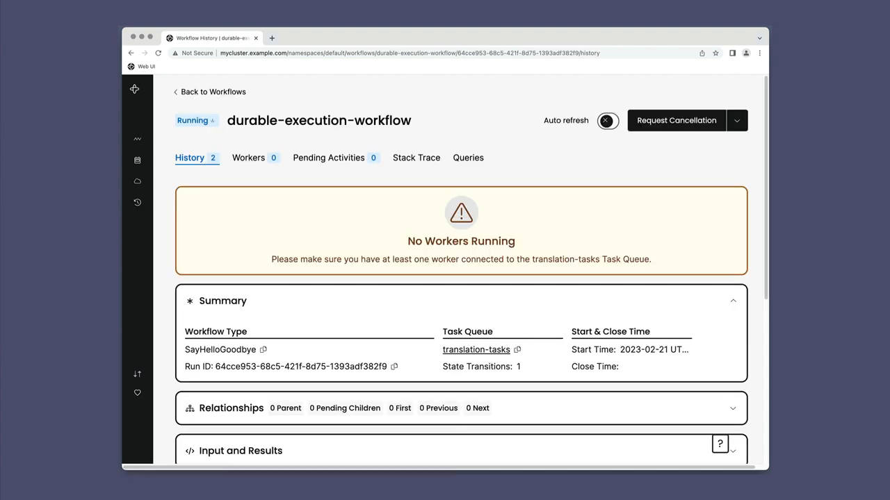

The history contains only the start and scheduling Events. There is no `WorkflowTaskStarted`, so the Workflow code has not begun running:

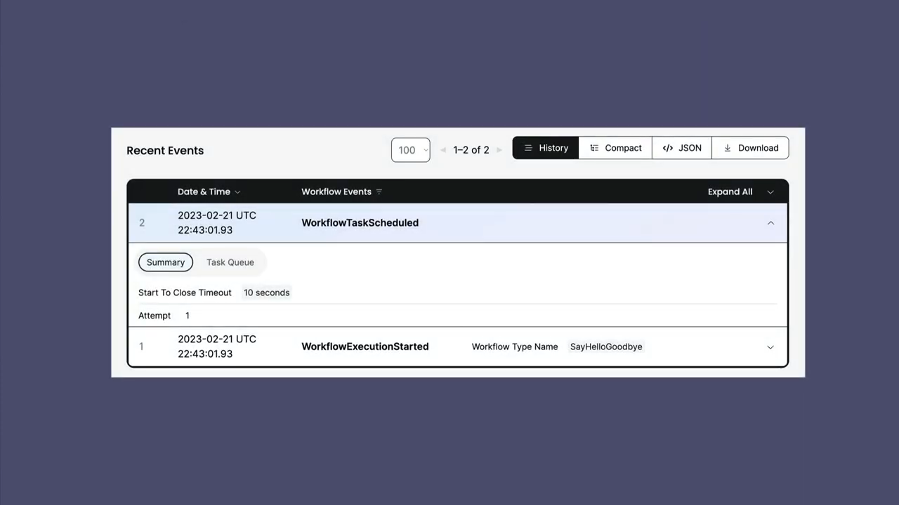

The displayed Workflow Task **Start-to-Close Timeout does not begin while the Task is merely queued**. It starts when a Worker picks up the Task, so a ten-second value does not mean this queue wait will end after ten seconds.

Start a Worker configured for the Workflow's Namespace and Task Queue. It can pick up the already queued Task; you do not need to submit another execution. The Worker must also have the Workflow Type registered.

### Scenario 2: Recently Stopped Workers Still Appear

A nonzero Worker count can be misleading. The poller list reflects **recent polling activity**, not an instantaneous check that every listed process is alive.

For example, three Workers can poll a queue and then all stop. A newly submitted Workflow may still show **Workers 3**, with no missing-Worker warning, even though nobody can pick up its Task:

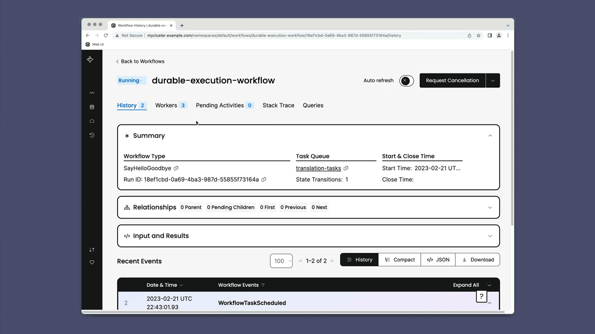

The poller information shown here retains identities that polled within roughly the last **five minutes**. Treat that as a recent-activity window, not a guarantee of current availability; details can vary with Server and UI versions.

**Confirm the processes are running and inspect their logs.** The absence of a UI warning is not enough to establish that a healthy Worker is polling now.

### Using Worker Identities to Investigate

The Go Client has an **identity** used in Worker logs and relevant Task history attributes. By default, the SDK derives it from the process ID and hostname; applications can override it through Client options.

Restarting a Worker usually gives it a different identity because its process ID changes. This makes identities useful for connecting a Task to a particular Worker process, but they are not globally unique identifiers or proof that a process is still alive.

Compare the poller list with startup and shutdown logs. Here, all three listed identities correspond to processes whose logs show they stopped:

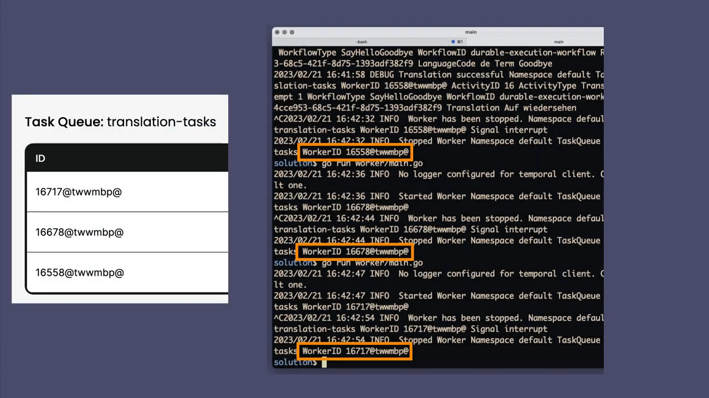

When a Task has started or completed, its recorded identity can also help identify which Worker processed it. For a Task that has only been scheduled, there is no processing Worker to identify yet.

### Checking Task Queues and Deployed Code

A Worker can be running but polling the wrong queue. Compare the **exact Task Queue name** in the starter's `StartWorkflowOptions` with the name passed to `worker.New`. Also confirm that both connect to the same Cluster and Namespace.

For `03-testing-code`, both use `TaskQueueName` from `shared.go`, currently `durable-exec-tasks`. The screenshots illustrate the same diagnosis with a queue named `translation-tasks`; use the queue shown in your own execution's history.

The opposite problem is an old Worker you forgot was still running. Editing source files does not update the code loaded into an existing process. If old and new Workers poll the same queue, Tasks can be handled by either version.

After a development change, check every terminal tab or process running that Worker and restart the intended processes. If behavior still reflects old code, use Task identities and logs to locate the remaining old process.

### A Quick Progress Check

| Last relevant history state | What to investigate |
| :--- | :--- |
| First `WorkflowTaskScheduled`, with no `WorkflowTaskStarted` | Worker availability, queue/Namespace mismatch, and polling configuration. |
| `WorkflowTaskStarted`, followed by failures or timeouts | Worker logs, registered Workflow Type, replay compatibility, or code that cannot finish its Task. |
| `ActivityTaskScheduled`, with no recorded start | Pending Activities and Worker logs: distinguish queue wait from ongoing retries, then check pollers and the Activity Task Queue. |
| `ActivityTaskStarted`, without a completion | Activity execution, external dependencies, timeouts, and heartbeats. |
| `TimerStarted`, without `TimerFired` | Whether the Timer's scheduled delay has elapsed; waiting can be expected. |

For the translation exercise, inspect history with:

```bash
make 03-testing-code-history-detailed
```

If the first Task is still queued, start its Worker in another terminal:

```bash
make 03-testing-code-worker
```

Keep the translation service running as well so the Activities can complete once the Workflow starts progressing.

## Interpreting Event History for Workflow Executions

**Event History shows what the Cluster recorded for a particular Run.** Use it to trace inputs, scheduling decisions, results, and the Workers that processed Tasks.

For the translation Workflow, the main path is:

```text
Start → translate Hello → wait on a Timer → translate Goodbye → complete
```

Workflow Task Events appear between these steps as Workers process new information and return Commands.

### Refreshing Status and Inspecting the Stack

The Web UI can show an older snapshot of an execution. If the starter has printed its final result but the page still says **Running**, refresh the page or enable **auto-refresh**. The UI shown here refreshes automatically every 15 seconds when enabled; the interval can differ between versions.

The **Stack Trace** tab can help explain where a running Workflow is waiting. It queries a Worker for the Workflow's current stack rather than reading a historical stack from Event History, so it depends on an available Worker. A completed Workflow no longer has a running stack to inspect.

### Choosing a History View

| View or action | Best use |
| :--- | :--- |
| **History** | Inspect individual Events and their attributes. The default ordering shown here puts the newest Event at the top. |
| **Compact** | Follow Activities, Timers, and other application-level operations without most Workflow Task bookkeeping. |
| **JSON** | Inspect the serialized history, including fields not prominent in the other views. |
| **Download** | Save the history for later inspection or replay testing. |

Read from the bottom upward when following this newest-first History view chronologically. Expand an Event to see its full details; some Event Types divide those details into tabs.

In JSON, payload byte fields are represented as **Base64 strings**. History and Compact views can display decoded inputs and results when the UI supports their encoding. Custom codecs, including encrypted payloads, require appropriate decoding support. Base64 itself is not encryption.

### Reading the Start Event

`WorkflowExecutionStarted` is the first Event in a Run. Its row shows the Event ID, recorded timestamp, Event Type, and a summary such as the Workflow Type.

Expand it to check the actual input and the **Identity** of the Client that submitted the start request. Here, the input is Tom with language code `es`:

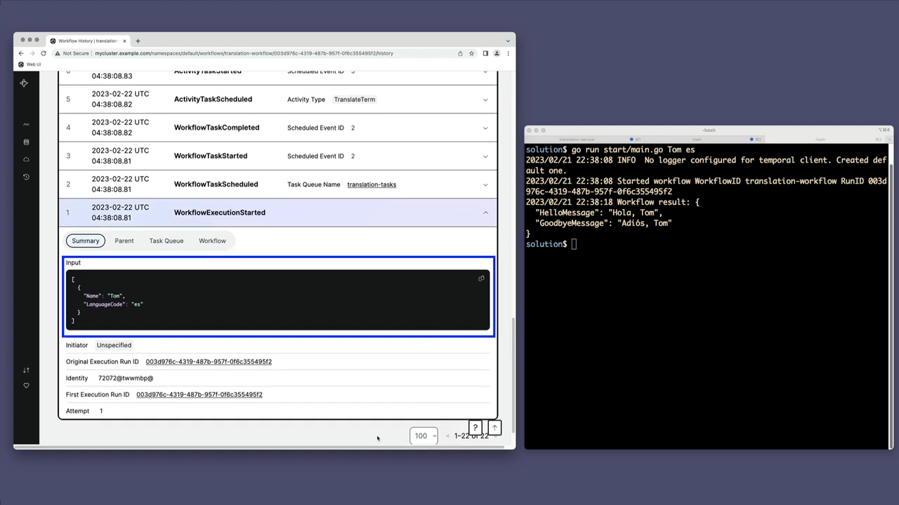

This is a useful first check when results seem wrong: confirm that the execution received the values you intended, rather than assuming the starter supplied them.

### Following Normal and Sticky Workflow Tasks

The first `WorkflowTaskScheduled` records the named **Normal** Task Queue used to start the Workflow. Its Summary tab includes the Workflow Task timeout; its Task Queue tab identifies where the Task was sent.

After a Worker processes the Workflow and enables sticky execution, later Workflow Tasks can use an automatically generated **Sticky** queue associated with that Worker. In this history, Event `8` uses such a queue:

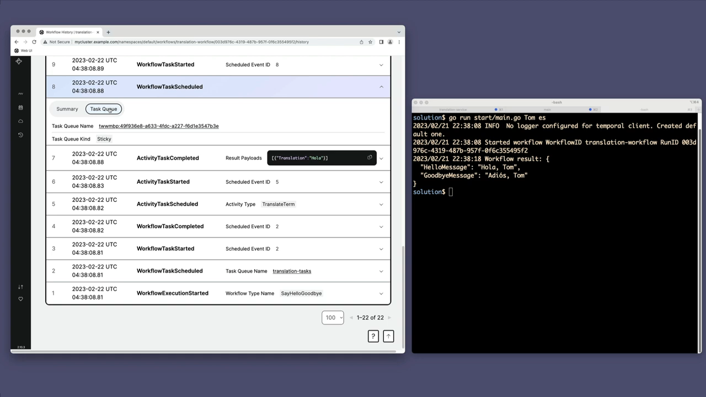

The unfamiliar queue name is expected: it routes the Task toward cached Workflow state. It does not mean the starter changed its configured queue. If sticky execution is unavailable or falls back, later Tasks can return to the normal queue.

### Inspecting an Activity's Configuration and Outcome

`ActivityTaskScheduled` records what the Workflow actually requested. Inspect its:

- **Activity Type and input** to confirm the correct operation and arguments.
- **Timeouts** to understand execution and queue-wait limits.
- **Task Queue** to identify the Activity Workers expected to handle it.
- **Retry Policy** to see the effective settings recorded when it was scheduled.

Here, the Retry Policy tab shows a one-second initial interval, backoff coefficient `2`, a 100-second maximum interval, and unlimited attempts:

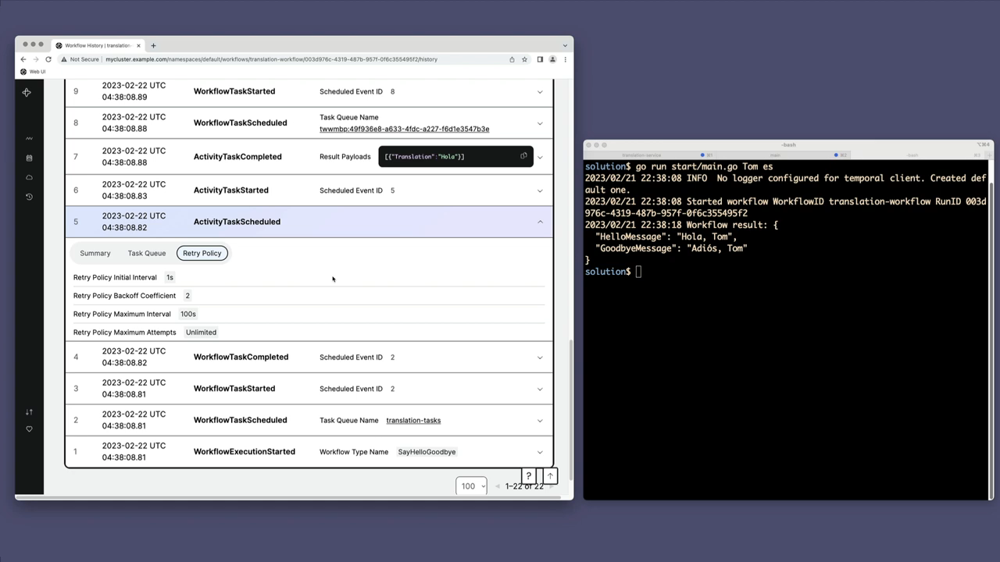

**Inspect recorded configuration, not just today's source code.** Defaults fill omitted settings, an old Worker may have scheduled the Activity, and later code edits do not retroactively change its recorded options. Unlimited attempts also does not override an overall timeout or cancellation.

Next, inspect `ActivityTaskStarted` and `ActivityTaskCompleted`:

| Event | Useful attributes |
| :--- | :--- |
| `ActivityTaskStarted` | Scheduled Event ID, attempt number, and identity of the Worker that picked up the attempt. |
| `ActivityTaskCompleted` | Returned result, Scheduled and Started Event IDs, and identity reported with completion. |

An attempt number of `1` means the recorded attempt was the first. A higher number indicates retry attempts occurred. History does not necessarily contain a full Started/Failed sequence for every intermediate retry.

Worker identities help trace execution, but **a crash and retry do not necessarily produce different identities on the final Started and Completed Events**. The recorded start can belong to the final successful attempt, whose Worker also reports completion. Use attempt numbers, errors, pending Activity information, and Worker logs together when investigating retries.

### Correlating Related Events

Related Events are not guaranteed to be adjacent. A Workflow running several Activities concurrently can interleave their starts and completions.

**Work backward from an outcome using its Event ID references.** In this example, Activity completion Event `7` points to:

- **Scheduled Event ID `5`**: which Activity was requested and with what input/options.
- **Started Event ID `6`**: which attempt and Worker began processing it.

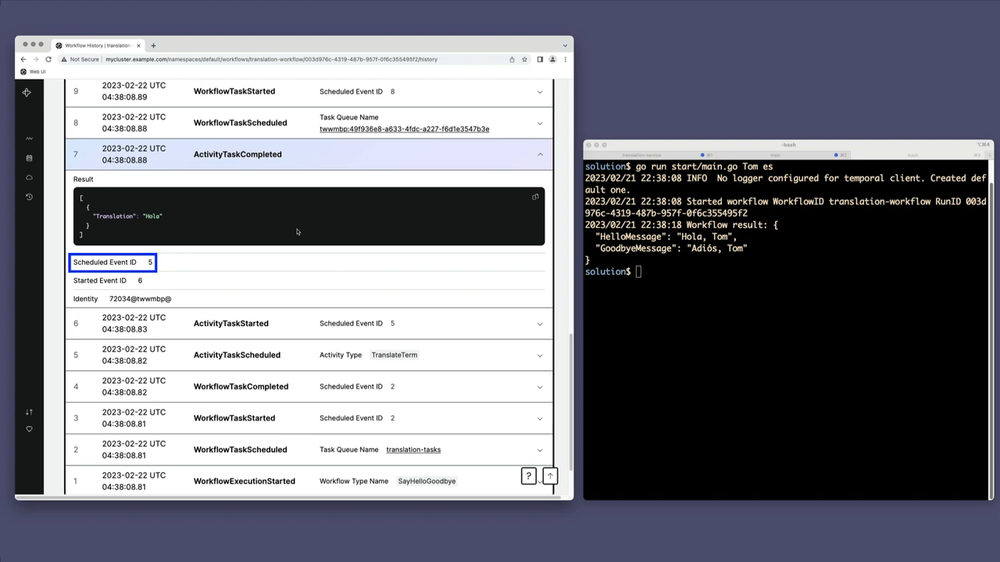

The linked sequence is therefore:

```text
5: ActivityTaskScheduled → 6: ActivityTaskStarted → 7: ActivityTaskCompleted
```

Use the same approach for Workflow Tasks: their completed or failed Events reference the corresponding scheduled and started Events. For Timers, `TimerFired` links back to `TimerStarted` through its Started Event ID, with the Timer ID identifying the Timer.

The Compact view can group these operations more conveniently, but the explicit references in History or JSON are the reliable way to correlate Events in a busy execution. Event IDs are local to a Run, so ensure you are inspecting the intended Run ID.

## Terminating a Workflow Execution with the Web UI

**Termination closes a Workflow immediately, without waiting for its code to cooperate.** It is useful when an execution cannot make meaningful progress—for example, because it was started with invalid input that every Activity retry repeats.

### Recognizing a Permanent Activity Failure

Suppose the translation Workflow receives language code **`ws`** instead of **`es`** for Spanish. The Activity passes that value to the service, which rejects it:

```text
HTTP Error 400: Unknown language code 'ws'
```

The Workflow stays **Running** because its Activity is retrying. Inspect **Pending Activities** to see the latest failure, attempt number, next retry, and any expiration:

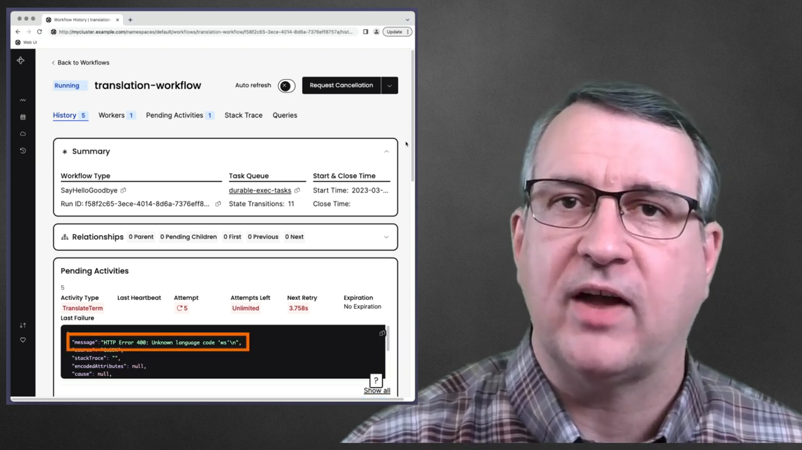

For an ordinary retryable Activity error, the default Retry Policy uses:

| Setting | Default behavior |
| :--- | :--- |
| Initial retry interval | 1 second. |
| Backoff coefficient | `2`: delays grow roughly as 1, 2, 4, 8 seconds, and so on. |
| Maximum retry interval | 100 seconds. |
| Maximum attempts | Unlimited, subject to other limits such as Schedule-to-Close timeout or Workflow closure. |

An HTTP `400` does not automatically make the Go error non-retryable. This Activity returns a regular error, so Temporal treats it as retryable unless the application says otherwise.

Retries can repair a transient failure, such as a service outage. **They cannot correct the unchanged invalid language code.** For this execution, terminate it and start a new one with `es`. More generally, validate input and classify permanent failures as non-retryable so they do not produce endless retry loops.

### Terminating through the Web UI

1. Open the affected Workflow's detail page and confirm its Workflow ID and Run ID.
2. Open the arrow beside **Request Cancellation** and select **Terminate**. The location or label can vary by UI version.
3. Enter a clear reason, such as `Specified invalid language code when starting the Workflow`.
4. Confirm termination, then refresh the page if necessary.

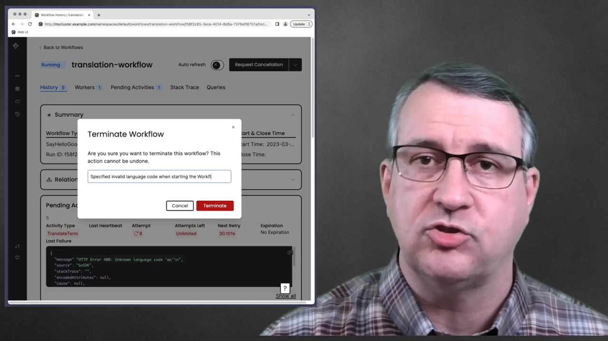

The status changes to **Terminated**. The final Event is `WorkflowExecutionTerminated`, which records the supplied reason:

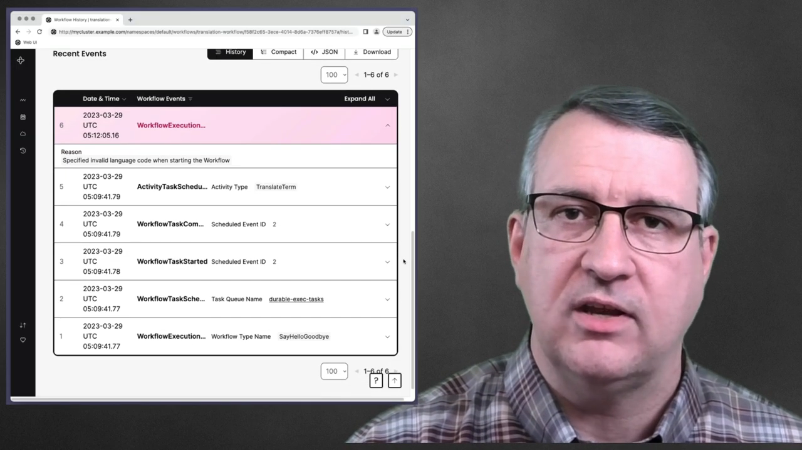

The reason is optional, but recording it helps explain the outcome to anyone investigating later. Termination closes this Run; it does not automatically launch a replacement or correct its input.

### What Termination Does to Running Work

**Termination and cancellation are different operations.** Cancellation asks the Workflow to respond, allowing it to run cleanup logic. Termination closes it on the Server without giving its code an opportunity to clean up.

Pending retries stop, but an Activity already executing on a Worker may continue until it completes. Its result cannot advance the terminated Workflow, and external side effects are not rolled back. A UI indication that pending work was canceled is not proof that an in-flight process or HTTP request was forcibly stopped.

When starting a replacement execution, account for work the original may already have performed. Activities that write to external systems still need idempotency or deduplication.

### Terminating from the Command Line

The same operation is available through the Temporal CLI:

```bash
temporal workflow terminate \
  --workflow-id process-invoice-82461092 \
  --reason "Invalid input data provided when starting the Workflow"
```

Add `--run-id` to target a particular Run. Without it, the request targets the current execution for that Workflow ID. Use the appropriate Namespace and connection settings for the execution you are inspecting.

### Terminating from Go Code

Given a connected SDK Client `c` and a `context.Context` named `ctx`:

```go
workflowID := "process-invoice-82461092"
reason := "Invalid input data provided when starting the Workflow"

err := c.TerminateWorkflow(ctx, workflowID, "", reason)
if err != nil {
    return fmt.Errorf("terminate workflow %q: %w", workflowID, err)
}
```

The third argument is the **Run ID**. An empty string selects the current execution for the Workflow ID; pass a specific Run ID when the request must apply only to that Run. This snippet belongs in a function that returns an error and imports `fmt`.

Check the returned error to confirm the Server accepted the termination request. Successful termination does not confirm that all external Activity work has stopped.

## Identifying and Fixing a Bug in an Activity Definition

**An Activity implementation can be corrected while a Workflow is waiting for that Activity to succeed.** A later retry can run the updated code, allowing the same Workflow Execution to continue without termination or a fresh start.

This differs from the invalid-input example: the Workflow input is correct, but the Activity constructs the wrong HTTP request.

### Diagnosing the Failing Request

The translation service expects query parameters named `lang` and `term`. A typo changes `term` to **`trem`**, so the service responds with:

```text
HTTP Error 400: Missing required 'term' parameter.
```

The Activity returns a retryable error. The Workflow remains Running while its Activity retries, and **Pending Activities** exposes the latest failure:

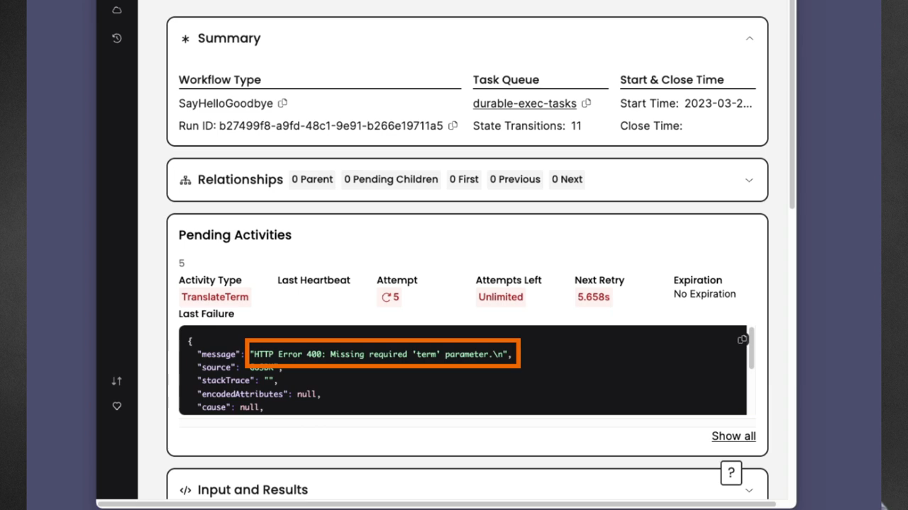

Follow the error back to the URL construction in the Activity. The misspelled query key is visible here:

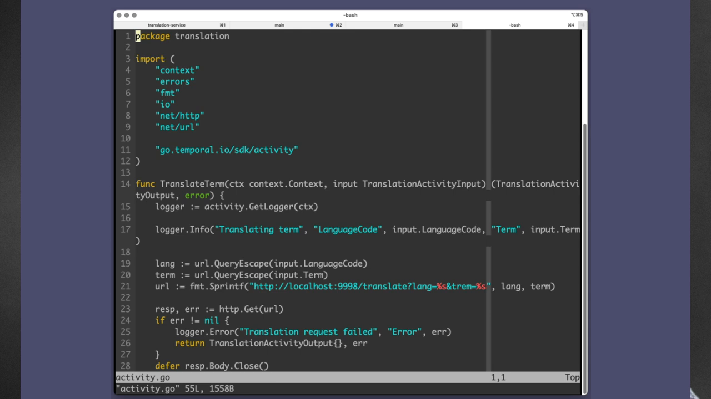

The required correction is the parameter name:

```text
Incorrect: /translate?lang=fr&trem=Hello
Correct:   /translate?lang=fr&term=Hello
```

Repeating the same buggy implementation cannot resolve the error.

### Why History May Still End at ActivityTaskScheduled

**A history ending at `ActivityTaskScheduled` does not always mean nobody has run the Activity.** Unlike a first Workflow Task waiting for a Worker, an Activity can be actively retrying without each attempt appearing as a separate sequence of history Events.

Temporal avoids expanding history with every intermediate retry. Activity start information is typically buffered until the Activity reaches a terminal outcome; the recorded `ActivityTaskStarted` then identifies the relevant final attempt. A successful outcome records `ActivityTaskCompleted`, while an exhausted or non-retryable failure can record `ActivityTaskFailed`.

Use **Pending Activities and Worker logs** to inspect attempts still in progress. Do not infer that no Worker has picked up an Activity solely because its Started Event is not yet visible in history.

### Verifying the Fix with Activity Tests

Before changing the code, run a test that executes the real Activity against the local translation service. For `03-testing-code`, start the service in one terminal and run the Activity tests in another:

```bash
make 03-testing-code-service
```

```bash
make 03-testing-code-test-activity
```

A misspelled parameter should fail the successful-translation tests. Correct the URL key in `activity.go`, then rerun the tests to verify the request works.

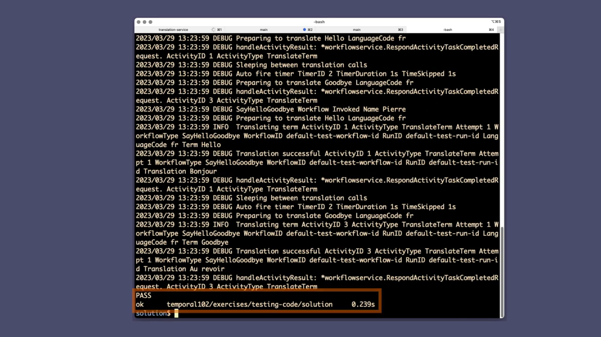

Mocked Workflow tests alone would not catch this typo because they bypass the real Activity's HTTP code. Testing both the orchestration and the Activity implementation covers different failure modes.

### Deploying the Fix to the Existing Execution

Once the tests pass:

1. Stop the Worker running the buggy Activity implementation.
2. Start a Worker with the corrected code on the same Cluster, Namespace, and Activity Task Queue.
3. Leave the existing Workflow open and wait for the next Activity retry.
4. Refresh the Web UI and verify that the Activity succeeds and the Workflow continues.

In the local exercise, restart the Worker with:

```bash
make 03-testing-code-worker
```

Replace every old Worker polling this queue. The next retry follows the recorded Retry Policy; restarting Workers does not trigger it immediately.

**No Workflow Reset is needed for this fix.** The Workflow still schedules the same Activity with the same input. Only the Activity's internal HTTP request construction changes, which is not part of Workflow replay.

This recovery depends on the Activity still being eligible for another attempt. If retry limits or timeouts have already closed it, deploying a fix alone does not reopen it. Completed Activity results are also not rerun merely because their implementation changed.

Activity changes must honor existing input/output contracts and handle repeated external side effects safely.

## Hands-On Exercise #3: Debugging and Fixing an Activity Failure

Use a pizza-order Workflow to practice tracing history, diagnosing a retrying Activity, testing a correction, and deploying it to an execution that is already running.

### Pizza Exercise Files and Starting State

Work in **`04-debug-activity/`**, and run all Makefile commands from the course root.

| File | Purpose |
| :--- | :--- |
| `start/main.go` | Creates the pizza order and waits for its confirmation. |
| `worker/main.go` | Registers `PizzaWorkflow`, `GetDistance`, and `SendBill`. |
| `workflow.go` | Calculates the total, checks delivery distance, waits three seconds, and schedules billing. |
| `activities.go` | Simulates distance calculation and payment processing. |
| `activity_test.go` | Tests distances, normal billing, discounts, and negative charges. |
| `workflow_test.go` | Tests successful orders and delivery-area rejection using mocked Activities. |
| `shared.go` | Defines the order, billing, confirmation, and address structs. |

**The current files already contain the corrected discount and its regression test.** The starter also includes the third pizza. Part C explains how to deliberately reproduce a discount bug, then recover from it. No external translation service or real payment service is needed.

Prices are integer **cents**. The offer is **500 cents off orders strictly over 3000 cents**; an order of exactly 3000 does not qualify.

### Part A: Run the Pizza Workflow

Start the local Temporal Server:

```bash
make temporal-up
```

Start a Worker in each of two separate terminals:

```bash
make 04-debug-activity-worker
```

Then start the order in another terminal:

```bash
make 04-debug-activity-start
```

The Workflow Type is **`PizzaWorkflow`**, the Task Queue is **`pizza-tasks`**, and the Workflow ID is **`pizza-workflow-order-Z1238`**. Both Workers poll the same queue; either can process an Activity.

The current order contains pizzas priced at `1500`, `1200`, and `1300`: a total of **4000 cents**. With the corrected discount, expect confirmation status `SUCCESS` and amount **3500 cents**.

For the original non-discount baseline, temporarily change the starter's slice to `[]debug_activity.Pizza{p1, p2}` and remove the unused `p3` declaration. That order totals **2700 cents** and should be charged without a discount. Restore the third pizza when moving to Part C.

### Part B: Interpret the Pizza Order History

Open **http://localhost:8233**, choose the `default` Namespace, and find the Workflow by its ID. Refresh or enable auto-refresh if its displayed status is stale.

Before reading the implementation in detail, use history to answer:

1. Did Workflow Tasks after the first use sticky execution? Compare queue names and expand `WorkflowTaskScheduled` to check the queue kind. Sticky execution is an optimization, so inspect what actually happened rather than assuming every later Task was sticky.
2. What was the first Activity Type?
3. Which of your two Worker processes started it, and did that same identity report completion? Match the Event identities with each terminal's Worker logs.
4. After that Activity, did another Activity run, a Timer start, or the Workflow close?
5. What duration did the Timer request? Check `TimerStarted`.
6. Find the `GetDistance` completion Event and its references to the Started and Scheduled Event IDs. Record the IDs from your Run; they are not universal constants.
7. What address was supplied to `GetDistance`?
8. What distance did it return?
9. What maximum retry interval was recorded for `SendBill`?
10. What Start-to-Close Timeout was recorded for `SendBill`?

After investigating, compare these key values with the code:

| Detail | Expected value for the supplied order |
| :--- | :--- |
| First Activity | `GetDistance`. |
| Address | `701 Mission Street`, `Apartment 9C`, San Francisco, CA `94103`. |
| Simulated distance | 20 kilometers, within the 25-kilometer delivery limit. |
| Next operation | A three-second Timer, then `SendBill`. |
| Activity maximum retry interval | 10 seconds. |
| Activity Start-to-Close Timeout | 5 seconds per attempt. |

Switch to **Compact**, collapse expanded rows, and compare the overview with History. Try **Expand All** to inspect related Activity and Timer Events together, then return to History for the remaining steps.

You can also inspect history from the terminal:

```bash
make 04-debug-activity-history-detailed
```

### Part C: Reproduce the Discount Failure

The third pizza is already present in `start/main.go`:

```go
p3 := debug_activity.Pizza{
    Description: "Medium, with extra cheese",
    Price:       1300,
}

items := []debug_activity.Pizza{p1, p2, p3}
```

To create the failure for practice, temporarily replace the correct discount subtraction inside `SendBill` with:

```go
chargeAmount = 500 - bill.Amount
```

This deliberately reverses the subtraction. The 4000-cent order now produces **-3500 cents**, which the Activity rejects. Leave the existing negative-charge guard in place.

Restart **both Workers** so they load this deliberately buggy implementation, then run `make 04-debug-activity-start` again. Ensure the previous execution has closed before reusing the same Workflow ID.

The new execution should remain Running rather than returning a confirmation. Open **Pending Activities** and identify the failure before proceeding. You should find `SendBill` reporting an invalid negative charge and retrying with a maximum interval of ten seconds.

### Part D: Test and Correct the Discount

Run the Activity tests while the deliberately buggy code is present:

```bash
make 04-debug-activity-test-activity
```

`TestSendBillTypicalOrder` does not exercise the discount branch: its input amount is `2600`. It can pass even while the discount is broken.

The existing **`TestSendBillAppliesDiscount`** covers the missing scenario from the original exercise. Inspect its input and expected result:

| Field | Value |
| :--- | :--- |
| Description | `5 large cheese pizzas`. |
| Input amount | `6500` cents. |
| Expected confirmation amount | `6000` cents. |

It should fail with the deliberately reversed subtraction. For practice writing the regression test, reconstruct this case from `TestSendBillTypicalOrder`, keeping only one function named `TestSendBillAppliesDiscount`.

Correct the discount branch in `activities.go`:

```go
if bill.Amount > 3000 {
    logger.Info("Applying discount")
    chargeAmount -= 500
}
```

Run `make 04-debug-activity-test` and confirm every test passes. The mocked Workflow tests do not execute the real billing calculation; the Activity regression test is what directly verifies this correction.

Keep the business boundary clear when extending coverage: amounts of `3000` receive no discount, while `3001` qualifies. Use `require.NoError` before decoding successful results, and `require.Error` before inspecting an expected error.

### Part E: Deploy the Fix Without Restarting the Workflow

The existing execution is still waiting for `SendBill` to succeed. Deploy the corrected implementation:

1. Press `Ctrl-C` in **both Worker terminals**.
2. Restart both with `make 04-debug-activity-worker` so neither can pick up the retry with the buggy implementation.
3. Leave the starter terminal waiting for its result. Do not terminate, reset, or submit another Workflow for this recovery.
4. Enable auto-refresh or refresh the existing Run's detail page.
5. Wait for the next eligible retry to run on a corrected Worker.

The retry should return a successful confirmation for **3500 cents**. The same Run then closes with `WorkflowExecutionCompleted`, and the starter prints its result. Compare its Run ID before and after recovery to confirm this was not a replacement execution.

The ten-second maximum retry interval limits the configured backoff, not a guaranteed completion deadline: polling, Activity execution, and UI refresh add time. This recovery also assumes the Activity remains eligible to retry.

The discount is implemented inside the Activity to demonstrate this recovery technique. Moving it into Workflow code is a separate design change that must preserve compatibility with recorded histories. This exercise's payment call is simulated; real billing would also need a stable idempotency key to avoid duplicate charges across retries.

### Pizza Exercise Commands

| Command | Purpose |
| :--- | :--- |
| `make temporal-up` | Start the local Server and Web UI. |
| `make 04-debug-activity-worker` | Start one Worker; run in two terminals for the exercise. |
| `make 04-debug-activity-start` | Submit the order defined in `start/main.go` and wait for confirmation. |
| `make 04-debug-activity-history` | Show the order's history. |
| `make 04-debug-activity-history-detailed` | Show history with Event attributes. |
| `make 04-debug-activity-test-activity` | Run distance and billing tests. |
| `make 04-debug-activity-test-workflow` | Run the mocked Workflow tests. |
| `make 04-debug-activity-test` | Run all exercise tests and compile its command packages. |

Tests run locally without a Temporal Server. When finished, stop both Workers with `Ctrl-C`; `make temporal-down` stops the local Server while preserving its Docker volume.

## The Deployment Landscape

**A production deployment has two independently operated parts: the application Workers that run your code, and the Temporal Service that coordinates durable execution.** Scaling one does not automatically scale the other.

### The Four Cluster Services

A self-hosted Temporal Cluster contains four main services:

| Service | Responsibility |
| :--- | :--- |
| **Frontend** | Validates and routes API requests from Clients, including those inside application Workers. |
| **History** | Maintains Workflow execution state and history, processes state transitions, and initiates Workflow and Activity Tasks. |
| **Matching** | Manages Task Queues and matches Tasks with polling Workers. |
| **Worker Service** | Performs internal system work, including system Workflows used for maintenance features such as archiving. |

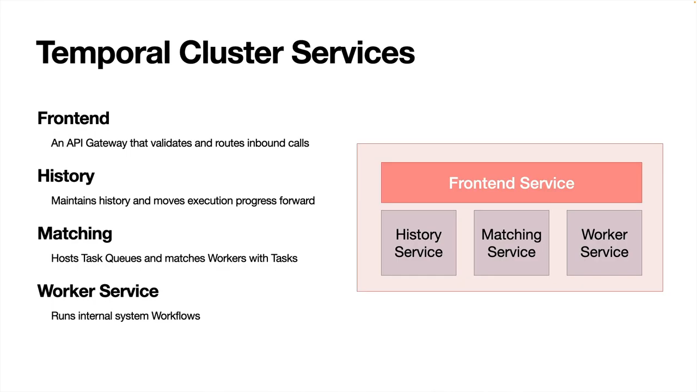

**The Server's Worker Service is not your application's Worker fleet.** Its internal system Workflows are separate from the application executions you normally browse in your Namespace. Adding Server Worker Service instances does not add capacity to execute your application's Activities.

### Scaling the Cluster

A small development deployment can run one instance of each service. Production deployments can run multiple instances, with each service scaled independently according to its workload.

Frontend instances typically sit behind a **load balancer or ingress**. Clients connect to one endpoint rather than knowing every instance's address:

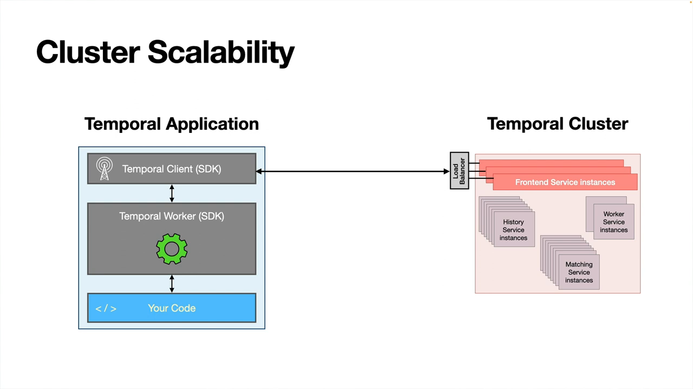

This allows capacity to be added where it is needed—for example, API handling, execution-state processing, or Task matching. Multiple instances also support availability when an instance fails, provided persistence and the rest of the deployment are configured for availability too.

Scale the database and application Workers alongside the Cluster when they become bottlenecks. More Frontend instances cannot compensate for slow Activities or exhausted persistence capacity.

### Connectivity and Persistence

Application Clients communicate with **Frontend**, not directly with History, Matching, or the Cluster's persistence database. A Worker also uses a Client to poll for Tasks and report outcomes through this endpoint.

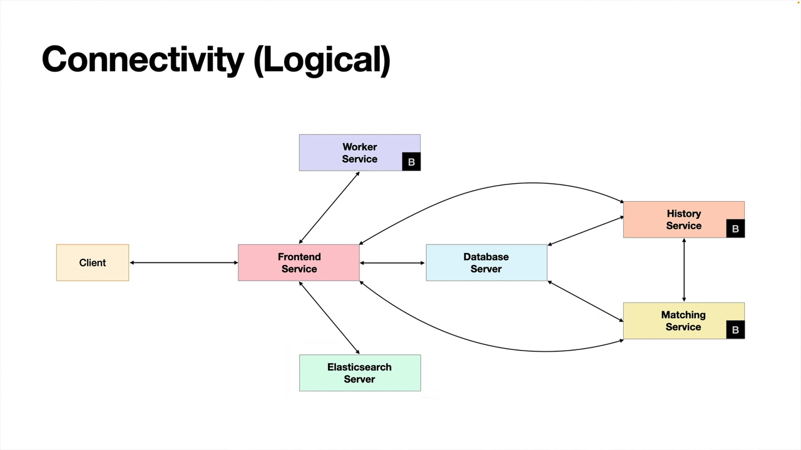

Client-to-Frontend and inter-service RPCs use **gRPC with Protocol Buffers**. TLS can protect these connections, including internal service traffic. A self-hosted deployment configures these security settings explicitly.

Exposing the Frontend API through a single endpoint simplifies application network access. The database and backend service ports can remain internal; operational interfaces such as the Web UI and metrics have their own access requirements.

The Cluster requires durable **persistence** for execution state and history. Its database can run on infrastructure you manage or a managed database service, such as a supported PostgreSQL or MySQL deployment on AWS RDS. The load balancer and database are infrastructure dependencies, not services implemented by Temporal itself.

The connectivity diagram is conceptual: database and Visibility access depend on the Server configuration, and the arrows do not imply that every internal component must be exposed to application Clients.

### Visibility and Search

**Visibility** supports listing and filtering Workflow Executions, including SQL-like queries over Search Attributes. It is distinct from the detailed history used to recover execution state.

Elasticsearch is one supported Visibility backend and is shown as optional in these diagrams. **It is not required for advanced queries in current Temporal Server versions.** Supported SQL stores, including PostgreSQL and MySQL, also provide advanced Visibility; SQLite is useful for local development. Supported OpenSearch versions are another option.

Choose a supported backend according to query volume, operational requirements, and Server version. Visibility storage is required even when it shares a database deployment with other persistence data. See the [self-hosted Visibility documentation](https://docs.temporal.io/self-hosted-guide/visibility) for the compatibility matrix.

### The Application Worker Fleet

A **Worker fleet** is the collection of application Worker processes polling your Task Queues. Each process runs the SDK Worker and your registered Workflow and Activity code:

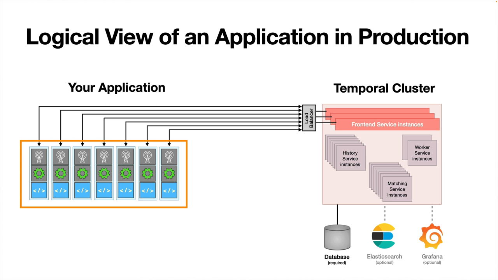

Those processes can run on physical machines, virtual machines, or containers. The logical fleet can be distributed across several application servers or Kubernetes nodes:

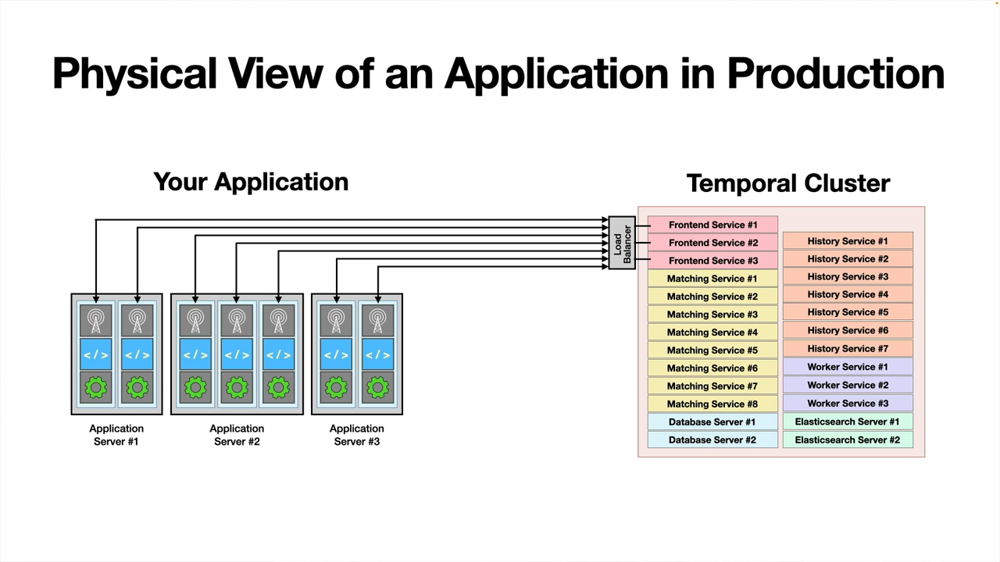

The counts in this diagram are illustrative, not a deployment prescription. Application Workers are separate from the Cluster's service instances, and their capacity should reflect the Workflow and Activity workload.

With the deployment model shown here, **your team operates the application runtime**, including code rollout, Worker restarts, resource allocation, and access to external systems used by Activities.

### Self-Hosting and Temporal Cloud

| Responsibility | Self-hosted Cluster | Temporal Cloud |
| :--- | :--- | :--- |
| Application code and Worker infrastructure | Your team. | Your team. |
| Temporal service operation and scaling | Your team. | Temporal. |
| Cluster persistence and service infrastructure | Your team, possibly using managed infrastructure providers. | Temporal. |
| Client connection | Your configured Frontend endpoint. | The endpoint supplied for your Cloud Namespace. |

Temporal Cloud provides the managed service side of the connection. Your Workers still run outside that service:

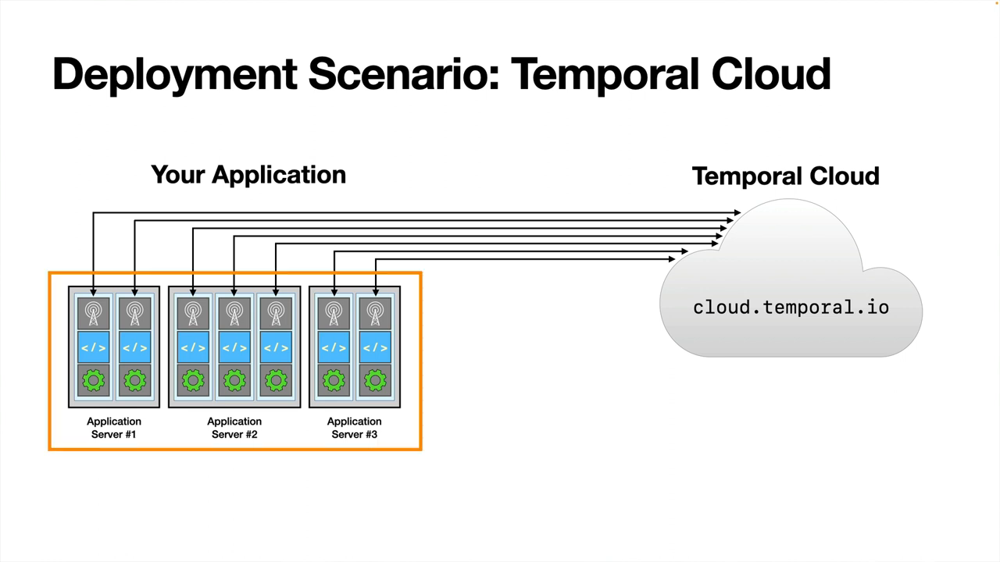

The `cloud.temporal.io` label is schematic. Configure the actual endpoint provided for your Namespace rather than using that label as an SDK address.

### Moving Between Environments

Workflow and Activity APIs remain the same when moving from local development to a self-hosted production Cluster or Temporal Cloud. The main SDK change is usually the **`client.Options`** passed to `client.Dial`:

- **`HostPort`** selects the destination endpoint.
- **`Namespace`** selects the execution Namespace.
- Connection security and credentials configure TLS and the authentication required by the destination, such as certificates or API-key credentials.

Production readiness still includes deploying compatible Worker versions, providing external dependency configuration, and setting appropriate capacity and timeouts. Connecting to another environment also does not automatically migrate histories or executions from the local Cluster.

## Configuring a Temporal Client for Production

**A Temporal Client connects application code to the Frontend API.** A web application can use it to start Workflows or retrieve results; a Worker uses it to poll for Tasks and report outcomes.

Workflow code requests Activities and Timers through SDK APIs. Those requests become Commands returned to the Cluster through the Worker—not direct network calls made by the Workflow function.

### Default Client Options

For local development, an empty options struct is often sufficient:

```go
c, err := client.Dial(client.Options{})
if err != nil {
    log.Fatalln("Unable to create Temporal client", err)
}
defer c.Close()
```

The defaults select:

| Setting | Default |
| :--- | :--- |
| Frontend address | `localhost:7233`. |
| Namespace | `default`. |
| TLS | Not enabled by this configuration. |

Create the Client once for the application or Worker process and reuse it. Close it when that process shuts down rather than creating a new connection for every Workflow request.

### Connecting to a Non-Local Cluster

Production Clients usually connect to a Frontend endpoint exposed through a load balancer or ingress. Common options are:

| Option | Purpose |
| :--- | :--- |
| `HostPort` | Frontend hostname and port, such as `mycluster.example.com:7233`. |
| `Namespace` | Namespace used for this Client's requests. |
| `ConnectionOptions` | Connection settings, including TLS configuration. |

For a remote Cluster that accepts connections without TLS:

```go
opts := client.Options{
    HostPort:  "mycluster.example.com:7233",
    Namespace: "operations",
}

c, err := client.Dial(opts)
if err != nil {
    log.Fatalln("Unable to create Temporal client", err)
}
defer c.Close()
```

This does not work against a Frontend requiring TLS. Specifying a Namespace also does not create it; it must already exist and be accessible to the Client.

The Temporal CLI is another Client. Supply the same destination and Namespace:

```bash
temporal workflow list \
  --address mycluster.example.com:7233 \
  --namespace operations
```

### TLS and Mutual Authentication

**TLS protects data in transit and authenticates the server.** Go validates the server's certificate chain and hostname when using a correctly configured TLS connection.

**Mutual TLS (mTLS) also presents a client certificate**, allowing the server to authenticate the Client. The server's authorization configuration determines what that authenticated identity can access.

| Connection mode | Client certificate and private key needed? |
| :--- | :--- |
| Server-authenticated TLS | No. The Client needs trust in the server's certificate authority. |
| mTLS | Yes. The Client additionally loads its own certificate and matching private key. |

TLS therefore does **not always require a client certificate**. Temporal Cloud supports secure authentication options including mTLS and API-key credentials; use the method configured for your Namespace.

### Configuring an mTLS Client in Go

The following complete helper loads a client certificate/key pair and connects with mTLS:

```go
package connection

import (
    "crypto/tls"
    "fmt"

    "go.temporal.io/sdk/client"
)

func Dial(hostPort, namespace, certPath, keyPath string) (client.Client, error) {
    cert, err := tls.LoadX509KeyPair(certPath, keyPath)
    if err != nil {
        return nil, fmt.Errorf("load Temporal client certificate: %w", err)
    }

    c, err := client.Dial(client.Options{
        HostPort:  hostPort,
        Namespace: namespace,
        ConnectionOptions: client.ConnectionOptions{
            TLS: &tls.Config{
                MinVersion:   tls.VersionTLS12,
                Certificates: []tls.Certificate{cert},
            },
        },
    })
    if err != nil {
        return nil, fmt.Errorf("connect to Temporal: %w", err)
    }
    return c, nil
}
```

The caller passes paths such as `/home/myuser/tls/certificate.pem` and `/home/myuser/tls/private.key`, handles the returned error, and closes the successful Client when finished. `LoadX509KeyPair` checks that the files contain a usable certificate and matching private key; the connection handshake validates trust and authentication.

This configuration uses the system's trusted certificate authorities for server verification. If a self-hosted Cluster uses a private CA, configure `tls.Config.RootCAs` with the appropriate CA certificates. Set `ServerName` when the expected certificate hostname differs from the connection address; do not disable certificate verification to bypass a mismatch.

### Using the CLI with a Secure Cluster

For the same mTLS endpoint, supply matching CLI settings:

```bash
temporal workflow list \
  --address mycluster.example.com:7233 \
  --namespace operations \
  --tls \
  --tls-cert-path /home/myuser/tls/certificate.pem \
  --tls-key-path /home/myuser/tls/private.key
```

For a private server CA, also configure `--tls-ca-path`. Use `--tls-server-name` if an explicit server hostname is required for certificate verification. A server-authenticated TLS connection without mTLS uses `--tls` without the client certificate/key options, plus any credentials required by the service.

### Keeping Connection Settings Environment-Specific

Keep the endpoint, Namespace, certificate paths, and authentication settings in configuration rather than hardcoding production values into Workflow or Activity code. Command-line flags, environment variables, or a configuration file can provide these values at startup.

Both starters and Workers need the appropriate Client configuration. Updating only the starter can leave Workers polling a different Cluster or Namespace, causing executions to remain queued.

The [`helloworldmtls` sample](https://github.com/temporalio/samples-go/tree/main/helloworldmtls) illustrates supplying connection settings through command-line options. See the [Go Client options documentation](https://pkg.go.dev/go.temporal.io/sdk/client#Options) for the full configuration surface.

## Overview of Temporal Application Deployment

**Deploying a Temporal application means deploying the programs that run its Workers, along with their dependencies and configuration.** The Temporal Service coordinates execution; it does not load and run your application code for you.

### Development and Production

During development, you can edit source files, restart Workers with `go run`, and submit Workflows using a starter or the CLI.

Production follows the same basic model, but usually uses a repeatable build and deployment process:

```text
Source change → test → build/package → deploy → start updated Workers
```

Rather than editing source directly on production machines, deploy a versioned artifact produced from the intended source revision. Keep connection settings and credentials appropriate to the target environment.

### Building Workers for Each SDK

Temporal supports **polyglot applications**. For example:

| Component | Language | Runtime needed |
| :--- | :--- | :--- |
| Client that starts the Workflow | TypeScript | The Client application's JavaScript runtime. |
| Workflow Worker | Go | A deployed Go Worker executable. |
| Activity Worker | Java | A Java Worker application and JVM. |

The TypeScript Client does not need a TypeScript Worker merely to start a Go Workflow. Workers are needed for the languages that actually execute Workflow or Activity code. In this example, Go and Java Workers poll the appropriate queues, and the Go Workflow schedules the Java Activity by its registered name with compatible payloads.

Run multiple instances of each required Worker role when availability or throughput demands it. Those instances can be spread across machines or containers.

Temporal does not mandate a build system. Use the language's normal tools and your organization's CI pipeline to automate testing and artifact creation.

For a Go Worker, compile the **package**, including all its source files. From this course's root, an example build command is:

```bash
go build -o pizza-worker ./04-debug-activity/worker
```

The resulting `pizza-worker` executable includes the registered Workflow and Activity functions and their compiled Go dependencies. Build for the target operating system and architecture; a macOS executable cannot simply be deployed to a Linux host.

### Packaging the Application

The deployable application includes more than a Worker entry point:

- **Application code:** registered Workflow and Activity implementations, plus Worker setup.
- **Libraries:** the Temporal SDK and dependencies such as database drivers or service clients.
- **Runtime requirements:** for example, a JVM for Java or a Python interpreter and installed packages for Python.
- **Runtime configuration:** endpoint, Namespace, Task Queues, credentials, and settings for external dependencies.

Go's compiled dependencies are generally included in the executable. That does not automatically package runtime files or external systems: certificate trust stores, configuration files, shared libraries when required, and Activity dependencies must still be available in the deployment.

Deploy these requirements using the form your infrastructure supports, such as a binary on a VM or a container image. The artifact and its configuration should identify which application version is running.

### Rolling Out Worker Updates

**Running Workers keep using the code loaded into their processes.** Deploying new files or an image alone does not update an existing process; replace or restart it to run the new version.

Use a **rolling rollout** rather than stopping the entire fleet at once:

1. Bring up updated Workers with the correct connection settings and registrations.
2. Confirm they can connect and poll their intended Task Queues.
3. Gracefully shut down old Workers in batches while maintaining sufficient capacity.
4. Monitor Task failures, queue delays, retries, and application results during the transition.

Keeping Workers available reduces queue delays and the risk of exceeding applicable timeouts. Graceful shutdown gives in-flight Tasks a chance to finish; work interrupted by a shutdown can still be retried or replayed, so Activities must remain retry-safe.

**A rolling restart does not solve replay incompatibility.** Old and new Workers can coexist during a rollout, and new Workers may receive Tasks for existing histories. Changes to Workflow Commands require a compatible implementation or a supported versioning/routing strategy before deployment.

Activity fixes can take effect on future attempts without restarting the Workflow itself, but they still need compatible contracts and safe handling of repeated side effects. Deploying updated Workers is separate from upgrading the Temporal Server.
